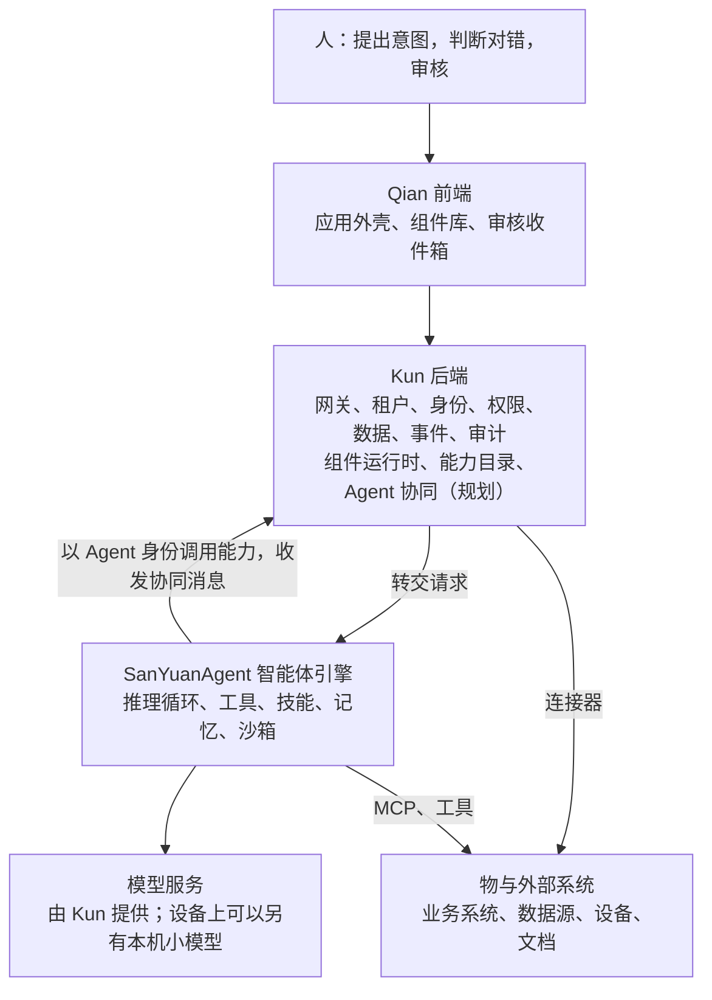

# 匠心智能体平台

企业级的 AI 原生平台。人用自然语言说清要什么，智能体把它落成可运行的系统；系统上线后在人的反馈里继续改进。

> **状态：规划稿（2026-11-17）。** 本仓库是平台的主页与总览，目前只有框架级文档。代码仍在原仓库开发，按[路线](docs/06-roadmap.md)分阶段迁入。文档里标「已定」的是产品负责人已经裁定的事，标「提议」「待定」的还没有拍板。

## 这是什么

过去企业搭业务系统的省力办法是低代码或无代码平台：把系统拆成表单、列表、流程这些可配置的元数据，由人在设计器里拖拽出来。匠心保留「系统由声明式元数据描述」这一点，把写元数据的人换成智能体。人负责提出意图、判断结果对不对，智能体负责理解、生成和执行。按设计，每一步都受权限、审计和人工审核约束。

平台面向组织，不面向个人消费者。多租户、单点登录、权限、审计、私有部署是底线要求。它建在 Kubernetes 与微服务之上。

## 三元全智生命体

平台的设计理念叫「三元全智生命体」，三个词各管一件事：

| 词 | 管什么 | 在平台里是什么 |
|---|---|---|
| 三元 | 躯体，结构怎么融合：云边端；工蜂、章蜂、群蜂；人机物 | 平台底座，也就是企业级框架：[Kun](https://github.com/CavaiLAB/kun)（后端）与 [Qian](https://github.com/CavaiLAB/qian)（前端） |
| 全智 | 心智，智能到什么水平：从工具到能自己做主的智能体 | 智能体引擎 [SanYuanAgent](https://github.com/CavaiLAB/sanyuan-agent) |
| 生命体 | 活法，以什么状态运转：自主、代谢、进化 | 平台上长出来的系统与智能体。它们在「意图 → 决策 → 行动 → 反馈」的闭环里运转，每转一圈改进一点 |

展开见[理念](docs/01-vision.md)。

## 三种形态：工站、产线、工厂

平台从工业智能体走向工业生命体。「工蜂、章蜂、群蜂」对应工站、产线、工厂三级，每一级是一种智能体，SanYuanAgent 是它们的大脑（已定）：

| 层级 | 形态 | 做什么 |
|---|---|---|
| 工站（工蜂） | 具身智能体 | 感知工件，调用技能，控制工具完成作业 |
| 产线（章蜂） | 协同智能体 | 协调工序、工站和物料，保持生产节拍 |
| 工厂（群蜂） | 超级智能体 | 协调跨系统制造任务，支撑物理 AI 研发 |

每一级的技术架构、与三个框架怎么对应，见[三种形态](docs/08-industrial-forms.md)。

## 三个框架

| 框架 | 角色 | 技术栈 | 仓库 | 来源 | 代码现在在哪 |
|---|---|---|---|---|---|
| **Kun** | 企业级后端框架：租户、身份、权限、数据、事件、审计、网关、组件运行时与能力目录；模型服务也由它提供 | .NET 10 | [CavaiLAB/kun](https://github.com/CavaiLAB/kun) | 原 Kun 框架与原 Qian 平台的后端归并而成 | `CavaiLAB/kun` 的过渡目录；两个原仓库 `idadawn/kun` 与 `idadawn/qian` 已于 2026-11-17 归档为只读 |
| **Qian** | 前端框架：设计令牌、组件库、应用外壳、微前端、由 Schema 驱动的界面 | TypeScript、React | [CavaiLAB/qian](https://github.com/CavaiLAB/qian) | `idadawn/qian` 的前端框架库，原名 yue，迁入时已更名 | `CavaiLAB/qian`；0.2.0 已发布到 GitHub Packages |
| **SanYuanAgent** | 智能体引擎，一个独立运行的 SDK：推理循环、工具、技能、记忆、沙箱、模型路由。云上、桌面和机器人这类边缘设备都要用到它 | Python 3.12 | [CavaiLAB/sanyuan-agent](https://github.com/CavaiLAB/sanyuan-agent) | iClaw 的 Python Agent 引擎 | 核心已在 `CavaiLAB/sanyuan-agent`，服务层与媒体适配层还在 iClaw 仓库 |

三个框架各用一种主语言、各占一个仓库，彼此只经[契约](docs/02-architecture.md#7-契约)和发布出来的包往来，不做跨仓库的源码引用。

「Qian」这个名字换了所指：以前指基于 Kun 的平台层，那部分并入 Kun；现在只作前端框架的名字。新旧名字的对照见[术语与名称对照](docs/glossary.md)。

## 总体结构

SanYuanAgent 是独立运行的 SDK（已定）。提议：不接平台也能运行；装在设备上时只向外连到平台；设备上有本机模型时，断网后本机的活照干。见[总体架构](docs/02-architecture.md)第 5 节。

## 四条主线

1. **一切皆插件。** 没有只能打补丁的特权内核。租户、身份、权限这些平台能力和每一个业务功能都是插件：一个文件夹、一份清单、若干声明式表面，一条命令安装。技能、子 Agent、命令、钩子、MCP 声明沿用社区通行的文件格式，目标是开源组件目录里的现成组件过了校验就能装进来（导入器是规划）。见[一切皆插件](docs/03-plugin-model.md)。
2. **自然语言构建。** 系统是一组插件，插件主要由声明式表面组成，所以构建系统这件事可以交给智能体：它按人的意图生成或修改表面，经过校验、预览和人工批准后装进租户。
3. **每个人都有 Agent，协同必经人审。** 每个人可以有一个或多个 Agent，发给每个 Agent 的内容要由人审核（已定）。提议 Agent 之间不直接互调，往来的内容走平台的信箱，送达之前由人审核。见 [Agent 协同](docs/04-agent-collaboration.md)。
4. **云原生与多租户。** 运行在 Kubernetes 上，可部署单元由 profile 定义；租户隔离、零信任的服务间通信、审计链贯穿全栈。见[总体架构](docs/02-architecture.md)。

## 现状与路线

| 阶段 | 内容 | 状态 |
|---|---|---|
| 0 立项 | 建仓库、主页与框架级文档 | 进行中 |
| 1 治理就位 | 权限与评审规则、任务管理方式、CI 基线；确认对已接受的合并蓝图的修订 | 未开始。修订项已登记，待产品负责人确认 |
| 2 SanYuanAgent 迁入 | Agent 引擎改名、独立成库 | 核心已于 2026-11-17 带历史迁入并改名；服务层与媒体适配层随后 |
| 3 Kun 归并与 Qian 更名 | 原 Kun 与原 Qian 的后端按合并蓝图归并，包名并为 `Kun.*`；前端迁入自己的仓库并更名为 Qian | 2026-11-17 定现在开始，后端与前端同时进行；两个原仓库已于同日带历史导入 `kun` 并归档为只读，整理与归并未做；前端的框架库已于同日带历史导入并更名，以新名字发布了 0.2.0。合并蓝图已于同日接受 |
| 4 协同与生命体 | 个人 Agent、Agent 协同、自然语言构建闭环 | 未开始 |

阶段 2 与阶段 3 互不依赖，可以并行。各阶段的进入与完成条件见[路线与迁移](docs/06-roadmap.md)。

## 文档

| 文档 | 回答什么 |
|---|---|
| [理念](docs/01-vision.md) | 为什么从低代码转向自然语言构建；三元全智生命体怎么落到平台上 |
| [总体架构](docs/02-architecture.md) | 三个框架怎么分工、请求怎么走、怎么部署、靠哪些契约协作 |
| [一切皆插件](docs/03-plugin-model.md) | 组件模型、表面、目录与安装，怎么用现成的生态组件 |
| [Agent 协同](docs/04-agent-collaboration.md) | 每人有一个或多个 Agent 时，Agent 之间怎么沟通，人在哪里审核 |
| [仓库与归属](docs/05-repositories.md) | 现有代码各归哪个仓库，哪些拆、哪些并，旧仓库怎么处理 |
| [路线与迁移](docs/06-roadmap.md) | 分几步迁，每步的条件 |
| [协作约定](docs/07-governance.md) | 多人和编码代理一起干活的规则 |
| [三种形态](docs/08-industrial-forms.md) | 工站、产线、工厂三级智能体各是什么，与三个框架怎么对应 |
| [平台级裁定](docs/decisions/2026-11-17-platform.md) | 产品负责人定了什么，改写了已接受的合并蓝图的哪几条 |
| [术语与名称对照](docs/glossary.md) | 新旧名字各指什么 |

这些文档连同三个框架仓库的文档聚成了一个站点。站点部署在内网，合并到 `main` 后自动更新；在本机跑起来的办法见 [website/README.md](website/README.md)。

## 参与

先读[协作约定](docs/07-governance.md)。用编码代理（Codex、Claude Code 等）干活时，让它先读 [AGENTS.md](AGENTS.md)。

现阶段要改代码，去代码所在的原仓库提 PR；要改平台级的设计与口径，在本仓库提 PR。
