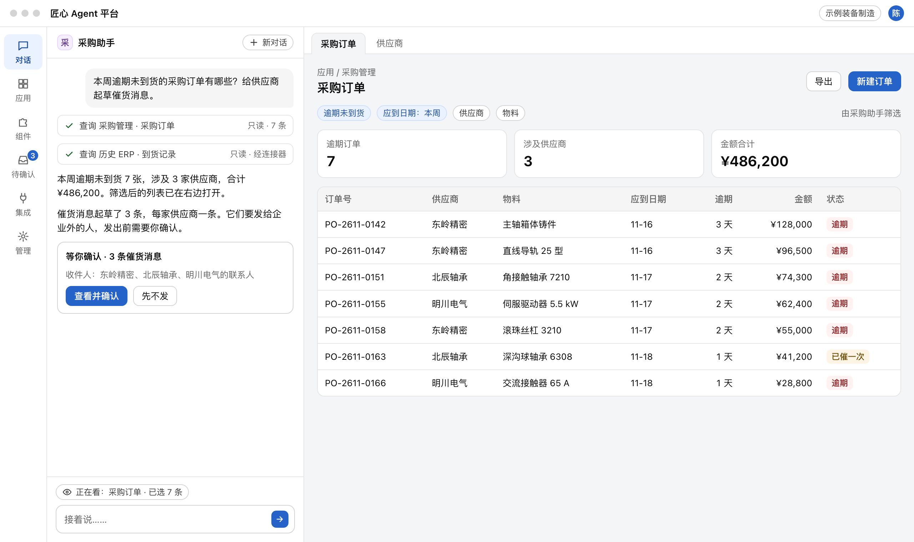
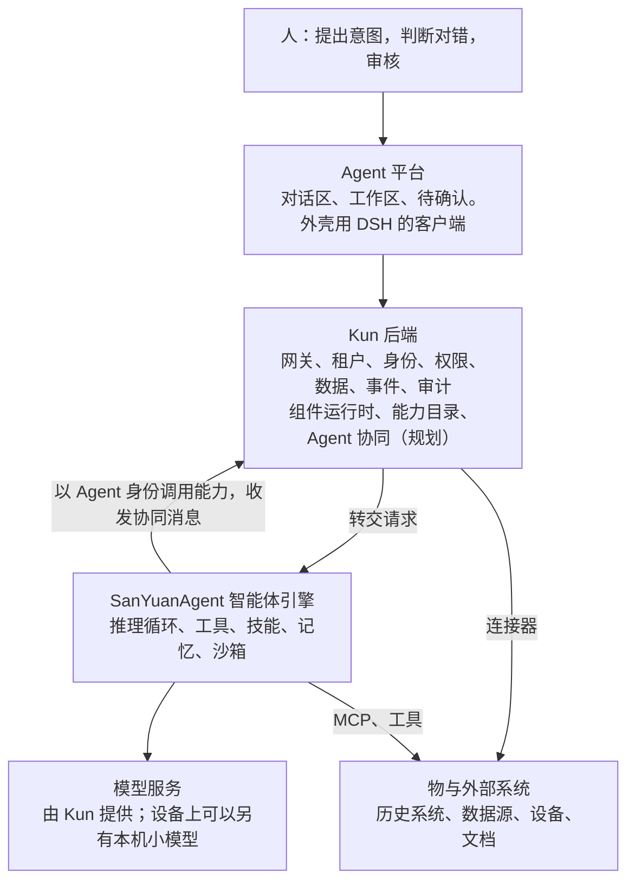

# 匠心工业智能体平台

企业级的 AI 原生平台。人用自然语言说清要什么，智能体把它落成可运行的系统；系统上线后在人的反馈里继续改进。

> **状态：规划稿（2026-11-20）。** 本仓库是平台的主页与总览，也是把 Agent 框架与企业级框架拼成一个产品的组合体（已定）。组合体的代码在本仓库，见下面的[组合体](#组合体)；三个框架的代码在各自的仓库里，迁入与归并按[路线](docs/06-roadmap.md)分阶段进行。文档里标「已定」的是产品负责人已经裁定的事，标「提议」「待定」的还没有拍板。

## 这是什么

过去企业搭业务系统的省力办法是低代码或无代码平台：把系统拆成表单、列表、流程这些可配置的元数据，由人在设计器里拖拽出来。匠心保留「系统由声明式元数据描述」这一点，把写元数据的人换成智能体。人负责提出意图、判断结果对不对，智能体负责理解、生成和执行。按设计，每一步都受权限、审计和人工审核约束。

平台面向组织，不面向个人消费者。单点登录、权限、审计、私有部署是底线要求；交付给客户的可以是多租户的版本，也可以是单租户的版本（已定）。它建在 Kubernetes 与微服务之上。

## 两种角色，一个入口

平台上分两种角色（已定）：

| | 平台开发 | 最终用户 |
|---|---|---|
| 做什么 | 开发 Agent 框架与企业级应用平台 | 基于 Agent 平台，在企业级框架上构建自己需要的软件。不负责框架与核心的开发，只使用工具 |
| 交付或产出 | 两样东西：Agent 框架（Agent 运行时加 Agent 平台；运行时 2026-11-20 定为 DSH；SanYuanAgent 2026-11-24 起暂缓开发，以后怎么接待定），企业级应用平台（Kun 加 Qian）。两者互补，最终是一体化的产品 | 两种扩展：基于企业级应用平台开发的业务插件；加在 Agent 上的组件 |

最终用户的使用界面是 Agent 平台（已定）。提议它是一个三栏的工作台：左边是导航，中间是和 Agent 的对话，右边是工作区，企业级应用平台的页面在工作区里打开。下图是示意，不是最终设计，图里的企业、人名与数据是虚构的。

展开与另外五张示意图见[角色与产品形态](docs/09-roles-and-product.md)。

## 三元全智生命体

平台的设计理念叫「三元全智生命体」，三个词各管一件事：

| 词 | 管什么 | 在平台里是什么 |
|---|---|---|
| 三元 | 躯体，结构怎么融合：云边端；工蜂、章蜂、群蜂；人机物 | 平台底座，也就是企业级框架：[Kun](https://github.com/CavaiLAB/kun)（后端）与 [Qian](https://github.com/CavaiLAB/qian)（前端） |
| 全智 | 心智，智能到什么水平：从工具到能自己做主的智能体 | 智能体引擎 [SanYuanAgent](https://github.com/CavaiLAB/sanyuan-agent) |
| 生命体 | 活法，以什么状态运转：自主、代谢、进化 | 平台上长出来的系统与智能体。它们在「意图 → 决策 → 行动 → 反馈」的闭环里运转，每转一圈改进一点 |

展开见[理念](docs/01-vision.md)。

## 三种形态：工站、产线、工厂

平台从工业智能体走向工业生命体。「工蜂、章蜂、群蜂」对应工站、产线、工厂三级，每一级是一种智能体，SanYuanAgent 是它们的大脑（已定）：

| 层级 | 形态 | 做什么 |
|---|---|---|
| 工站（工蜂） | 具身智能体 | 感知工件，调用技能，控制工具完成作业 |
| 产线（章蜂） | 协同智能体 | 协调工序、工站和物料，保持生产节拍 |
| 工厂（群蜂） | 超级智能体 | 协调跨系统制造任务，支撑物理 AI 研发 |

每一级的技术架构、与三个框架怎么对应，见[三种形态](docs/08-industrial-forms.md)。

## 三个框架

| 框架 | 角色 | 技术栈 | 仓库 | 来源 | 代码现在在哪 |
|---|---|---|---|---|---|
| **Kun** | 企业级后端框架：租户、身份、权限、数据、事件、审计、网关、组件运行时与能力目录；模型服务也由它提供 | .NET 10 | [CavaiLAB/kun](https://github.com/CavaiLAB/kun) | 两套后端代码归并而成：.NET 微服务框架与建在它上面的平台层 | `CavaiLAB/kun` 的 `src/` 放 .NET 项目；组件清单、profile 和宿主分别在根目录的 `plugins/`、`profiles/` 和 `hosts/` |
| **Qian** | 前端框架：设计令牌、组件库、应用外壳、微前端、由 Schema 驱动的界面 | TypeScript、React | [CavaiLAB/qian](https://github.com/CavaiLAB/qian) | 后端仓库前端工作区里的框架库 | `CavaiLAB/qian`；已发布到 GitHub Packages，现在是 0.2.1，冻结在这一版（2026-11-20 定） |
| **SanYuanAgent** | 智能体引擎，一个独立运行的 SDK：推理循环、工具、技能、记忆、沙箱、模型路由。云上、桌面和机器人这类边缘设备都要用到它（2026-11-20 起，Web 端和客户端的 Agent 运行时改用 DSH；2026-11-24 起暂缓开发，现在使用 DSH） | Python 3.12 | [CavaiLAB/sanyuan-agent](https://github.com/CavaiLAB/sanyuan-agent) | 私有产品里的 Python Agent 引擎 | 核心已在 `CavaiLAB/sanyuan-agent`，服务层与媒体适配层还在原来的私有仓库 |

三个框架各用一种主语言、各占一个仓库，彼此只经[契约](docs/02-architecture.md#7-契约)和发布出来的包往来，不做跨仓库的源码引用。

## 组合体

组合体现在放的是「匠心工业智能体平台」：用开源的智能体运行框架 DSH 做 Agent 运行时和界面外壳，在它上面加企业要用的能力，换上匠心的名称、logo 与主题色。客户可能用到 Web 端和客户端（桌面）两个端，管理端先不做；产品版本号是日历版本号 `vYYYY.M.D`。这几条是产品负责人 2026-11-20 定的。第一版是不是全部基于 DSH、登录与策略由哪个后端提供、SanYuanAgent 以后怎么接，都还没有定。见 [2026-11-20 产品裁定](docs/decisions/2026-11-20-product.md)。2026-11-24 补：平台名统一为「匠心工业智能体平台」；SanYuanAgent 暂缓开发，现在使用 DSH（[2026-11-24 平台级裁定](docs/decisions/2026-11-24-platform.md) P45、P53）。

| 目录 | 放什么 |
|---|---|
| [`distribution/`](distribution/README.md) | 发行目录：钉死版本的 DSH、品牌包与插件包、配置补丁、启动器。Web 端和客户端共用 |
| [`apps/web/`](apps/web/README.md) | Web 端 |
| [`apps/desktop/`](apps/desktop/README.md) | 客户端（桌面）：一个薄的 Electron 壳 |
| [`apps/console/`](apps/console/README.md) | 管理端，先不做 |
| [`packages/`](packages/README.md) | 品牌包、企业插件的样板、界面组件包 |
| [`tests/egress/`](tests/egress/README.md) | 外联检查 |
| [`tools/mock-model/`](tools/mock-model/README.md) | 本机的假模型服务 |

这些代码都还没有发布过。DSH 按 MIT 许可使用，产品里带着它的版权与许可声明。

旧应用外壳保留在现网，本次迁移按 Qian `0.2.1` 归档验收并保留数据库。见[旧应用外壳迁移裁定 P42](docs/decisions/2026-11-21-shell-migration.md)。

## 总体结构

SanYuanAgent 是独立运行的 SDK（已定）。提议：不接平台也能运行；装在设备上时只向外连到平台；设备上有本机模型时，断网后本机的活照干。见[总体架构](docs/02-architecture.md)第 5 节。

2026-11-20 补：匠心工业智能体平台的 Agent 运行时与界面外壳改用 DSH（已定）。上图是这之前的规划，SanYuanAgent 在里面的位置、登录与策略由哪个后端提供，怎么改待定。

2026-11-24 补：SanYuanAgent 暂缓开发，现在使用 DSH（已定，[2026-11-24 平台级裁定](docs/decisions/2026-11-24-platform.md) P53）。

## 四条主线

1. **一切皆插件。** 没有只能打补丁的特权内核。租户、身份、权限这些平台能力和每一个业务功能都是插件：一个文件夹、一份清单、若干声明式表面，一条命令安装。技能、子 Agent、命令、钩子、MCP 声明沿用社区通行的文件格式，目标是开源组件目录里的现成组件过了校验就能装进来（导入器是规划）。见[一切皆插件](docs/03-plugin-model.md)。
2. **自然语言构建。** 系统是一组插件，插件主要由声明式表面组成，所以构建系统这件事可以交给智能体：它按人的意图生成或修改表面，经过校验、预览和人工批准后装进租户。
3. **每个人都有 Agent，协同必经人审。** 每个人可以有一个或多个 Agent。发给每个 Agent 的内容、每个 Agent 发出去的内容都要由人审核，起步两道都必审（已定）。提议 Agent 之间不直接互调，往来的内容走平台的信箱。见 [Agent 协同](docs/04-agent-collaboration.md)。
4. **云原生与多租户。** 运行在 Kubernetes 上，可部署单元由 profile 定义；租户隔离、零信任的服务间通信、审计链贯穿全栈。见[总体架构](docs/02-architecture.md)。

另有两件已定的事：发布的应用之间可以互相通讯，缺省是目录里看得到、调用与订阅按声明经批准放行，见[应用互通](docs/10-app-interop.md)；企业里已有的历史系统经连接器接进来，并融合进 Agent 框架，见[历史系统接入](docs/11-legacy-systems.md)。

## 现状与路线

| 阶段 | 内容 | 状态 |
|---|---|---|
| 0 立项 | 建仓库、主页与框架级文档 | 进行中 |
| 1 治理就位 | 权限与评审规则、任务管理方式、CI 基线；确认对已接受的合并蓝图的修订 | 未开始。2026-11-24 已定：对合并蓝图的修订与任务管理方式（P45 至 P52）；权限与评审规则、CI 基线待定 |
| 2 SanYuanAgent 迁入 | Agent 引擎独立成库 | 核心已于 2026-11-17 带历史迁入；服务层与媒体适配层随后。2026-11-24 起暂缓开发（P53） |
| 3 Kun 归并与 Qian 独立成库 | 两套后端代码按合并蓝图归并，包名统一为 `Kun.*`；前端的框架库迁入自己的仓库 | 2026-11-17 接受合并蓝图，两个后端来源仓库带历史导入后归档，前端框架库迁入 `qian` 并发布 0.2.0。Kun 已完成按域归并并[移除过渡目录](https://github.com/CavaiLAB/kun/pull/110)，先后发布[预览版](https://github.com/CavaiLAB/kun/releases/tag/v2026.11.20-beta.1)和[首个合并稳定版 2026.11.21](https://github.com/CavaiLAB/kun/releases/tag/v2026.11.21)。Qian 已按 P38 冻结在 0.2.1 |
| 4 协同与生命体 | 已拆成里程碑，最小的一圈提前（已定，2026-11-19）：能问能查、能办事、一句话做应用、给 Agent 加组件、应用互通与市场、历史系统、协同与人审、端与三级 | 未开始 |

阶段 2 与阶段 3 互不依赖，可以并行。各阶段的进入与完成条件、各里程碑的完成标志见[路线与迁移](docs/06-roadmap.md)。

## 文档

| 文档 | 回答什么 |
|---|---|
| [理念](docs/01-vision.md) | 为什么从低代码转向自然语言构建；三元全智生命体怎么落到平台上 |
| [角色与产品形态](docs/09-roles-and-product.md) | 谁在用平台，平台开发交付什么，最终用户的界面长什么样，两种交付版本 |
| [总体架构](docs/02-architecture.md) | 三个框架怎么分工、请求怎么走、怎么部署、靠哪些契约协作 |
| [一切皆插件](docs/03-plugin-model.md) | 组件模型、表面、目录与安装，怎么用现成的生态组件，最终用户的两种扩展 |
| [应用互通](docs/10-app-interop.md) | 应用之间怎么往来，在哪里声明，谁来批准 |
| [历史系统接入](docs/11-legacy-systems.md) | 企业里已有的系统怎么接进来，接到多深，怎么进 Agent |
| [Agent 协同](docs/04-agent-collaboration.md) | 每人有一个或多个 Agent 时，Agent 之间怎么沟通，人在哪里审核 |
| [仓库与归属](docs/05-repositories.md) | 现有代码各归哪个仓库，哪些拆、哪些并，来源仓库怎么处理 |
| [路线与迁移](docs/06-roadmap.md) | 分几步迁，每步的条件 |
| [协作约定](docs/07-governance.md) | 多人和编码代理一起干活的规则 |
| [三种形态](docs/08-industrial-forms.md) | 工站、产线、工厂三级智能体各是什么，与三个框架怎么对应 |
| [2026-11-17 平台级裁定](docs/decisions/2026-11-17-platform.md) | 产品负责人定了什么（P1 至 P21），改写了已接受的合并蓝图的哪几条 |
| [2026-11-19 平台级裁定](docs/decisions/2026-11-19-platform.md) | 产品负责人定了什么（P22 至 P33）：两种角色、组合体、应用互通、历史系统、人审、路线重排 |
| [2026-11-20 迁移与发布裁定](docs/decisions/2026-11-20-release.md) | P34 至 P36，前端包版本、组件文档归属、后端合并版发布渠道 |
| [2026-11-20 产品裁定](docs/decisions/2026-11-20-product.md) | P37 至 P41：Agent 运行时与界面外壳用 DSH、两个端、产品名与版本号、代码放进 `jiangxin`；取代了哪几条，还有哪些没定 |
| [2026-11-21 旧应用外壳迁移裁定](docs/decisions/2026-11-21-shell-migration.md) | P42 规定旧外壳的现网、数据与归档验收范围，P43 记录旧前端包的初次处置 |
| [2026-11-23 旧 npm 版本迁移裁定](docs/decisions/2026-11-23-legacy-npm.md) | P44 保留三个原版本，以迁移指南的逐版替代对照完成验收 |
| [术语表](docs/glossary.md) | 平台与框架的名字、常用术语各指什么 |

这些文档连同三个框架仓库的文档聚成了一个站点。站点部署在内网，合并到 `main` 后自动更新；在本机跑起来的办法见 [website/README.md](website/README.md)。

## 参与

先读[协作约定](docs/07-governance.md)。用编码代理（Codex、Claude Code 等）干活时，让它先读 [AGENTS.md](AGENTS.md)。

组合体的代码在本仓库，三个框架的代码去各自的仓库提 PR；要改平台级的设计与口径，在本仓库提 PR。
