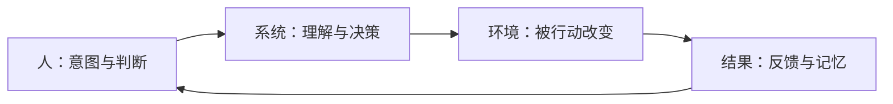

# 理念：三元全智生命体

> 状态：规划稿（2026-11-17）。「现状」一列里的「已有」指在来源仓库里已经实现，不代表已经迁入新仓库。

## 1 从拖拽到说话

低代码平台做对了一件事：把业务系统拆成表单、列表、流程、权限这些声明式的元数据，系统由元数据解释执行，改系统就是改元数据。它的瓶颈在谁来写元数据。拖拽设计器要求人先学会平台的全部概念，系统一复杂，拖拽并不比写代码省事。

匠心沿用元数据这条路，换掉写的人：

| | 低代码 / 无代码 | 匠心 |
|---|---|---|
| 系统由什么描述 | 声明式元数据 | 声明式元数据（插件的各种表面） |
| 谁来写 | 人，用拖拽设计器 | 智能体，按人的自然语言意图 |
| 人做什么 | 学会平台概念，逐项配置 | 说清要什么，判断什么算对，审核关键步骤 |
| 上线之后 | 系统不变，等下一次人工修改 | 运行反馈回到智能体，系统继续调整 |

这要求平台的每一项能力都能被智能体读懂、调用和生成。所以「一切皆插件」和「声明式表面」是前提，见[一切皆插件](03-plugin-model.md)。

## 2 三个词各管什么

三元全智生命体 = 三元给躯体，全智给心智，生命体给活法。

### 2.1 三元：躯体

「三元」有三组，每一组说的都是融合成一体：

- **云、边、端。** 平台服务跑在云上的集群里，靠近现场的节点处理要求低延迟的事，浏览器、桌面、移动设备和现场设备是端。同一套插件按不同的 profile 装配到这三处。
- **工蜂、章蜂、群蜂。** 智能体的组织形态，从单个 Agent 到成群协同。三种形态各自的定义待产品负责人补充。
- **人、机、物。** 人出意图与价值判断，机出算力与执行，物出感知与行动手段。三者是共生关系，拆开都不完整。

在平台里，三元对应底座，也就是企业级框架：后端 Kun 与前端 Qian。人、机、物在平台里有明确的身份：

| 角色 | 平台里的身份 |
|---|---|
| 人 | `user` 主体，经单点登录进入，属于某个租户 |
| 机 | `agent` 主体（智能体）与 `service` 主体（平台服务、插件、定时作业） |
| 物 | 设备、业务系统、数据源，由连接器或 MCP 服务器代表接入 |

### 2.2 全智：心智

全智说的是智能的水平：不止会一件事，什么都能学；从被人调用的工具，长成能自己做主的智能体。在平台里它对应智能体引擎 SanYuanAgent。

「自己做主」有边界。Agent 的权限不超过它主人的权限与授给它的范围的交集；高风险动作要人确认；Agent 之间的往来要人审核。

### 2.3 生命体：活法

生命体说的是存在方式：它不是造出来就不再变的系统，而是自主运转、有新陈代谢、会进化的存在。

在平台里，生命体指平台上长出来的系统与智能体的组合：由自然语言构建出来，在反馈环里运转。平台的目标是能持续长出更多这样的生命体。

## 3 反馈环

生命体靠一个闭环活着：

| 环上的一步 | 含义 | 平台里谁承担 |
|---|---|---|
| 人：意图与判断 | 要什么，什么算对 | Qian 的界面：提出意图、审核、批准或驳回 |
| 系统：理解与决策 | 感知环境，选择行动 | SanYuanAgent：理解意图、规划、选工具 |
| 环境：被行动改变 | 业务数据、产线、设备、文档发生变化 | Kun 的能力与连接器：写业务数据、调外部系统、驱动设备 |
| 结果：反馈与记忆 | 对的错的都记下来 | Kun 的事件与审计记录事实；SanYuanAgent 的记忆沉淀经验 |

开环是工具：指令进、结果出，系统自己不变。闭环是生命：每一次行动都在改变系统自己。反馈同时改写两头，一头是人的判断，一头是系统的策略。

## 4 六个体征与平台能力

「生命体」三个字承诺了六件事。下表是它们在平台里的对应。

| 体征 | 含义 | 平台里的对应 | 现状 |
|---|---|---|---|
| 新陈代谢 | 数据是营养，知识有生老病死，过时的要代谢掉 | 记忆与知识带来源、版本和有效期，过期的降权或归档；业务数据经事件流持续进入 | 分层记忆已有；有效期与淘汰策略是规划 |
| 应激性 | 感知、决策、行动一气呵成，环境一变立刻反应 | 事件驱动：平台事件触发 Agent；边缘节点就近处理 | 事件总线与可靠投递已有；事件触发 Agent、边缘处理是规划 |
| 生长发育 | 终身学习，越用越强，没有最终版本 | 每次运行的轨迹、人的批准、驳回与修改都回写成记忆与技能 | 运行轨迹与记忆已有；把人审结果用作学习信号是规划 |
| 遗传与繁殖 | 方案与知识复制到新场景，Agent 生成子 Agent | 方案打包成插件，经目录一键装到新租户；Agent 派生子 Agent | 组件模型、目录格式与安装已有；子 Agent 编排已有；跨人的协同是规划 |
| 变异与进化 | 多个策略同时上线，用效果做选择 | 同一能力多个实现或多个版本并存，按范围灰度，用效果数据决定去留 | 按范围挂载与替换已有；效果评测与择优是规划 |
| 稳态与免疫 | 故障自愈，负载自平衡，安全体系就是免疫系统 | Kubernetes 的自愈与伸缩；租户隔离、权限强制执行点、审计链、沙箱、人审 | 隔离、权限、审计已有；沙箱已有；人审流程是规划 |

## 5 面向企业意味着什么

- **多租户。** 每个组织是一个租户，数据与配置按租户隔离，租户可以各自启用和定制插件。
- **身份与权限。** 人经单点登录进入；每次能力调用都经过权限判定；Agent 不能绕过它主人的权限。
- **审计。** 人的操作、Agent 的动作、每一次审核决定都留下可核验的记录。
- **数据主权。** 核心组件可以私有部署，客户的数据留在客户的机房。
- **生态可治理。** 可以用社区的现成组件，但每个组件有信任等级，装之前看得到它要的权限，按租户启用。
- **人在环里。** 关键步骤由人批准：智能体生成的系统变更、高风险动作、Agent 之间的往来。

## 6 边界

- 不做面向个人消费者的聊天产品。
- 不再做一个拖拽设计器当主入口。已有的声明式元数据继续用，换的是写元数据的方式。
- 不让智能体绕过权限、审计与人审。平台能证明谁在什么授权下做了什么，是它能进企业的前提。
