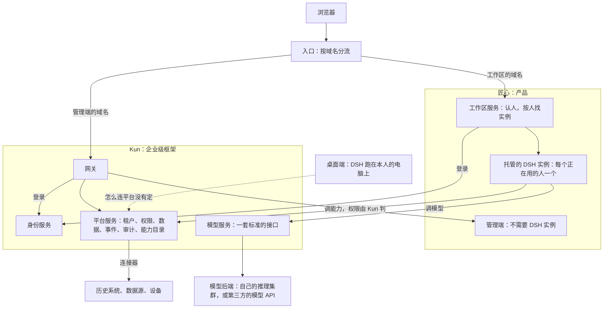
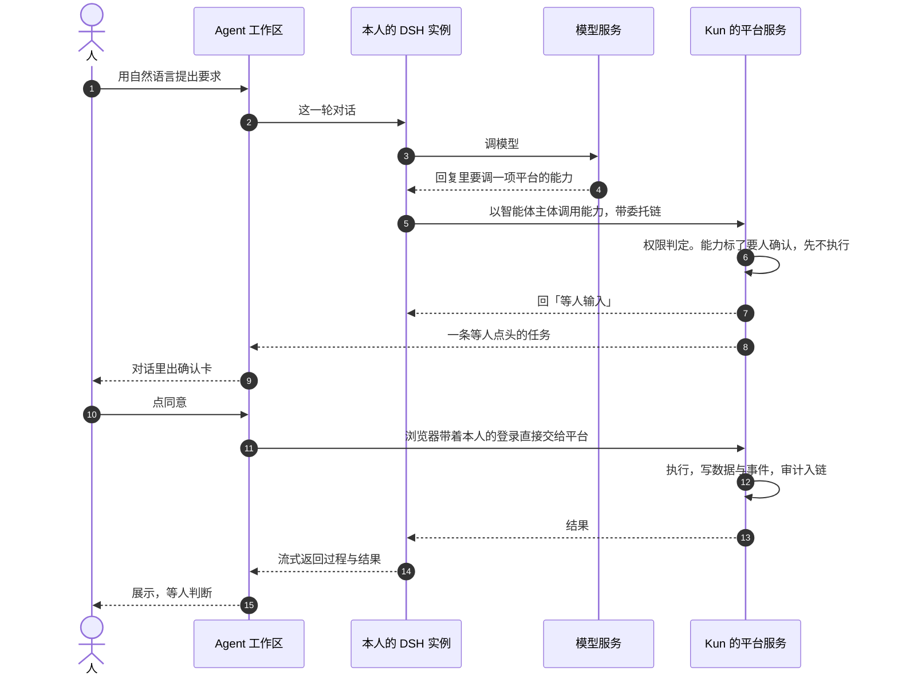

# 总体架构

> 状态：2026-11-26 按收拢后的方向重写。标法见[平台做什么与设计理念](01-vision.md)开头。说 Kun 的「已有」，指在 Kun 的仓库里已经实现；说匠心的「已有」，指在本仓库里已经实现。
>
> 匠心一侧的管理端、工作区服务、托管的 DSH 实例，Kun 一侧的模型服务的接口、远程的授权接口、智能体主体，都是规划，没有实现。

## 1 一张图

- 图里已有的是 Kun 的网关、身份服务与平台服务。管理端、工作区服务、托管的 DSH 实例、模型服务的接口、连接器都是规划。
- Web 端分成两块，放在两个域名上：管理端的域名过 Kun 的网关；工作区的域名由匠心的工作区服务直接接，不经过 Kun 的网关（已定，P63、P64）。
- 每人一个 DSH 实例：Web 端的托管在服务器上，桌面端的跑在各人自己的电脑上（已定，P62、P63）。
- 图省略了网关的分层与 Agent 调能力的路径，见第 4.1 节。

## 2 匠心、Kun、DSH 各管什么

| | 匠心 | Kun | DSH |
|---|---|---|---|
| 是什么 | 产品 | 企业级框架，.NET 10 | 上游的 Agent 运行时，开源，以 npm 包发布 |
| 负责 | Agent 工作区的 Web 端与桌面端、管理端、产品的插件、部署清单；把登录的人送进他自己实例的工作区服务 | 登录、权限、多租户、数据、事件、审计、模型服务的接口，以插件的形式装配；组件运行时、注册表、能力目录；网关 | Agent 的运行：对话与推理、工具调用、技能、子智能体、MCP 客户端、会话；界面外壳，也就是它自己的客户端 |
| 不负责 | 不自己判权限，不另存一套用户、租户、角色 | 不负责任何业务，不带最终的界面；不写 Agent 的推理循环 | 不管多用户与租户：一个实例只有一个主人 |
| 代码在哪 | 本仓库 | [CavaiLAB/kun](https://github.com/CavaiLAB/kun) | 上游的仓库。我们钉死版本，不改它的源码 |
| 依据 | P41、P60、P61、P63 至 P66；「不自己判权限」是 P86 的读法，见第 2.1 节 | P14、P57、P60、P83、P86 | P37、P38、P62 |

现在只剩两个项目：匠心与 Kun（已定，2026-11-26，P78）。前端框架 Qian 的仓库已归档，已发布的包留着（P77）；SanYuanAgent 的仓库保留，暂不维护（P78）。

三条边界规则：

1. **业务主数据与权限以 Kun 为准。** 租户、用户、角色、能力目录、审计记录只有一份，在 Kun。
2. **Agent 办平台上的事都经 Kun。** 它查能力目录、调用能力，每一次调用都经过 Kun 的权限判定并留审计。DSH 实例里自己的工具策略是补充，可以更严，不能代替 Kun 的判定。
3. **界面只经公开的接口与契约访问 Kun。** 界面里看不到的能力，后端同样拒绝。

Kun 是通用的组件，不负责任何业务；最终的界面放在匠心，也可以放到另一个仓库（已定，P60）。Kun 仓库里现有的登录页、租户与成员页这些界面以后怎么用，没有定。

DSH 这一侧，我们自己的东西只有自己写的插件包，和叠在 DSH 配置上的补丁。升级 DSH 要做什么，见 [DSH 更新之后做什么](13-dsh-upgrade.md)；DSH 的实例怎么和企业级平台对接，见 [DSH 与企业级平台的对接](12-dsh-integration.md)。

### 2.1 权限统一走 Kun

已定（2026-11-26，P86）：平台上不论做什么系统，权限都走 Kun 这一套；这一部分要在 Kun 上做好。

整理时的读法：平台上的系统不自己判权限，只问 Kun，不各做一套；管到的是管理端、平台上的应用与插件、Agent、DSH 一侧的服务。

怎么问，按系统在哪里分。这张表是提议，现状一列是事实：

| 谁 | 怎么问 Kun | 现状 |
|---|---|---|
| 装在 Kun 进程里的组件 | 进程内的权限判定 | 已有 |
| 经 Kun 的网关进来的请求 | 入口上的强制执行点，缺省拒绝 | 已有 |
| 不在 Kun 进程里的系统：管理端、工作区服务、页面插件 | 远程的授权接口，加各语言的客户端包 | 规划。Kun 现在没有这个接口，也没有客户端包；对应 Kun 的任务 S1-AZ-005 |
| Agent | 智能体主体带委托链，有效权限取委托人的权限与授给这个 Agent 的范围的交集 | 已有决策，没有启用，排在里程碑 M1 |

做开发的人怎么声明能力和权限，见[在平台上做开发](14-development.md)。

### 2.2 模型服务的接口

已定：

- 模型服务由 Kun 提供；机器人这类设备本地可能还有小模型（P14）。
- 要设计标准的接口，用来对接后面的模型推理服务；只提供一套（2026-11-26，P83）。整理时的读法：模型服务这一块留一套标准的接口，后面接自己的推理服务，还是接第三方的 API，都接在这套接口上，上面的产品不用跟着改。接口的形状没有定。

接口怎么分是提议，分三个面：

| 面 | 给谁用 | 是什么 |
|---|---|---|
| 调用面 | DSH 的实例、应用、Agent | OpenAI 兼容的接口。调用方只认平台的地址和平台发的凭据，用逻辑模型名，不知道后面是哪个模型后端 |
| 接入面 | 模型后端的适配，做成插件 | 一个适配回答四件事：有哪些模型，各自能做什么，是否健康，怎么调。自己管推理的后端多答一件：部署、扩缩与下线 |
| 管理面 | 管理端 | 模型目录、凭据的引用、配额与限流、计量、审计 |

两种形态的差别落在接入面装哪个适配上：带推理的集群装推理服务的适配，不带推理的装第三方模型 API 的适配；调用面和管理面不变。这一句也是提议。

现状：

- Kun 里模型服务的组件现在只有配置骨架，没有实现；相关的任务 S1-MGW-001 至 003 没有开始。
- Kun 已有的决定是不自己写模型代理：模型请求的转发用现成的模型网关，Kun 的组件只做三件事，把上游登记进网关、适配上游、维护模型目录；租户、配额、计量在平台一侧。见 Kun 的 [ADR-015](https://github.com/CavaiLAB/kun/blob/main/docs/adr/ADR-015-model-gateway.md)。
- 本仓库这一侧，发行目录里模型的地址是一个环境变量，指向一个 OpenAI 兼容的地址，默认指本机的假模型。

没有定的：不带推理的那种形态，模型请求要不要也过模型网关；计量与配额第一版做到哪；第三方的凭据由平台统一配，还是租户自带。

设备上的本机模型不在这套接口里：它等设备一侧用什么运行时定下来再定，排在里程碑 M8 之前（已定，P56），见[工业智能制造](08-industrial-forms.md)第 5 节。

## 3 主体模型

| 谁 | 平台主体 | 说明 |
|---|---|---|
| 人 | `user` | 经单点登录进入，带租户与成员身份 |
| 智能体 | `agent` | 归属于某个人（团队 Agent 是提议）。令牌里带委托链，写明它代表谁行事。有效权限 = 委托人的权限 ∩ 授给这个 Agent 的范围 |
| 服务 | `service` | 平台服务、插件、定时作业 |
| 设备与外部系统 | 由连接器代表 | 设备、业务系统、数据源经连接器或 MCP 服务器接入；连接器以 `service` 主体运行，能访问哪些外部地址要事先声明。历史系统怎么接，见[历史系统接入](11-legacy-systems.md) |

现状：三类主体与委托链字段已经写进 Kun 冻结的契约。`user` 与 `service` 已在签发；`agent` 主体与委托链还没有启用，排在[路线](06-roadmap.md)第 2.1 节的里程碑 M1。

能力可以标成「只许人做」。标了的能力不会变成 Agent 可见的工具，Agent 主体来调用也会被拒绝。这条规则已经写进能力条目的契约，强制执行随 `agent` 主体一起启用。

能力还可以标成「要人确认」。标了的能力，调用方不是人本人时，平台自己不执行，先生成一条等人输入的任务，人点了才执行；人自己在界面上直接调，不拦（已定，P73）。标记已经在契约里，现在只是登记，平台还不按它拦。

## 4 一次请求怎么走

人让 Agent 办一件要人确认的事。这是设计，图里的每一步都还没有实现：

几个要点：

- 能力没有标要人确认时，第 6 步判定通过就直接执行，回结果或结构化的错误。
- 确认卡的点击不经过模型，也不经过 DSH 实例：平台的事，要平台自己从人那里拿到答案（已定，P68）。
- 权限判定在 Kun 的强制执行点做，入口缺省拒绝。
- 写业务数据和发事件在同一个事务里落库，再由后台可靠投递。审计记录按哈希链串起来，事后可以核验有没有被改。
- 错误一律是结构化的：稳定的错误码加上机器可读的细节。Agent 靠它判断下一步，不靠解析报错文字。
- 外部令牌只到 Kun 的网关。网关之后，服务之间用网关签发的内部短期令牌，令牌里带租户、主体类型和权限范围。

后四条说的是 Kun 一侧，已有。

### 4.1 谁调谁，走哪里

上图省略了网关的分层。照 Kun 已有的决策，网关分三层，各管各的：公网入口只做路由；Kun 的网关管业务接口和身份；模型与 MCP 网关管模型调用和 Agent 调用能力的流量。Agent 不直接连平台服务的地址，一律经 MCP 路由。

有两处有意的偏离：

- Web 端里 Agent 工作区的域名由匠心的工作区服务直接接，不经过 Kun 的网关（已定，P64）。三层的分工不变，管理端的域名照旧过 Kun 的网关。
- 确认卡的最小一圈在里程碑 M1 之前先用替身演示，M1 做好以后替身撤掉（已定，P75）。提议的做法是：实例里的工具调匠心的工作区服务，由它用自己的服务身份调平台，不经 MCP 路由。「一律经 MCP 路由」与下表「Agent → 平台能力」一行都不改。

| 谁调谁 | 走哪里 | 带什么身份 | 现状 |
|---|---|---|---|
| 人 → Agent | Web 端：浏览器 → 入口 → 匠心的工作区服务 → 本人的托管 DSH 实例，不经过 Kun 的网关（P63、P64）。桌面端：DSH 在各人自己的电脑上（P62） | 用户会话。工作区服务用 Kun 发布的登录组件认人，登录到 Kun 的身份服务 | Kun 的登录组件已有；工作区服务与托管实例是规划 |
| 人 → 管理端 | 浏览器 → 入口 → Kun 的网关（P64） | 用户会话 | 管理端是规划 |
| Agent → 平台能力 | 模型与 MCP 网关的 MCP 路由 → Kun 的能力 | 智能体主体，带委托链。权限判定在 Kun | 能力目录已有；智能体主体未启用；MCP 路由是规划 |
| Agent → 模型 | DSH 的实例 → 模型服务的调用面 → 模型后端（提议，见第 2.2 节） | 平台发的凭据 | 调用面是规划。现在实例的模型地址是一个环境变量 |
| 确认卡的点击 → 平台 | 浏览器直接到平台，不经过模型和 DSH 实例（P68） | 本人的登录 | 规划 |
| 应用页面 → 平台服务 | Kun 的网关 | 用户会话 | 已有 |
| 应用 → 应用 | 能力调用或事件，都经 Kun | 应用代用户行事，或应用的服务身份 | 见[应用互通](10-app-interop.md) |
| 连接器 → 历史系统 | 只访问声明过的外部地址 | 服务账号或本人账号，密钥只写引用 | 见[历史系统接入](11-legacy-systems.md) |

DSH 的实例这一头的细节，登录、模型、权限、审计、等人点头的任务各怎么接，见 [DSH 与企业级平台的对接](12-dsh-integration.md)。

## 5 部署

底座是 Kubernetes、云原生、微服务（已定，P4）。部署上有三条线：带不带模型推理，多租户还是单租户，跑在集群上还是一台服务器上。把它们当成三件不同的事，是整理时的读法；本文照这个读法写，不把它们混成一条。

### 5.1 两种形态

已定（2026-11-26，P83）：部署分两种，一种带模型推理，一种不带。本文说「形态」，专指这一条线：

| 形态 | 模型从哪来 |
|---|---|
| 带模型推理的集群 | Kubernetes 集群里自己的推理服务，用 GPUStack 这一类 |
| 不带模型推理 | 通过 API 接第三方的模型服务 |

第二种写成「不带模型推理、通过 API 接第三方的模型服务」，是整理时的读法。

这些尽量用插件的形式实现（已定，P83）。照整理时的读法，是把两种形态的差别做成 Kun 的组件：换一个组件就换了形态，产品还是一套。提议的做法是把差别落在模型服务的接入面上，见第 2.2 节。两种形态各装什么，还没有清单。

### 5.2 多租户版与单租户版

已定（P33、P83）：交付给客户的，可以是多租户版，也可以是单租户版。两个版本与两种形态怎么组合，没有定，见第 5.4 节。

提议：两个版本是同一套代码、同一种数据模型的两种装配，不分叉。

| | 多租户版 | 单租户版 |
|---|---|---|
| 适合 | 一套部署服务多个组织，例如集团、园区、运营方 | 一个组织自己用一套 |
| 租户 | 多个。各自隔离，各自启用与定制 | 只有一个 |
| 装什么 | 全部，含租户开通与租户运营 | 不装租户开通与租户运营；界面上不出现切换租户 |
| 数据 | 每条记录带租户 | 同样带租户，只是只有一个。以后要变成多租户，不用迁移数据 |

单租户说的是只有一个租户，不是单进程，也不是单机。单租户版怎么装配，对应 Kun 的哪一种 profile，待定。

### 5.3 企业版与单机版

这条线说的是部署的规模，叫法是整理时的读法。它的来由是产品负责人 2026-11-24 的一句话：有些企业比较小，要能在单机上跑，大模型通过 API 调用。

- **企业版。** 跑在集群上的全套部署。
- **单机版。** 给小企业，一台服务器上能跑。照上面那句话，它的模型经 API 调用。

已定的有三处（[2026-11-25 平台级裁定](decisions/2026-11-25-platform.md) P58、P59、P63）。前两处是例外：

- 单机版默认不装配置中心，读配置文件；要在运行期改配置的客户可以加装。企业版照旧装。
- 单机版里身份服务与平台服务同一个进程，网关仍独立成进程。企业版仍是三个进程分开。

第三处是 P63 里的一句：单机版以桌面为主。它和「一台服务器上能跑」怎么合在一起，记录里没有展开；读作服务器上跑平台的服务，人用 Agent 工作区主要走桌面端，DSH 跑在各人自己的电脑上。这是整理时的读法。

单机版其余怎么装配是提议，见那份裁定的第 6 节。

### 5.4 三条线合起来

| 线 | 分的是什么 | 两头 | 依据 |
|---|---|---|---|
| 形态 | 带不带模型推理 | 带推理的集群；不带推理、接第三方的模型 API | P83 |
| 版本 | 租户的数量 | 多租户版；单租户版 | P33、P83 |
| 规模 | 部署在集群上还是一台机器上 | 企业版；单机版 | 2026-11-24 的那句话；P58、P59 |

- 不管哪一种，统一由管理端管理（已定，P83）。照整理时的读法，两种形态、两个版本用同一个管理端，模型服务也在里面管。管理端在匠心，见[产品形态](09-product.md)第 4 节。
- 三条线怎么组合、哪几种组合要交付，产品负责人没有说，待定。
- 产品的部署清单放本仓库的 `deploy/`，跟着产品版本打标签；各环境的差异留在部署仓库（已定，P61）。目录还没有建。
- 运维侧各个控制台的登录也接 Kun 的身份服务，交付给客户的产品里不带另一套身份系统；各控制台保留一个本地的应急管理员（已定，P57）。

### 5.5 工作负载

Kun 的可部署单元叫 profile：一个 profile 是一份具名的插件组装，新增一个可部署单元就是新增一个 profile 文件。

| 工作负载 | 来自 | 说明 | 现状 |
|---|---|---|---|
| 网关 | Kun 的 `gateway` profile | 入口、外部令牌校验、内部令牌签发、限流 | 已有 |
| 身份服务 | Kun 的 `identity` profile | 单点登录的签发方，可接外部身份源 | 已有 |
| 平台服务 | Kun 的 `platform` profile | 租户、权限、数据、事件、审计等全部平台插件 | 已有 |
| 模型服务 | Kun 的平台组件，加模型网关这个外部组件 | 模型目录、租户路由、配额与计量在 Kun；模型请求的转发在模型网关 | 规划 |
| 推理服务 | 带推理的那种形态才有 | 集群里的模型推理 | 规划 |
| 管理端 | 匠心 | 浏览器里的 Cordis 应用，域名过 Kun 的网关（P64 至 P66） | 规划 |
| 工作区服务 | 匠心 | 接工作区的域名，用 Kun 的登录组件认人，把登录的人送进他自己的 DSH 实例（P63、P64） | 规划 |
| 托管的 DSH 实例 | DSH，从发行目录装出来 | 给 Web 端用：每个正在用 Agent 的人一个，按需启动、空闲回收、有上限（P63）。实例怎么隔离是提议 | 发行目录已有；按人托管是规划 |
| 连接器的执行部分 | 连接器组件 | 历史系统在企业内网时，执行部分装在内网，只向外连（已定，P27）。做法是提议，见[历史系统接入](11-legacy-systems.md)第 7 节 | 规划 |

Kun 另有 `standalone` 与 `minimal` 两个 profile：前者把全部装进一个进程，后者只有运行时和声明式表面的装载器，其余按需加。

依赖的基础设施：PostgreSQL、Redis、消息队列、配置中心、对象存储、可观测后端。交付走 GitOps：清单在 git 里，集群按清单对齐。

设备上的 Agent 怎么部署、怎么接平台，见[工业智能制造](08-industrial-forms.md)第 5 节。

## 6 横切约束

| 约束 | 做法 | 现状 |
|---|---|---|
| 多租户 | 每个请求、事件、审计记录都带租户；数据层按租户行级隔离 | 已有 |
| 零信任的服务间通信 | 网关签发内部短期令牌，服务只信内部令牌 | 已有 |
| 权限缺省拒绝 | HTTP、命令、gRPC 入口都经强制执行点 | 已有 |
| 权限只有一套 | 不论做什么系统，权限都走 Kun 这一套（已定，P86）。照整理时的读法，系统不自己判权限，只问 Kun | Kun 进程内的判定已有；远程的授权接口是规划 |
| 审计可核验 | 审计记录串成哈希链 | 已有 |
| 可靠事件 | 业务数据与事件同事务落库，后台投递，消费端幂等 | 已有 |
| 统一错误模型 | 结构化错误加错误码目录 | 已有 |
| 可观测 | OpenTelemetry 的追踪、指标、日志 | 已有 |
| 密钥不落明文 | 清单、配置、日志里只出现密钥引用，使用时再解析 | 已有 |
| 发出去之前人审 | Agent 发给别的 Agent、发给别人、写外部系统之前，由人确认；发给 Agent 的内容由收件方的主人审核。起步两道都必审（已定，P28） | 规划，见 [Agent 协同](04-agent-collaboration.md) |
| 要人确认的能力由平台停下来等人点 | 调用方不是人本人时，平台不执行，先生成等人输入的任务（已定，P73） | 规划 |
| 应用之间只经平台往来 | 应用之间不直连对方的数据库，不引用对方的代码；调用与订阅按声明、经批准放行（缺省已定，P26；细则是提议） | 规划，见[应用互通](10-app-interop.md) |

「已有」的各行说的是 Kun。

## 7 契约

匠心与 Kun 用不同的语言写，靠契约协作。契约是 JSON Schema 加样例，冻结之后只做加法。

| 契约 | 管什么 | 现状 |
|---|---|---|
| 服务间令牌的字段 | 主体类型、租户、角色、权限范围、委托链 | 已冻结 |
| 事件信封 | 事件的统一外层字段 | 已冻结 |
| 结构化错误与错误码目录 | 错误的形状与全部错误码 | 已冻结 |
| 能力条目与能力目录 | 一项能力的输入输出 Schema、副作用等级、所需权限、是否对 Agent 暴露、是否要人确认 | 已冻结 |
| 插件清单与表面格式 | 组件文件夹的布局、清单字段、各表面的文件格式 | 已有规格 |
| 表单、列表与控件的 Schema | 界面由什么数据描述 | 已有草案 |
| 授权的远程接口 | 不在 Kun 进程里的系统怎么问权限 | 规划，见第 2.1 节 |
| 模型服务的接口 | 调用面、接入面、管理面；一个模型的模态、是否支持工具调用、上下文长度这些能力怎么描述 | 规划，见第 2.2 节 |
| 等人输入的任务 | 等人点头的任务长什么样、允许哪些动作、点击怎么交给平台 | 规划。接口的形状是提议 |
| 协同消息信封与审核状态 | Agent 之间往来的消息长什么样、审核怎么流转 | 规划，见 [Agent 协同](04-agent-collaboration.md) |
| 应用互通的声明 | 一个应用要调用别的应用的哪些能力、订阅哪些事件 | 规划，见[应用互通](10-app-interop.md) |
| 连接器的映射格式 | 历史系统的操作、变更与数据怎么映射成平台的能力、事件与数据源 | 规划，见[历史系统接入](11-legacy-systems.md) |
| 知识库 | 资料来源、整理与索引的方式、谁能访问 | 规划，见[一切皆插件](03-plugin-model.md)第 3 节 |
| 设备与平台之间的接口 | 入网、下发、上报 | 规划。设备一侧用什么运行时没有定 |

契约在 Kun 的仓库里。提议匠心以后从那里生成 TypeScript 的类型，放本仓库的 `contracts/`；这个目录现在是空的。

## 8 技术选型

| 层 | 选型 |
|---|---|
| 企业级框架 | .NET 10；ASP.NET Core Minimal API 与 gRPC；EF Core；YARP（网关）；OpenIddict（身份服务） |
| 数据与中间件 | PostgreSQL、Redis、RabbitMQ、Apollo（配置中心；单机版默认不装，P58）、S3 兼容的对象存储 |
| Agent 运行时与界面外壳 | DSH，版本钉死（P37、P38）。它的客户端是浏览器里的 Cordis 应用，用 React |
| 产品的界面 | DSH 的插件与页面插件，TypeScript；基础组件用 shadcn 这一套，底下是 Base UI，样式用 Tailwind（P76）；桌面端是一个薄的 Electron 壳的原型 |
| 模型服务 | 模型网关用 Higress，推理服务用 GPUStack |
| 运行与交付 | Kubernetes（K3s）、Argo CD、Kustomize、Harbor |
| 可观测 | OpenTelemetry |
| 文档站 | Rspress（已定，P9） |

企业级框架、数据与中间件、模型服务、运行与交付这几行是 Kun 现在在用的选型。
