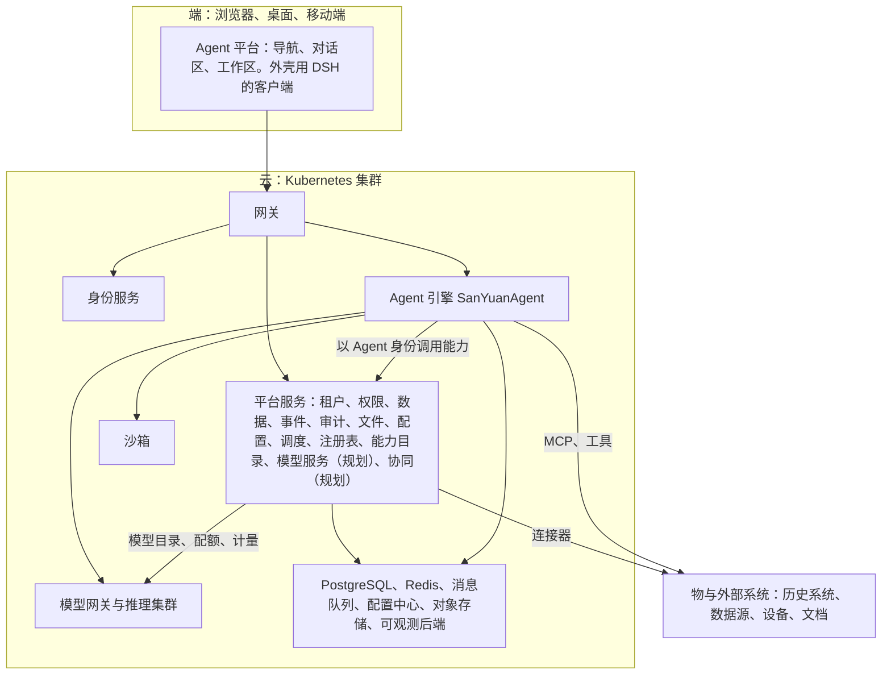
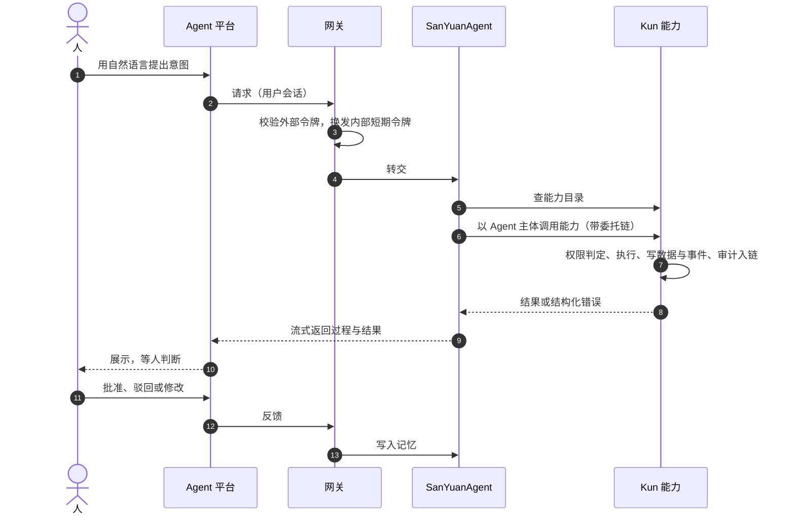
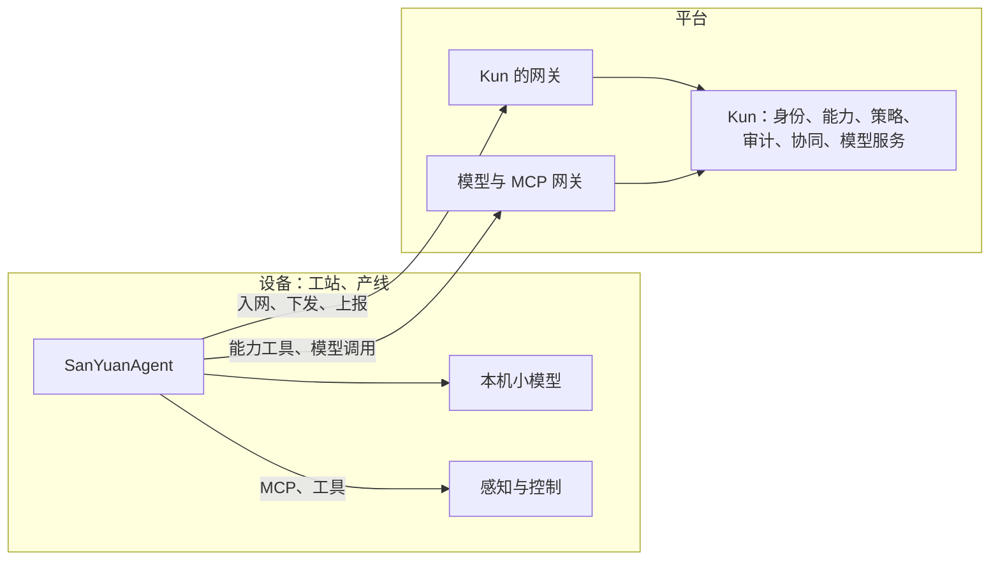

# 总体架构

> 状态：规划稿（2026-11-17）。「已有」指在来源仓库（后端的两个来源仓库与引擎原来所在的私有仓库）里已经实现，不代表已经迁入新仓库。
>
> 2026-11-19 补：平台开发交付的两样东西、最终用户的入口、两种交付版本已定（[2026-11-19 平台级裁定](decisions/2026-11-19-platform.md) P23、P24、P33），见第 2.1、4.1、5.1 节；展开见[角色与产品形态](09-roles-and-product.md)。
>
> 2026-11-20 补：匠心工业智能体平台的 Agent 运行时用 DSH，界面外壳用 DSH 自己的客户端，Qian 冻结在 0.2.1（已定，[2026-11-20 产品裁定](decisions/2026-11-20-product.md) P37、P38）。本文写于这之前：图里的「界面用 Qian 搭」已改成外壳用 DSH 的客户端，其余部分（SanYuanAgent 在请求路径与部署里的位置、前端的部署方式、端的种类）还是原来的规划，怎么改待定，见那份裁定的第 3 节。

## 1 一张图

网关、身份服务、平台服务来自 Kun；Agent 引擎与沙箱调度来自 SanYuanAgent；端上的界面是 Agent 平台，它是最终用户的入口（已定），界面外壳用 DSH 的客户端（已定，2026-11-20，P38）。历史系统经连接器接入，见[历史系统接入](11-legacy-systems.md)。

图里画的是集群里的那一份引擎。SanYuanAgent 是独立运行的 SDK（已定），它还要装在工站、产线的设备上运行，见第 5 节。

## 2 三个框架的分工

| | Kun | Qian | SanYuanAgent |
|---|---|---|---|
| 一句话 | 企业级后端框架 | 前端框架 | 智能体引擎，独立运行的 SDK |
| 技术栈 | .NET 10 | TypeScript、React | Python 3.12 |
| 负责 | 租户、身份、权限、数据、事件、审计、文件、配置、网关、调度；组件运行时、注册表、能力目录；Agent 的身份；模型服务（由 Kun 提供是已定的，实现是规划）；协同信箱与人审流程（规划，放在 Kun 是提议，见 [Agent 协同](04-agent-collaboration.md)第 9 节） | 设计令牌、组件库、应用外壳、微前端加载、由 Schema 驱动的表单与列表；意图输入、过程展示、审核收件箱等 Agent 相关界面 | 推理循环、工具调用、技能加载、记忆、沙箱、模型路由、子 Agent 编排 |
| 不负责 | 不写 Agent 的推理循环 | 不绕过后端接口直接碰数据 | 不另存一套用户、租户、权限 |
| 对应理念 | 三元（躯体） | 三元（躯体） | 全智（心智） |

三条边界规则：

1. **业务主数据与权限以 Kun 为准。** 租户、用户、角色、能力目录、审计记录只有一份，在 Kun。
2. **接入平台的 SanYuanAgent 经 Kun 做事。** 它以 Agent 主体的身份查能力目录、调用能力，每次调用都经过 Kun 的权限判定并留审计。它自己的存储只放运行状态与记忆。它是独立运行的 SDK（已定）。目标是不接平台时自己能完整运行，那时没有租户与权限这一层；一旦接入，平台管的事以平台为准。
3. **Qian 只经公开接口与契约访问后端。** 界面里看不到的能力，后端同样拒绝。

### 2.1 两样交付物与组合体

平台开发交付两样东西，两者互补，最终是一体化的产品；`jiangxin` 仓库就是组合体（已定）。

| 交付物 | 由什么组成 | 管什么 |
|---|---|---|
| Agent 框架 | 智能体引擎 SanYuanAgent；Agent 平台，即最终用户的使用界面 | 理解意图、规划、调用工具、记忆；和人对话，把结果交给人判断 |
| 企业级应用平台 | 后端 Kun；前端 Qian | 租户、身份、权限、数据、事件、审计；应用、应用市场、历史系统的接入 |
| 组合体 | 在 `jiangxin` 仓库 | 把上面两样拼成一个产品 |

Agent 平台的客户端基于企业级框架（已定，P24）。原来的写法是界面用 Qian 搭，身份、权限、应用与能力来自 Kun，智能来自 SanYuanAgent。2026-11-20 起界面外壳用 DSH 的客户端、Agent 运行时用 DSH（P37、P38），P24 的这一句由此部分取代；身份、权限这些由哪个后端提供，SanYuanAgent 以后怎么接，待定，见 [2026-11-20 产品裁定](decisions/2026-11-20-product.md)第 2、3 节。企业级应用平台不另做一套入口，Agent 平台收起对话区就是它（已定）；在 DSH 的外壳下怎么落，待定。上面三条边界规则不变。

组合体里放什么是提议，见[仓库与归属](05-repositories.md)第 1.1 节。

## 3 人、机、物：主体模型

| 角色 | 平台主体 | 说明 |
|---|---|---|
| 人 | `user` | 经单点登录进入，带租户与成员身份 |
| 机：智能体 | `agent` | 归属于某个人（团队 Agent 是提议）。令牌里带委托链，写明它代表谁行事。有效权限 = 委托人的权限 ∩ 授给这个 Agent 的范围 |
| 机：服务 | `service` | 平台服务、插件、定时作业 |
| 物 | 由连接器代表 | 设备、业务系统、数据源经连接器或 MCP 服务器接入；连接器以 `service` 主体运行，能访问哪些外部地址要事先声明。历史系统怎么接，见[历史系统接入](11-legacy-systems.md) |

现状：三类主体与委托链字段已经写进冻结的契约。`user` 与 `service` 已在签发；`agent` 主体与委托链还没有启用，排在[路线](06-roadmap.md)第 2.1 节的里程碑 M1。

能力可以标成「只许人做」。标了的能力不会变成 Agent 可见的工具，Agent 主体来调用也会被拒绝。这条规则已经写进能力条目的契约，强制执行随 `agent` 主体一起启用。

## 4 一次请求怎么走

几个要点：

- 外部令牌只到网关。网关之后，服务之间用网关签发的内部短期令牌，令牌里带租户、主体类型和权限范围。
- 权限判定在 Kun 的强制执行点做，入口缺省拒绝。Agent 引擎一侧另有自己的安全组件（工具策略等），它们是补充，不能代替 Kun 的判定。
- 写业务数据和发事件在同一个事务里落库，再由后台可靠投递。审计记录按哈希链串起来，事后可以核验有没有被改。
- 错误一律是结构化的：稳定的错误码加上机器可读的细节。Agent 靠它判断下一步，不靠解析报错文字。

### 4.1 谁调谁，走哪里

上图省略了网关的分层。照已有决策，网关分三层，各管各的：公网入口只做路由；Kun 的网关管业务接口和身份；模型与 MCP 网关管模型调用和 Agent 调用能力的流量。Agent 不直接连平台服务的地址，一律经 MCP 路由。

| 谁调谁 | 走哪里 | 带什么身份 | 现状 |
|---|---|---|---|
| 人 → Agent | Agent 平台 → Kun 的网关 → 引擎 | 用户会话。网关换发内部短期令牌 | 网关与令牌已有；转交给引擎是规划 |
| Agent → 平台能力 | 模型与 MCP 网关的 MCP 路由 → Kun 的能力 | 智能体主体，带委托链。权限判定在 Kun | 能力目录已有；智能体主体未启用；MCP 路由是规划 |
| Agent → 模型 | 模型与 MCP 网关 → 推理集群或外部供应方 | 按租户与 Agent 计量 | 引擎经模型网关调用模型已有；Kun 的模型服务与按 Agent 计量是规划 |
| 应用页面 → 平台服务 | Kun 的网关 | 用户会话 | 已有 |
| 应用 → 应用 | 能力调用或事件，都经 Kun | 应用代用户行事，或应用的服务身份 | 见[应用互通](10-app-interop.md) |
| 连接器 → 历史系统 | 只访问声明过的外部地址 | 服务账号或本人账号，密钥只写引用 | 见[历史系统接入](11-legacy-systems.md) |

## 5 部署

平台跑在 Kubernetes 上。Kun 的可部署单元叫 profile：一个 profile 是一份具名的插件组装，新增一个可部署单元就是新增一个 profile 文件。

| 工作负载 | 来自 | 说明 |
|---|---|---|
| 网关 | Kun 的 `gateway` profile | 入口、外部令牌校验、内部令牌签发、限流 |
| 身份服务 | Kun 的 `identity` profile | 单点登录的签发方，可接外部身份源 |
| 平台服务 | Kun 的 `platform` profile | 租户、权限、数据、事件、审计等全部平台插件 |
| Agent 引擎（集群里） | SanYuanAgent 的服务层 | 独立工作负载，可按负载伸缩 |
| 沙箱 | 由 SanYuanAgent 调度 | 隔离运行 Agent 产生的代码与文件操作 |
| 前端 | Agent 平台的客户端，界面用 Qian 搭 | 静态资源；应用页面作为远程模块按需装进工作区。现有的是后端仓库里的应用外壳，它怎么并进 Agent 平台的客户端待定，见[仓库与归属](05-repositories.md)第 1.1 节 |
| 模型服务 | Kun 的平台组件（规划）加模型网关（外部组件） | 模型目录、租户路由、配额与计量在 Kun；模型请求的转发在模型网关 |
| Agent 引擎（设备上） | SanYuanAgent | 装在工站、产线的设备上独立运行；接入平台时只向外连。规划，做法是提议 |
| 连接器的执行部分（企业内网里） | 连接器组件 | 历史系统在企业内网时，执行部分装在内网，只向外连（已定）。规划，做法是提议，见[历史系统接入](11-legacy-systems.md)第 7 节 |

Kun 另有 `standalone` 与 `minimal` 两个 profile：前者是单进程形态，后者只有运行时和声明式表面的装载器，其余按需加。

依赖的基础设施：PostgreSQL、Redis、消息队列、配置中心、对象存储、可观测后端。交付走 GitOps：清单在 git 里，集群按清单对齐。

云、边、端的落法是规划：同一套插件按不同 profile 装到云上集群与靠近现场的边缘节点，边缘节点处理低延迟与离线场景，定期与云端同步。

SanYuanAgent 要提供给工站、产线、工厂三级使用（已定）。它是独立运行的 SDK：每个端都要用到它，包括机器人这类边缘设备，装上就能用（已定）。模型服务由 Kun 提供，机器人本地可能还有小模型（已定）。

设备上的引擎怎么和平台往来是提议：

- **不接平台也能跑。** 独立运行是缺省，只要一个模型端点。接入平台是加法：身份、能力、策略、审计、协同与模型服务改由 Kun 提供，平台管的事以平台为准。
- **设备只向外连，只认一个入口地址。** 设备多半在车间网络里，外面连不进来。地址后面照现行的网关分层走两条路：入网、下发、上报进 Kun 的网关；能力工具与模型调用进模型与 MCP 网关。入网时在本机生成密钥，由主人本人在平台上批准，之后用设备密钥换短期的 `agent` 令牌。
- **断网尽量不停工。** 设备上有本机模型时，断网后本机该干的活照干，按缓存的策略行事；审计与用量先存本机，联网后补传。没有本机模型的设备，断网后做不了新的推理。
- **模型两头都能用。** 平台的模型经模型与 MCP 网关调用，由平台计量；本机小模型不经过模型网关，用量由引擎上报。缺省平台优先、本机兜底，标了不得离开设备的内容只走本机。

展开见 SanYuanAgent 的[独立运行的 SDK](https://github.com/CavaiLAB/sanyuan-agent/blob/main/docs/sdk.md)、[接入平台：与 Kun 的交互](https://github.com/CavaiLAB/sanyuan-agent/blob/main/docs/platform.md)、[与模型服务的交互](https://github.com/CavaiLAB/sanyuan-agent/blob/main/docs/models.md)，以及 Kun 的[对智能体的支撑](https://github.com/CavaiLAB/kun/blob/main/docs/agent-support.md)。三级各部署在云边端的哪一处仍然待定，见[三种形态](08-industrial-forms.md)。

### 5.1 两种交付版本

交付给客户的，可以是多租户的版本，也可以是单租户的版本（已定）。

提议：两个版本是同一套代码、同一种数据模型的两种装配，不分叉。

- **多租户的版本。** 一套部署服务多个组织。装全部组件，含租户开通与租户运营。
- **单租户的版本。** 一个组织自己用一套。只有一个租户；不装租户开通与租户运营，界面上不出现切换租户。数据照样带租户，以后要变成多租户，不用迁移数据。

单租户说的是只有一个租户，不是单进程。它用上面哪一种 profile 来装、要不要单独一份组装，待定，见[角色与产品形态](09-roles-and-product.md)第 7 节。

## 6 横切约束

| 约束 | 做法 | 现状 |
|---|---|---|
| 多租户 | 每个请求、事件、审计记录都带租户；数据层按租户行级隔离 | 已有 |
| 零信任的服务间通信 | 网关签发内部短期令牌，服务只信内部令牌 | 已有 |
| 权限缺省拒绝 | HTTP、命令、gRPC 入口都经强制执行点 | 已有 |
| 审计可核验 | 审计记录串成哈希链 | 已有 |
| 可靠事件 | 业务数据与事件同事务落库，后台投递，消费端幂等 | 已有 |
| 统一错误模型 | 结构化错误加错误码目录 | 已有 |
| 可观测 | OpenTelemetry 的追踪、指标、日志 | 已有 |
| 密钥不落明文 | 清单、配置、日志里只出现密钥引用，使用时再解析 | 已有 |
| 发出去之前人审 | Agent 发给别的 Agent、发给别人、写外部系统之前，由人确认；发给 Agent 的内容由收件方的主人审核。起步两道都必审（已定） | 规划，见 [Agent 协同](04-agent-collaboration.md) |
| 应用之间只经平台往来 | 应用之间不直连对方的数据库，不引用对方的代码；调用与订阅按声明、经批准放行（缺省已定，细则是提议） | 规划，见[应用互通](10-app-interop.md) |

## 7 契约

三个框架用三种语言写，靠契约协作。契约是 JSON Schema 加样例，冻结之后只做加法。

| 契约 | 管什么 | 现状 |
|---|---|---|
| 服务间令牌的字段 | 主体类型、租户、角色、权限范围、委托链 | 已冻结 |
| 事件信封 | 事件的统一外层字段 | 已冻结 |
| 结构化错误与错误码目录 | 错误的形状与全部错误码 | 已冻结 |
| 能力条目与能力目录 | 一项能力的输入输出 Schema、副作用等级、所需权限、是否对 Agent 暴露 | 已冻结 |
| 插件清单与表面格式 | 组件文件夹的布局、清单字段、各表面的文件格式 | 已有规格 |
| 表单、列表与控件的 Schema | 界面由什么数据描述 | 已有草案 |
| Agent 运行的事件流 | 步骤、工具调用、产物、最终回答 | 前端契约与引擎各有一套，还没有对齐；统一成一份契约是规划 |
| 协同消息信封与审核状态 | Agent 之间往来的消息长什么样、审核怎么流转 | 规划，见 [Agent 协同](04-agent-collaboration.md) |
| 模型能力的描述 | 一个模型的模态、是否支持工具调用、上下文长度、数据驻留、时延与成本的档位 | 已有，在引擎原来所在的私有仓库里；归到平台的契约是规划 |
| 设备与平台之间的接口 | 入网、下发、上报，以及设备上别的进程与引擎之间的本机通道 | 规划 |
| 应用互通的声明 | 一个应用要调用别的应用的哪些能力、订阅哪些事件 | 规划，见[应用互通](10-app-interop.md) |
| 连接器的映射格式 | 历史系统的操作、变更与数据怎么映射成平台的能力、事件与数据源 | 规划，见[历史系统接入](11-legacy-systems.md) |
| 知识库 | 资料来源、整理与索引的方式、谁能访问 | 规划，见[一切皆插件](03-plugin-model.md)第 3 节 |

契约现在随后端，合并之后也在 Kun 的仓库里。Qian 与 SanYuanAgent 从那里取，各自生成本语言的类型。

## 8 技术选型

来源仓库现在在用的：

| 层 | 选型 |
|---|---|
| 后端 | .NET 10；ASP.NET Core Minimal API 与 gRPC；EF Core；YARP（网关）；OpenIddict（身份服务） |
| 数据与中间件 | PostgreSQL、Redis、RabbitMQ、Apollo（配置中心）、S3 兼容的对象存储 |
| 前端 | React、TypeScript、Base UI、Tailwind CSS、Module Federation；pnpm 与 Turborepo |
| 智能体 | Python 3.12、LangGraph、FastAPI、LiteLLM、pgvector；uv |
| 模型服务 | Higress 与 GPUStack |
| 运行与交付 | Kubernetes（K3s）、Argo CD、Kustomize、Harbor |
| 可观测 | OpenTelemetry |
| 文档站 | Rspress（继续使用，已定） |

选型跟着来源仓库走，迁入过程中不借机更换。
