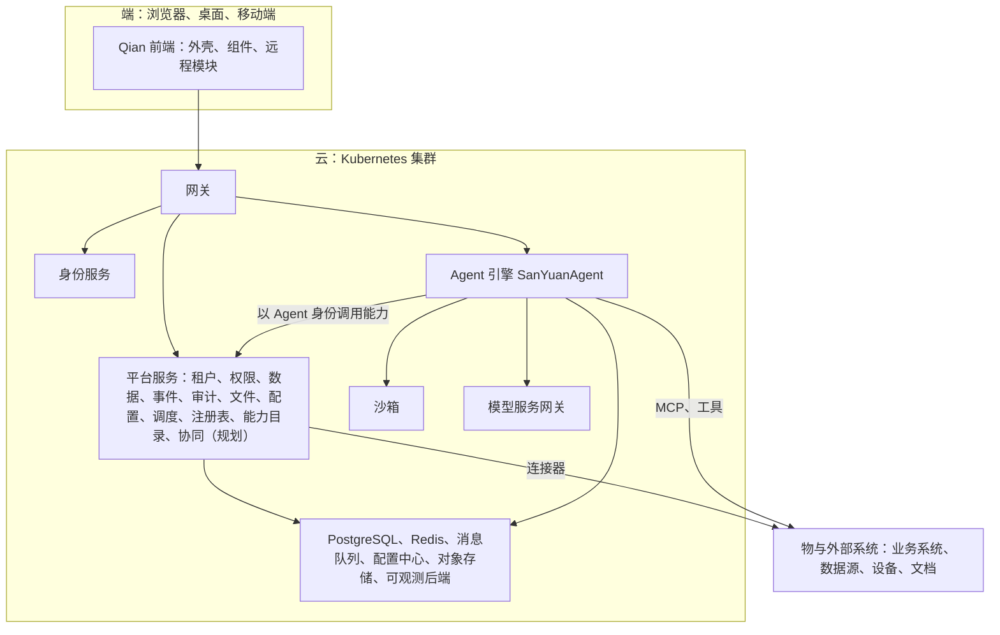

# 总体架构

> 状态：规划稿（2026-11-17）。「已有」指在来源仓库（`idadawn/kun`、`idadawn/qian`、iClaw）里已经实现，不代表已经迁入新仓库。

## 1 一张图

网关、身份服务、平台服务来自 Kun；Agent 引擎与沙箱调度来自 SanYuanAgent；浏览器里的一切来自 Qian。

## 2 三个框架的分工

| | Kun | Qian | SanYuanAgent |
|---|---|---|---|
| 一句话 | 企业级后端框架 | 前端框架 | 智能体引擎 |
| 技术栈 | .NET 10 | TypeScript、React | Python 3.12 |
| 负责 | 租户、身份、权限、数据、事件、审计、文件、配置、网关、调度；组件运行时、注册表、能力目录；Agent 的身份；协同信箱与人审流程（规划，放在 Kun 是提议，见 [Agent 协同](04-agent-collaboration.md)第 9 节） | 设计令牌、组件库、应用外壳、微前端加载、由 Schema 驱动的表单与列表；意图输入、过程展示、审核收件箱等 Agent 相关界面 | 推理循环、工具调用、技能加载、记忆、沙箱、模型路由、子 Agent 编排 |
| 不负责 | 不写 Agent 的推理循环 | 不绕过后端接口直接碰数据 | 不另存一套用户、租户、权限 |
| 对应理念 | 三元（躯体） | 三元（躯体） | 全智（心智） |

三条边界规则：

1. **业务主数据与权限以 Kun 为准。** 租户、用户、角色、能力目录、审计记录只有一份，在 Kun。
2. **SanYuanAgent 经 Kun 做事。** 它以 Agent 主体的身份查能力目录、调用能力，每次调用都经过 Kun 的权限判定并留审计。它自己的存储只放运行状态与记忆。
3. **Qian 只经公开接口与契约访问后端。** 界面里看不到的能力，后端同样拒绝。

## 3 人、机、物：主体模型

| 角色 | 平台主体 | 说明 |
|---|---|---|
| 人 | `user` | 经单点登录进入，带租户与成员身份 |
| 机：智能体 | `agent` | 归属于某个人（团队 Agent 是提议）。令牌里带委托链，写明它代表谁行事。有效权限 = 委托人的权限 ∩ 授给这个 Agent 的范围 |
| 机：服务 | `service` | 平台服务、插件、定时作业 |
| 物 | 由连接器代表 | 设备、业务系统、数据源经连接器或 MCP 服务器接入；连接器以 `service` 主体运行，能访问哪些外部地址要事先声明 |

现状：三类主体与委托链字段已经写进冻结的契约。`user` 与 `service` 已在签发；`agent` 主体与委托链还没有启用，是[路线](06-roadmap.md)里阶段 4 的第一件事。

能力可以标成「只许人做」。标了的能力不会变成 Agent 可见的工具，Agent 主体来调用也会被拒绝。这条规则已经写进能力条目的契约，强制执行随 `agent` 主体一起启用。

## 4 一次请求怎么走

几个要点：

- 外部令牌只到网关。网关之后，服务之间用网关签发的内部短期令牌，令牌里带租户、主体类型和权限范围。
- 权限判定在 Kun 的强制执行点做，入口缺省拒绝。Agent 引擎一侧另有自己的安全组件（工具策略等），它们是补充，不能代替 Kun 的判定；各自在哪些运行路径上启用，迁入时对着代码核对。
- 写业务数据和发事件在同一个事务里落库，再由后台可靠投递。审计记录按哈希链串起来，事后可以核验有没有被改。
- 错误一律是结构化的：稳定的错误码加上机器可读的细节。Agent 靠它判断下一步，不靠解析报错文字。

## 5 部署

平台跑在 Kubernetes 上。Kun 的可部署单元叫 profile：一个 profile 是一份具名的插件组装，新增一个可部署单元就是新增一个 profile 文件。

| 工作负载 | 来自 | 说明 |
|---|---|---|
| 网关 | Kun 的 `gateway` profile | 入口、外部令牌校验、内部令牌签发、限流 |
| 身份服务 | Kun 的 `identity` profile | 单点登录的签发方，可接外部身份源 |
| 平台服务 | Kun 的 `platform` profile | 租户、权限、数据、事件、审计等全部平台插件 |
| Agent 引擎 | SanYuanAgent | 独立工作负载，可按负载伸缩 |
| 沙箱 | 由 SanYuanAgent 调度 | 隔离运行 Agent 产生的代码与文件操作 |
| 前端 | Qian | 静态资源；业务页面作为远程模块按需加载 |
| 模型服务网关 | 外部组件 | 模型路由、配额与计量 |

Kun 另有 `standalone` 与 `minimal` 两个 profile：前者是单进程形态，后者只有运行时和声明式表面的装载器，其余按需加。

依赖的基础设施：PostgreSQL、Redis、消息队列、配置中心、对象存储、可观测后端。交付走 GitOps：清单在 git 里，集群按清单对齐。

云、边、端的落法是规划：同一套插件按不同 profile 装到云上集群与靠近现场的边缘节点，边缘节点处理低延迟与离线场景，定期与云端同步。

SanYuanAgent 要提供给工站、产线、工厂三级使用（已定）。三级各怎么打包、部署在云边端的哪一处，待定，见[三种形态](08-industrial-forms.md)。

## 6 横切约束

| 约束 | 做法 | 现状 |
|---|---|---|
| 多租户 | 每个请求、事件、审计记录都带租户；数据层按租户行级隔离 | 已有 |
| 零信任的服务间通信 | 网关签发内部短期令牌，服务只信内部令牌 | 已有 |
| 权限缺省拒绝 | HTTP、命令、gRPC 入口都经强制执行点 | 已有 |
| 审计可核验 | 审计记录串成哈希链 | 已有 |
| 可靠事件 | 业务数据与事件同事务落库，后台投递，消费端幂等 | 已有 |
| 统一错误模型 | 结构化错误加错误码目录 | 已有 |
| 可观测 | OpenTelemetry 的追踪、指标、日志 | 已有 |
| 密钥不落明文 | 清单、配置、日志里只出现密钥引用，使用时再解析 | 已有 |

## 7 契约

三个框架用三种语言写，靠契约协作。契约是 JSON Schema 加样例，冻结之后只做加法。

| 契约 | 管什么 | 现状 |
|---|---|---|
| 服务间令牌的字段 | 主体类型、租户、角色、权限范围、委托链 | 已冻结 |
| 事件信封 | 事件的统一外层字段 | 已冻结 |
| 结构化错误与错误码目录 | 错误的形状与全部错误码 | 已冻结 |
| 能力条目与能力目录 | 一项能力的输入输出 Schema、副作用等级、所需权限、是否对 Agent 暴露 | 已冻结 |
| 插件清单与表面格式 | 组件文件夹的布局、清单字段、各表面的文件格式 | 已有规格 |
| 表单、列表与控件的 Schema | 界面由什么数据描述 | 已有草案 |
| Agent 运行的事件流 | 步骤、工具调用、产物、最终回答 | 前端契约与引擎各有一套，还没有对齐；统一成一份契约是规划 |
| 协同消息信封与审核状态 | Agent 之间往来的消息长什么样、审核怎么流转 | 规划，见 [Agent 协同](04-agent-collaboration.md) |

契约现在随后端，合并之后也在 Kun 的仓库里。Qian 与 SanYuanAgent 从那里取，各自生成本语言的类型。

## 8 技术选型

来源仓库现在在用的：

| 层 | 选型 |
|---|---|
| 后端 | .NET 10；ASP.NET Core Minimal API 与 gRPC；EF Core；YARP（网关）；OpenIddict（身份服务） |
| 数据与中间件 | PostgreSQL、Redis、RabbitMQ、Apollo（配置中心）、S3 兼容的对象存储 |
| 前端 | React、TypeScript、Base UI、Tailwind CSS、Module Federation；pnpm 与 Turborepo |
| 智能体 | Python 3.12、LangGraph、FastAPI、LiteLLM、pgvector；uv |
| 模型服务 | Higress 与 GPUStack |
| 运行与交付 | Kubernetes（K3s）、Argo CD、Kustomize、Harbor |
| 可观测 | OpenTelemetry |

选型跟着来源仓库走，迁入过程中不借机更换。
