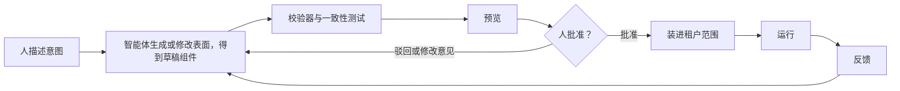

# 一切皆插件

> 状态：规划稿（2026-11-17）。组件模型在来源仓库 `idadawn/qian` 里已经成文并实现了大部分；本文是它的框架级概述，细节以那边的组件模型规格为准。名字里带 `qian` 的地方（已定）：组件 id 前缀、清单目录这些运行期字面当作历史字面保留，`qian` 命令行与 `@qian/*` 导入名本次不改；它们都不表示产品名。

## 1 原则

平台没有只能打补丁的特权内核。运行时只有一个很小的核心：上下文、服务注册、类型化事件、可撤销的副作用、装载器。租户、身份、权限、文件、配置、网关、事件、审计，以及每一个业务功能，都是插件。

- 扩展平台的方式是把一个插件挂在别的插件旁边，不是修改内核。
- 插件声明自己依赖哪些服务，依赖就绪才启动，装载顺序由依赖关系决定。
- 插件做的每一项注册都是副作用，卸载时按相反的顺序撤销。
- 任何一项能力都可以从配置里替换、按范围收窄或遮蔽。

这是智能体能发现、调用乃至生成平台能力的前提：只要存在一块只有内部人能改的内核，第三方和智能体就只能在它允许的位置扩展。

## 2 组件是什么

组件 = 一个文件夹 + 一份清单 + 若干声明式表面 + 可选的代码。它是分发与安装的单位。没有代码、只有表面的组件是常态。

```text
<组件>/
  .qian-plugin/plugin.json      清单，唯一必需的文件
  skills/<name>/SKILL.md        技能
  agents/<name>.md              子 Agent
  commands/<name>.md            给人用的命令
  hooks/hooks.json              钩子
  .mcp.json                     MCP 服务器声明
  tools/<name>.json             面向模型的工具描述
  ui/manifest.json              界面：远程模块、页面、控件
  metadata/                     权限点、角色、事件、消息类型
  forms/ lists/ flows/ pages/   业务元数据：表单、列表、流程、页面
  schemas/                      JSON Schema
  config/qian.patch.yml         配置补丁
  src/                          可选：.NET 或 TypeScript 代码
```

谈文件时叫「组件」，谈运行时叫「插件」：组件装进来、按一个条目挂进共享上下文之后，就是插件。

## 3 表面一览

表面是组件向外暴露的一类声明式内容，是组件的顶层分类。

| 表面 | 内容 | 主要由谁承接 |
|---|---|---|
| 技能 | 教 Agent 怎么做一类事：front matter 加正文，可带参考资料与脚本 | SanYuanAgent 按需加载；Kun 登记并按范围过滤 |
| 子 Agent | 一个专门角色的定义：front matter 加系统提示 | SanYuanAgent 的子 Agent 编排 |
| 命令 | 给人用的命令，不进入模型的消息 | 命令行与 Qian 的命令入口 |
| 钩子 | 在平台事件或 Agent 宿主事件上触发的动作 | Kun 的事件体系，与 Agent 宿主事件桥接 |
| MCP 服务器 | 外部工具服务的声明 | SanYuanAgent 的工具集；出网目标受 Kun 的策略约束 |
| 工具 | 面向模型的工具描述，由代码派生或手写 | Kun 的能力目录；SanYuanAgent 调用 |
| 界面 | 远程模块、页面、控件、设置卡 | Qian 的外壳按需加载 |
| 元数据 | 权限点、角色、事件、消息类型 | Kun 的权限、事件、通知各自的注册表 |
| 业务元数据 | 表单、列表、流程、页面 | Kun 存储与校验；Qian 按 Schema 渲染 |
| 配置补丁 | 对插件树里其他条目的替换、禁用或插入 | Kun 的装载器 |

所有模型看得到的东西都登记在注册表里，并且按范围过滤。被过滤掉的项既不出现在目录和提示词里，调用时也被拒绝，和不存在没有区别。

## 4 运行时的几个概念

- **上下文与服务键。** 插件经上下文拿到别的插件提供的服务，例如文件、身份、权限。服务键由定义它的包拥有。
- **能力的三个角色。** 一项能力拆成契约（接口与词汇，发成契约包）、提供方（一个或多个实现）、消费方。扩展插件只依赖契约包，不依赖具体实现。把文件存储从本地盘换成对象存储，消费方不用改。
- **事件就是扩展点。** 事件有五种分发方式：观察、环绕、并行、按序、取首个返回值。权限判定、租户校验这类强制执行点就是环绕式的监听器。
- **范围。** 任何一项注册要么是全局的，要么只属于一个范围。范围有三种：租户、应用、Agent 会话。范围内的注册遮蔽同名的全局项。租户启用一个插件，就是在自己的范围里挂上它的条目；租户定制，就是在自己的范围里做一个遮蔽注册。
- **profile、组合包与补丁。** 运行中的平台是一棵插件树，由几层按顺序叠出来：profile 列出的组合包、profile 自己的补丁、本机补丁、命令行补丁，运行中再叠上存在数据库里的租户补丁。一条命令可以把整棵树打印出来，打印出的任何条目都能被补丁替换。

## 5 安装与目录

- **一条命令安装。** 安装一个组件，就是把它的表面复制进项目、把代码部分加成包依赖、把配置条目写进当前 profile 的补丁。有对应的移除、列出、健康检查与打印配置树的命令。
- **目录市场是一份清单文件。** 市场是 git 仓库里的一个 JSON 文件，每个条目只写名字、来源（本地路径、网址、git 子目录）、安装与认证策略、分类。清单格式与校验已有；官方市场仓库、由它生成目录网站、社区发现是规划。
- **多个市场并存。** 官方市场、租户私有市场、社区市场可以同时配置。
- **应用也是组件。** 一个业务应用 = 一个组合包加一个市场条目。以后的商业市场（授权、计费、审核）叠在同一格式上，不另起格式。

## 6 用现成的生态组件

社区里已经有大量现成的 Agent 组件：技能、子 Agent、命令、钩子、MCP 服务器声明、设置片段，按类型放在文件夹里，一条命令安装，并且有开源的组件目录在汇集它们。平台的表面采用同样的文件形态，所以对接是文件对文件：

| 社区组件 | 平台里的表面 |
|---|---|
| 技能：带 front matter 的 `SKILL.md`，可带参考资料与脚本 | `skills/<name>/SKILL.md` |
| 子 Agent：front matter 加系统提示的 Markdown | `agents/<name>.md` |
| 命令：Markdown | `commands/<name>.md` |
| 钩子：JSON | `hooks/hooks.json` |
| MCP 服务器声明：JSON | `.mcp.json` |
| 设置片段 | 配置补丁 |
| 整包插件与市场清单 | 组件文件夹与目录市场条目 |

目标（已定）：开源组件目录里的组件能装进平台直接用。

企业不能把社区组件原样装进生产，所以装进来要过几道关：

1. **信任等级。** 每个组件有信任等级。社区来源的组件只接受无代码的形态，它的代码永远不进平台的共享进程。
2. **装之前看得见。** 安装前展示它包含哪些表面、要哪些权限与密钥、会访问哪些外部地址，由有权限的人确认。
3. **按租户启用。** 组件装进来不等于人人可用，租户在自己的范围里启用，谁启用的留审计。
4. **带脚本的部分不放行。** 技能目录里的脚本、命令里的内联 shell 是代码。现行规则：社区来源的组件里出现内联 shell，校验直接不过；这类脚本只在命令行、开发者本机，或平台自有组件的受限执行器里运行。放到沙箱里执行是提议，见下。

要做的事（规划）：

- 一个导入器，把社区目录的条目转成组件文件夹：补清单、定信任等级、跑校验器、列出它要的权限，并核对组件的许可与署名要求。
- 工具名的映射。社区组件里写的工具名与平台里的工具名对不上的，导入时要有对应办法。
- 统一技能的 front matter。社区规范、平台现有规格、Agent 引擎现有实现三处的字段有出入，迁入 SanYuanAgent 时要对齐成一份。
- 定下社区技能里的脚本在哪里执行。提议只在 Agent 引擎的沙箱里执行，待定。

## 7 自然语言构建：让智能体写插件

系统是一组插件，插件主要由声明式表面组成。于是「构建一个系统」可以这样走：



约束：

- 智能体产出的是草稿组件，和人写的组件走同一个校验器。
- 智能体生成的组件固定为 `private` 等级，不得带进平台共享进程的模块代码；需要代码时只能落在沙箱里的函数形态。
- 发布要人批准，发布后可以回滚。组件记录它由谁生成、依据的提示词摘要。
- 表单、列表的 Schema（已有草案）不变；流程的 Schema 与拖拽设计器都还没有实现。以后无论由设计器还是由智能体来写，产出的是同一种 Schema。

## 8 三个框架各自的落点

| 部分 | 归属 | 现状 |
|---|---|---|
| .NET 侧运行时、注册表、生命周期、profile 与补丁装载、表面校验、能力目录 | Kun | 已有 |
| TypeScript 侧运行时（应用外壳本身也是一棵插件树）、界面表面、前端插件开发包 | 待定，提议随 Qian | 已有 |
| 技能、子 Agent、钩子、MCP、工具这些 Agent 表面的执行 | SanYuanAgent | 技能加载、子 Agent 编排、MCP 客户端、工具注册表已有；从平台的插件树取表面是规划 |
| 清单规范、校验器、命令行、目录市场 | Kun。Kun 的定位里包含组件运行时、命令行与目录市场 | 清单规范、校验器、命令行已有，现在在 `idadawn/qian`；目录市场只有清单格式与校验，官方市场仓库、目录网站生成与社区发现是规划 |

SanYuanAgent 内部的可替换点（工具、记忆后端、沙箱后端、模型供应方）已经是注册表或提供方接口的形态。是否在 Python 侧实现与 .NET、TypeScript 同语义的组件运行时，待定。

## 9 待定

| 事项 | 说明 |
|---|---|
| 命令行放在哪个仓库 | 命令行属于 Kun，但它是 TypeScript 写的，现在和前端在同一个工作区。它和它用的声明式表面校验库不依赖任何前端包，提议留在 `kun`，待确认 |
| TypeScript 运行时、前端插件开发包放在哪个仓库 | 提议随 `qian`，待确认。见[仓库与归属](05-repositories.md)第 4 节 |
| Python 侧是否实现同语义的组件运行时 | 见第 8 节 |
| 社区技能的脚本在哪里执行 | 见第 6 节 |
