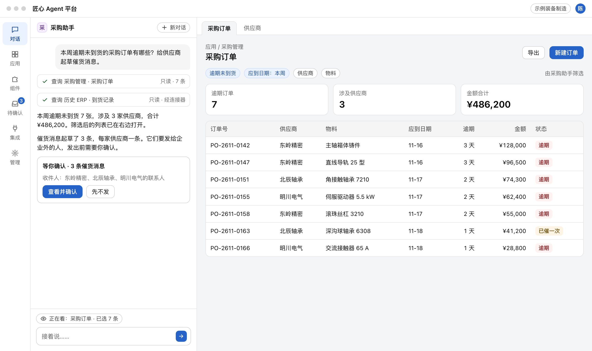
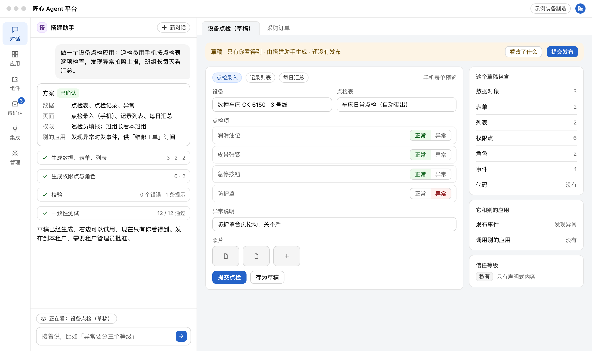
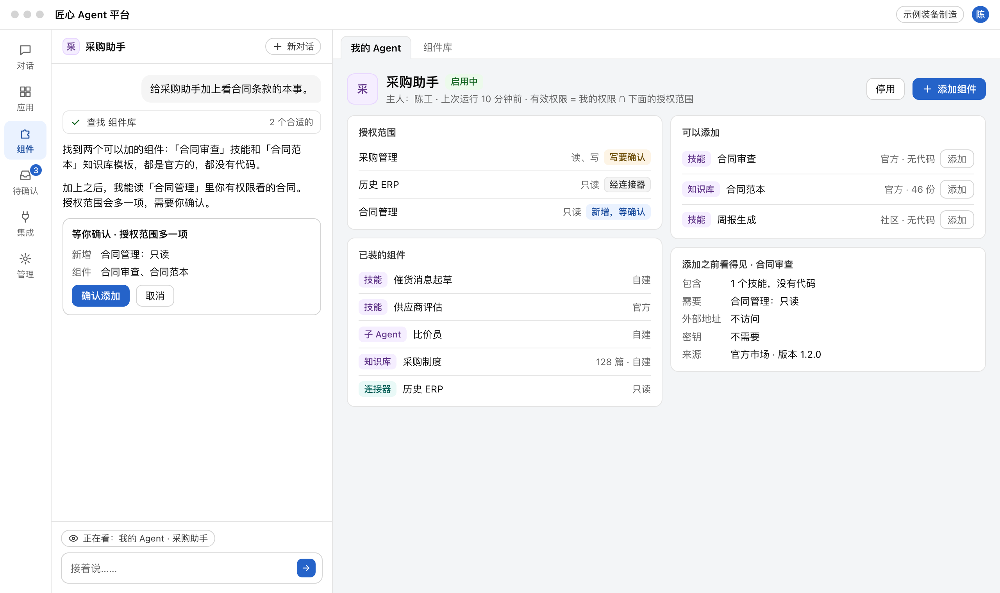
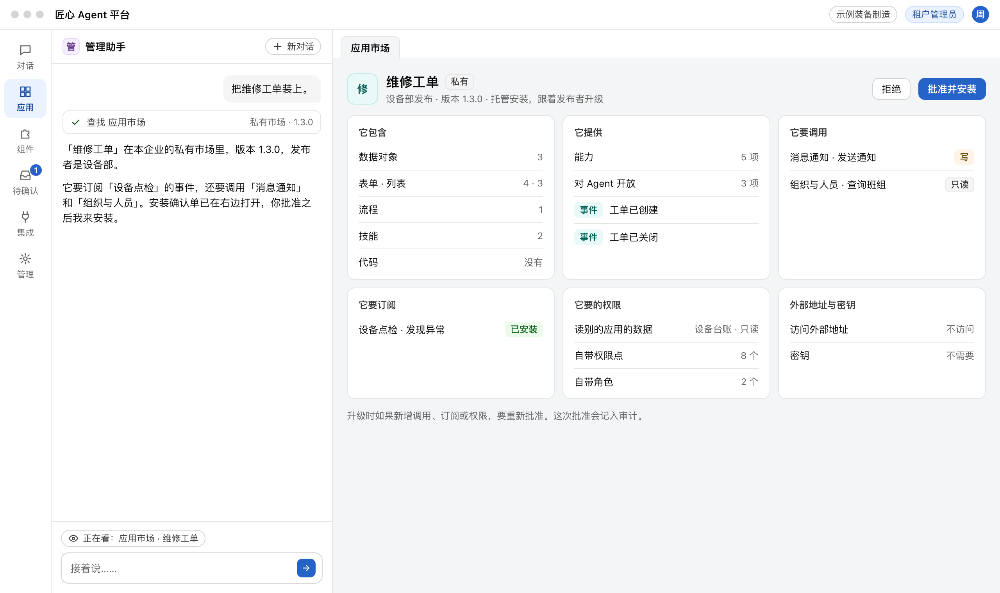
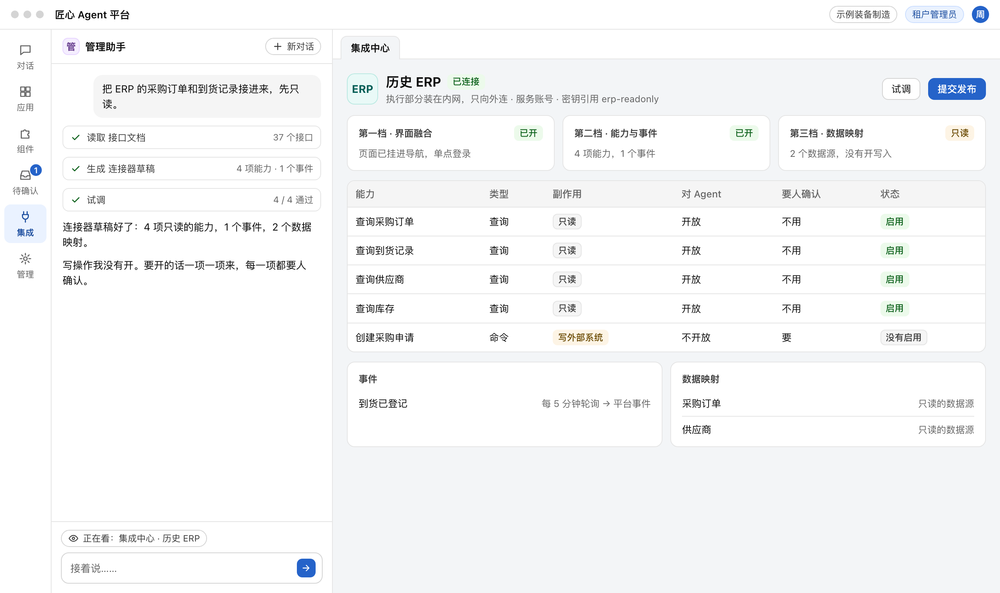
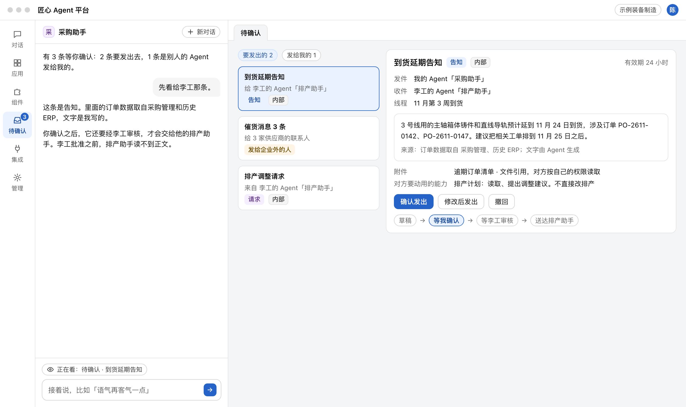

# 产品形态

> 状态：2026-11-26 重写。第 1 节列的是已定的事；其余标「提议」「待定」的没有拍板。标法见[平台做什么与设计理念](01-vision.md)开头。
>
> 本文说的管理端、工作区服务、托管的 DSH 实例、确认卡、「待确认」的页面都是规划，还没有实现。已有的是本机能跑起来的 Web 端与桌面端的原型，见第 2 节。

匠心是产品：Agent 工作区的 Web 端与桌面端、管理端、产品的插件、部署清单，代码在本仓库。它和 Kun、DSH 各管什么，见[总体架构](04-architecture.md)第 2 节。

## 1 已定

| 编号 | 定了什么 |
|---|---|
| P24 | 人用平台，入口是 Agent 工作区。企业级平台不另做一套入口 |
| P25 | 两种扩展：在企业级平台上开发业务插件；给 Agent 增加组件。平台提供基础组件，并内置智能体、知识库模板等内容；企业级平台里有应用市场 |
| P37、P38 | Agent 运行时用 DSH；界面外壳用 DSH 自己的客户端，Web 端与桌面端都是 |
| P39 | 客户可能用到两个端：Web 端和桌面端。管理端先不做，目录先建好 |
| P40 | 产品名「匠心工业智能体平台」，用匠心的 logo；产品版本号用日历版本号 |
| P57、P64 | 登录用 Kun 的身份服务。交付给客户的产品里不带另一套身份系统 |
| P60 | Kun 是通用的组件，不负责任何业务。最终的界面放在匠心，也可以放到另一个仓库 |
| P62、P63 | 每人一个 DSH 实例。桌面端的跑在各人自己的电脑上；Web 端分成管理端与按需托管的 Agent 工作区两块，放在两个域名上，托管实例每个正在用的人一个 |
| P64 | 工作区的域名由匠心的工作区服务直接接，不经过 Kun 的网关；管理端的域名过 Kun 的网关 |
| P65、P66 | 管理端也支持 Cordis，管理端的内容要能显示在 DSH 右侧的页签里。管理端只要浏览器一侧：界面是浏览器里的 Cordis 应用，页面是只有浏览器一半的 Cordis 插件 |
| P67 | 智能体生成的应用，界面只能是数据描述，由平台的渲染器画出来；生成的代码不当页面插件装 |
| P68、P69 | 等人点头的事记在平台，确认卡的点击由浏览器带着本人的登录直接交给平台。审批时模型默认不参与，人点了才让它看 |
| P71 | 「待确认」做成页面插件，DSH 的右侧和管理端装同一份 |
| P73、P74 | 标了要人确认的能力，调用方不是人本人时，平台自己不执行，等人点了才执行。等人点头的任务上的动作，缺省只能人做 |
| P75 | 确认卡的最小一圈先用替身演示，不等里程碑 M1 |
| P76 | 基础组件用 shadcn 这一套，样式用 Tailwind |
| P33、P83 | 部署有两种形态；提供多租户版和单租户版；不管哪一种，统一由管理端管理 |
| P86 | 平台上的系统，权限都走 Kun 这一套 |

P24、P25 是 2026-11-19 定的，原文里的称呼 2026-11-26 起不再用，这里换成了现在的说法，内容没有变；这样处理是整理时的读法。P24 原来还有两句，被后来的裁定改写过：客户端基于企业级框架，界面这一半 2026-11-20 改成用 DSH 的客户端（P38）；收起对话区就是企业级平台，在 DSH 的外壳下怎么落，待定。

## 2 几个端

| 端 | 是什么 | Agent 在哪里跑 | 现状 |
|---|---|---|---|
| Web 端的 Agent 工作区 | 浏览器里用 DSH 自己的客户端，和 Agent 对话、办事 | 托管在服务器上的 DSH 实例，每个正在用 Agent 的人一个，按需启动、空闲回收、有上限 | 已有：[`apps/web/`](https://github.com/CavaiLAB/jiangxin/blob/main/apps/web/README.md) 能在本机起一个单人的实例，用假模型。规划：按人托管的实例，把登录的人送进他自己实例的工作区服务 |
| Web 端的管理端 | 多人用的网页应用，不需要 DSH 实例 | 不跑 Agent | 规划。[`apps/console/`](https://github.com/CavaiLAB/jiangxin/blob/main/apps/console/README.md) 现在只有说明 |
| 桌面端 | 装在电脑上的应用，外壳也是 DSH 的客户端 | 本人电脑上的 DSH 实例 | 已有：[`apps/desktop/`](https://github.com/CavaiLAB/jiangxin/blob/main/apps/desktop/README.md) 是一个薄的 Electron 壳的原型，没有发布过。走薄壳还是从源码构建上游的桌面壳，是提议，没有定 |
| 移动端 | 没有定 | — | 待定。P39 说的是两个端 |

几条说明：

- **为什么每人一个实例。** DSH 的一个实例只有一种调用方身份，就是实例的主人；会话里没有用户和租户，设置、插件、凭据整个实例共用。所以多个人靠实例隔开（已定，P62）。
- **为什么 Web 端分两块。** 管理页面给很多人用，不该每人为它占一个实例。工作区里要渲染模型生成的内容，还要跑插件；万一被注入了脚本，不能让它带着登录态去调管理接口。所以两块放在两个域名上（已定，P63）。
- **两个端用同一份发行目录。** [`distribution/`](https://github.com/CavaiLAB/jiangxin/blob/main/distribution/README.md) 里是钉死版本的 DSH、产品的插件包和配置补丁，Web 端和桌面端都从它启动，所以跑的是同一份 DSH、同一个品牌包。
- **单机版以桌面为主**（已定，P63）。单机版指什么，见[总体架构](04-architecture.md)第 5 节。
- **没有定的。** 实例怎么隔离、凭据怎么保管、什么算空闲、上限是多少、登录以后先到哪一页、桌面端怎么连平台，都是提议或者没有问过，见 [2026-11-25 平台级裁定](decisions/2026-11-25-platform.md)第 6 节。DSH 的实例怎么和企业级平台对接，见 [DSH 与企业级平台的对接](09-dsh-integration.md)。

## 3 Agent 工作区是入口

人打开的是 Agent 工作区（已定，P24）。它的外壳是 DSH 的客户端（已定，P38）：一边是和 Agent 的对话，右侧可以打开页签。

企业级平台没有另一个要人去记的入口，它出现在三个地方：

- **右侧打开的页面。** 管理端的内容要能显示在 DSH 右侧的页签里（已定，P65）。应用、应用市场、集成、管理这些页面具体怎么放，是提议。
- **Agent 调用的平台能力。** Agent 查业务数据、办业务上的事，调的是登记在 Kun 能力目录里的能力。照已有的决策，它的有效权限不超过本人的权限与授给它的范围的交集；这一条还没有启用。DSH 自带的工具和本机的工具不在此列。
- **业务插件运行的底座。** 人开发的业务插件装在企业级平台上，装好就是能打开的应用，也是 Agent 能调用的能力。

对话和右侧是连着的，这几条是提议：

- 右侧当前的页面和选中的记录，是 Agent 的上下文。
- Agent 的结果可以落到右侧：打开页面、定位记录、给出草稿的预览。产品负责人举过的例子是「我想生成一个什么什么系统，然后在右侧可以生成界面并进行发布」（P65 的原话）；右侧显示的是渲染器按草稿画出来的界面（P67）。
- Agent 要改数据或往外发内容时，在对话里出一张确认卡，人点了才执行，见第 5 节。

### 3.1 三种用法

| 用法 | 例子 | 靠什么 |
|---|---|---|
| 办公 | 「本周逾期未到货的采购订单有哪些，给供应商起草催货消息」 | 能力目录、权限判定、确认卡 |
| 做应用 | 「做一个设备点检应用」「给采购助手加上看合同条款的本事」 | 构建闭环，见[一切皆插件](05-plugin-model.md)第 7 节 |
| 管理 | 「把维修工单装上」「把 ERP 的采购订单接进来」 | [应用互通](06-app-interop.md)、[历史系统接入](07-legacy-systems.md) |

### 3.2 导航里放什么

提议，2026-11-19 写的，早于外壳改用 DSH 的客户端。实际的导航以 DSH 的客户端为准，这六项怎么落进去没有定。

| 入口 | 里面有什么 |
|---|---|
| 对话 | 和自己的 Agent 说话。一个人有几个 Agent，在这里切换；历史会话也在这里 |
| 应用 | 租户里已经装的应用，和应用市场 |
| 组件 | 我的 Agent，它们各自的组件与授权范围，和组件库 |
| 待确认 | Agent 要发出去的、别人的 Agent 发给我的、等我批准发布的 |
| 集成 | 历史系统的连接器 |
| 管理 | 租户、成员、权限、审计、模型与用量。按权限显示 |

其中「待确认」已定做成页面插件（P71），见第 5 节。

## 4 管理端

管理端也叫管理系统，是 Web 端里不需要 DSH 实例的那一块，代码的位置是 `apps/console/`。

已定的：

- **界面不在 Kun。** Kun 只提供登录这类通用的组件，不负责业务；最终的界面放在匠心，也可以放到另一个仓库（P60）。没有新的话之前放本仓库，见第 9 节。
- **用 Cordis，只要浏览器一侧。** 界面是浏览器里的 Cordis 应用，页面是只有浏览器一半的 Cordis 插件。管理端不设多人共用的 Node 运行环境；带后端一半的插件只在各人的 DSH 实例里跑（P66）。同样的内容要能显示在 DSH 右侧的页签里（P65）。
- **入口过 Kun 的网关**（P64）。
- **管理端统一管理。** 不管哪一种部署，统一由管理端管理（已定，P83）。照整理时的读法，两种形态、两个版本用同一个管理端，模型服务也在里面管。

提议的：

- **管什么。** 租户与成员、角色与权限、模型服务、插件与应用、品牌、DSH 的实例与版本、审计。产品负责人说的场景里，管理端还有应用市场：里面是做好的应用，用自然语言生成的应用也上架到这里，见[工业智能制造](02-industrial-forms.md)第 2 节。
- **同一份页面两边都能装。** 页面做成只有浏览器一半的页面插件，DSH 的右侧和管理端各有一个很小的适配把它挂进去；页面的数据走平台的接口，不经过 DSH 实例。「待确认」这一页已定两边装同一份（P71），其余页面仍是提议。

没有定的：

- 什么时候开始做。P39 的「先不做」没有变；按 P72 定的先后，生成应用的最小一圈要用到管理端的外壳，它最晚随那一圈开始做，这是推论。
- 外壳怎么搭、页面怎么登记。
- Kun 仓库里现有的租户与成员管理页面，是在匠心重做，还是由 Kun 放开嵌入。

试过的：2026-11-25 在本机不起 DSH 进程，只用静态文件搭了一个不带对话的 Cordis 应用，把本仓库现有的插件样板和品牌包原样装进去，能用。用的是假的平台接口。

## 5 确认卡与「待确认」

Agent 要办的事里，有一些要人点头：起草的单据要落库，要往外发一条消息。平台来的审批任务也要人点头：流程走到某个人这一步。两种来路在产品里是同一样东西。

| 在哪里 | 是什么 | 依据 |
|---|---|---|
| 对话里 | 确认卡。任务来了默认只出卡片，不自动让模型读它；人点了，Agent 才去看 | P68、P69 |
| DSH 的右侧 | 「待确认」页签，列出等我点头的全部任务 | P71 |
| 管理端 | 同一份「待确认」页面，在管理端里就是待办页。对话里的卡片要 DSH 开着才有，所以这里是兜底 | P71 |

背后的规矩：

- 等人点头的事记在平台，只有一份记录；一处办了，别处一起消失（P68）。
- 确认卡的点击由浏览器带着本人的登录直接交给平台，不经过模型，也不经过 DSH 实例（P68）。
- 标了要人确认的能力，调用方不是人本人时，平台自己不执行，先生成一条等人输入的任务；人点了，平台才执行（P73）。
- 任务上的动作，比如同意、拒绝，缺省只能人做（P74）。

卡片长什么样、出现在界面的哪几处，是提议：输入框上方显示最新的一条，右侧的「待确认」页签列出全部，对话里提到某条任务时带出同一张卡。

这些都还没有实现。先做的是确认卡的最小一圈，对应里程碑 M2，先用替身演示（P72、P75），见[路线](13-roadmap.md)第 2.1 节。规则的展开见 [Agent 协同](08-agent-collaboration.md)第 4.2 节。

## 6 两种扩展

用平台的人可以自己扩展平台，有两种办法（已定，P25）：

| | 业务插件 | Agent 组件 |
|---|---|---|
| 是什么 | 在企业级平台上开发的插件 | 加在 Agent 上的组件 |
| 装上之后 | 多一个能打开的应用，Agent 也多一组能调用的能力 | 我的某个 Agent 多一样本事，比如一个技能、一个知识库 |

平台提供基础组件，并内置智能体、知识库模板等内容；企业级平台里有应用市场，做出来的应用可以上架（P25）。两种扩展里各有什么、怎么发布，见[一切皆插件](05-plugin-model.md)第 2.1、5 节；怎么动手做，见[在平台上做开发](11-development.md)。

## 7 交付给客户的是什么

- **名字与版本号。** 产品叫「匠心工业智能体平台」，用匠心的 logo。产品版本号是日历版本号：`vYYYY.M.D` 正式版，`vYYYY.M.D-N` 补丁版，`vYYYY.M.D-beta.N` 测试版，月和日不补零，构建时注入（已定，P40）。产品还没有发布过。
- **两种形态，两个版本。** 带模型推理的集群，或者不带推理、通过 API 接第三方的模型服务；提供多租户版和单租户版（已定，P33、P83）。它们怎么组合、哪几种要交付，没有定。
- **企业版与单机版。** 这是另一条线，说的是部署的规模：企业版跑在集群上，单机版一台服务器上能跑（已定的是单机版的两处例外，P58、P59，和它以桌面为主，P63）。
- **管理端统一管理。** 不管哪一种，统一由管理端管理（已定，P83）。

三条线怎么分、各装什么，见[总体架构](04-architecture.md)第 5 节。

## 8 界面示意

下面六张图是 2026-11-19 画的示意，不是最终设计。图里窗口的标题是当时对 Agent 工作区的叫法；实际的外壳是 DSH 的客户端，布局以它为准。图里的企业、人名与数据是虚构的。

**办公：问数据，办事情。** Agent 在本人的权限与授给它的范围之内查了两个地方的数据，把结果落到右侧的页面上；要发给企业外的人的消息，停在确认卡上等人点。

**做应用：一句话做应用。** Agent 先给方案，人确认之后才生成。草稿在右侧可以直接试用，旁边列出它包含什么、和别的应用有什么往来。发布要另外提交。

**给 Agent 增加组件。** 每个 Agent 有自己的授权范围和一组组件。添加组件之前，先看得见它包含什么、需要什么；授权范围变大要本人确认。

**安装确认：应用互通看得见。** 安装之前，管理员一次看清这个应用和别的应用之间的全部往来。见[应用互通](06-app-interop.md)。

**历史系统：连接器。** 一套历史系统一个连接器。三档接入各自开关；每项能力写明副作用、是否对 Agent 开放、是否要人确认；写操作缺省不开。见[历史系统接入](07-legacy-systems.md)。

**待确认：发出去之前人审。** Agent 要发出去的内容先停在这里。确认的人看得到谁发给谁、正文、数据来源、对方要动用哪些能力。见 [Agent 协同](08-agent-collaboration.md)。

## 9 待定

| 事项 | 说明 |
|---|---|
| 「收起对话区就是企业级平台」在 DSH 的外壳下怎么落 | P24 的这一句没有被取消，怎么落没有提议 |
| 导航里放什么 | 第 3.2 节是早先的提议 |
| 桌面端走哪条路 | 提议走薄壳，见 [apps/desktop 的说明](https://github.com/CavaiLAB/jiangxin/blob/main/apps/desktop/README.md)的「两条路线」 |
| 桌面端怎么连平台 | 没有问过 |
| 移动端 | 待定 |
| Web 端的细则 | 实例怎么隔离，凭据怎么保管，什么算空闲、上限是多少，所有人的工作区是不是同一个域名，登录以后先到哪一页，网页与桌面的会话通不通。都是提议 |
| 管理端什么时候开始做、外壳怎么搭、里面放哪些页面 | 见第 4 节 |
| 管理端与最终的界面放本仓库还是另一个仓库 | P60 说两处都可以。没有新的话之前放本仓库 |
| 确认卡的样子与位置 | 见第 5 节 |
| 普通用户要不要插件页 | 定了之后，再定发行配置里插件管理那几行怎么配 |
| 包名前缀 `@jx/`、放不下全称的地方用短名「匠心」 | 提议，现在的代码这样用 |
