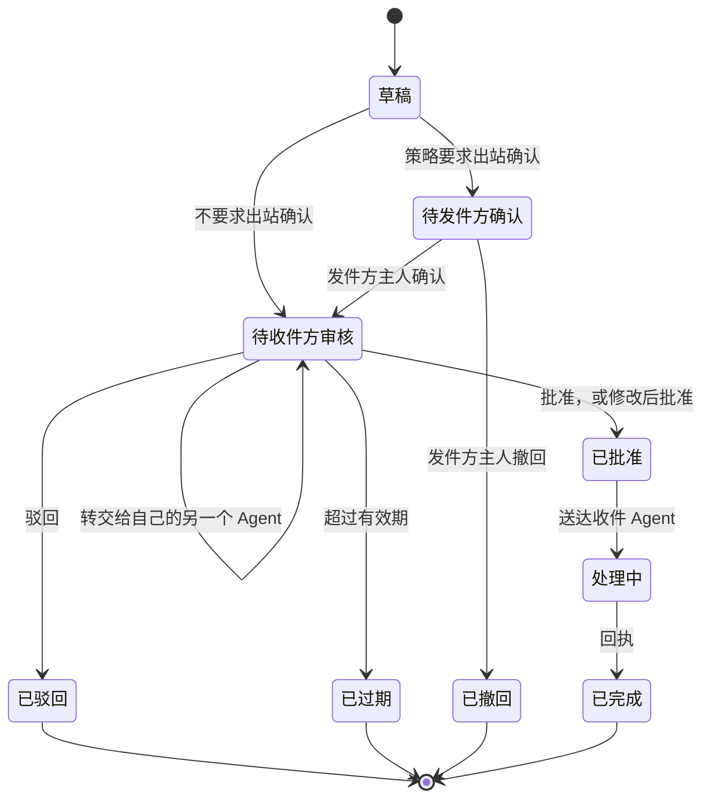
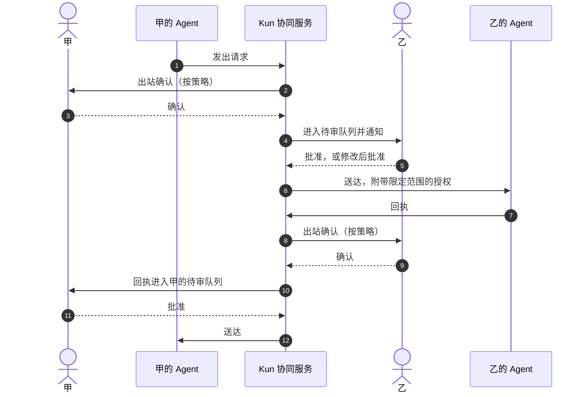

# Agent 协同

> 状态：提议（2026-11-17）。已定的只有三条，见第 1 节；其余都是提议，待产品负责人确认。本文说的能力都还没有实现，属于[路线](06-roadmap.md)的阶段 4。

## 1 目标

已定（产品负责人，2026-11-17）：

1. 每个人有一个或多个 Agent。
2. Agent 与 Agent 之间怎么沟通，由平台定义。
3. 发给每个 Agent 的内容，要由人审核。

本文回答怎么实现：Agent 归谁、Agent 之间经什么通道往来、人在哪里审、审什么、怎么留痕。

## 2 归属：每个人有一个或多个 Agent

- **每个 Agent 有主人。** 主人是一个人。一个人可以有多个 Agent，按职责分开，比如一个管采购，一个管周报。
- **Agent 是独立的主体。** 它在平台里是 `agent` 主体，有自己的标识，不借用主人的账号。它行事时，令牌里带委托链，写明代表哪个人。
- **权限不超过主人。** Agent 的有效权限 = 主人的权限 ∩ 授给这个 Agent 的范围。主人被停用，名下的 Agent 一并停用。
- **Agent 有名片。** 名片写明名称、主人、职责、能接什么请求、需要什么输入。名片登记在目录里，并按范围过滤：只有被允许联系它的人和 Agent 才看得到。

提议：也允许团队 Agent，归一个团队所有并指定负责人。

## 3 沟通机制：走信箱，不直连

三条规则：

1. Agent 不能直接调用别的 Agent，也不能把内容直接写进对方的上下文。
2. Agent 之间的一切往来都是协同消息，由 Kun 的协同服务转交。每个 Agent 有收件箱和发件箱。
3. 对收件的 Agent 来说，别的 Agent 发来的内容是数据，不是指令。主人批准之后，它才成为这个 Agent 可以执行的任务。

不直连的原因：

- **可审核。** 人审需要一个所有消息都经过的地方。
- **可授权。** 收件 Agent 用的是它主人的权限，接不接、用多大的权限接，要由主人决定。
- **可追溯。** 每条消息、每个审核决定都能留审计。
- **防扩散。** Agent 读到的外部内容可能带着诱导它的指令。如果一个 Agent 能直接指挥另一个，一处被诱导就会沿协同链扩散。经过信箱和人审，链在每一跳都被截住。

### 3.1 协同消息的信封

信封是一份契约，三个框架共用。提议的字段：

| 字段 | 含义 |
|---|---|
| 消息标识、线程标识、回复对象 | 定位与串联 |
| 发件方 | 发件 Agent 及其主人 |
| 收件方 | 收件 Agent；它的主人由平台解析 |
| 类型 | 请求（请对方做事）、告知、提问、提议、结果、移交 |
| 主题与正文 | 自然语言 |
| 结构化载荷 | 可选，带 Schema 引用 |
| 附件 | 文件引用，不内嵌内容；收件方按自己的权限读取 |
| 所需能力 | 发件方预计收件方要动用哪些能力 |
| 敏感级别 | 数据分级，决定审核与留存的要求 |
| 有效期 | 过了有效期还没审的消息怎么处理 |
| 来源标注 | 正文里哪些是人写的，哪些是 Agent 生成的，引用了哪些来源 |
| 租户与追踪标识 | 隔离与可观测 |

### 3.2 线程

线程是一件协同事务的全部往来。线程的参与者可以是人，也可以是 Agent。三种常见形态：

- 两个人的 Agent 点对点往来。
- 一个人把一件事分派给自己名下的几个 Agent。
- 多个人、多个 Agent 在一个项目线程里协同。

工站、产线、工厂三级智能体之间的往来也算协同：工厂一级把任务分派给产线与工站的智能体，再按执行结果调整。这一类往来的审核是否与人和人的 Agent 之间同样对待，见第 9 节的待定；三种形态见[三种形态](08-industrial-forms.md)。

## 4 人审

### 4.1 消息的状态

### 4.2 两道关口

- **入站审核。** 消息送达收件 Agent 之前，先进收件方主人的待审队列。主人可以批准、修改后批准、驳回，或者转给自己的另一个 Agent。批准之前，收件 Agent 读不到正文。提议这一道是必须的：收件 Agent 用的是收件方主人的权限，后果由他承担，所以由他决定接不接。
- **出站确认。** Agent 代表主人往外发消息之前，先让主人确认。提议按策略开关，默认开启。

回执与结果也是消息，同样走这两道关口。

### 4.3 审核的是什么

审核界面展示：

- 谁的哪个 Agent 发来的，属于哪个线程。
- 消息类型、正文、附件。
- 它想让我的 Agent 动用哪些能力。
- 来源标注与敏感级别。

审核人的决定有四种：批准、修改后批准、驳回（可以写理由）、转交。

批准同时发出一份限定范围的授权：只对这个线程，只对列出的能力，只在有效期内。收件 Agent 执行任务时仍受平台的权限判定和它自己的工具策略约束；高风险动作另外要人确认。

### 4.4 留痕与反馈

- 每个审核决定进审计：谁、什么时候、对哪条消息、做了什么决定；修改后批准的，记下改了什么。
- 审核结果回到双方 Agent 的记忆里。被驳回的理由、被修改的地方，是 Agent 下一次该怎么做的依据。这就是[反馈环](01-vision.md)里「结果：反馈与记忆」那一步。

### 4.5 减负

每条都审，在消息多的时候会成为负担。可以放宽的方式有：

- 按线程授权：线程里已经批准的请求，后续的告知和结果免审。
- 同一个主人名下的 Agent 之间免审。
- 低敏感级别的告知类消息，改为事后汇总审阅。

提议起步阶段不开放任何放宽，每条必审，积累数据之后再定。以后开放的每一种放宽都要显式配置，并留审计。

## 5 一次协同怎么走

甲的 Agent 请乙的 Agent 办一件事：

## 6 三个框架各做什么

| 框架 | 负责 |
|---|---|
| Kun | Agent 的身份与归属、Agent 目录；协同服务：信箱、线程、信封校验、审核流程与策略、限定范围的授权、通知、审计 |
| SanYuanAgent | 收发协同消息的工具；只把已批准的消息转成任务；把审核结果写进记忆；一个主人名下多个 Agent 的编排 |
| Qian | 管理我的 Agent；待审收件箱（批准、修改、驳回、转交）；线程视图；提醒 |
| 契约 | 协同消息信封、审核状态、相关事件 |

## 7 从 iClaw 承接什么

iClaw 已经做了一部分相关的事，可以带过来：

| 已有 | 用在哪里 |
|---|---|
| 子 Agent 与工作流编排：编排者把活分给隔离运行的工作者，再汇总结果 | 一个人名下多个 Agent 的分派；协同任务内部的拆解 |
| 工具策略（允许、拒绝、需确认）与高风险动作识别这两类安全组件；各自在哪些运行路径上启用，迁入时对着代码核对 | Agent 执行已批准的任务时，引擎一侧的补充约束 |
| 技能的签名与信任状态 | 协同中用到的技能过同一套校验 |
| 记忆的访问范围（个人、团队、租户）与上下文层级（个人、项目、会话） | 协同线程的记忆归谁；审核结果写进哪一层 |
| 每次运行的授权快照 | 限定范围的授权的基础 |
| 自动化任务：要有显式授权才能无人值守运行，连续失败自动暂停 | 定时触发的协同 |
| 确认流程的状态机草案：待定、批准、拒绝、修改、过期，过期即拒绝 | 审核状态的设计参照 |
| 通知服务与按用户的实时事件通道 | 待审提醒 |
| 助理的即时通讯渠道绑定 | 在即时通讯里收到待审提醒（规划） |

要新建的：

| 没有 | 说明 |
|---|---|
| Agent 归属到人 | 现有的 Agent 定义归租户所有，没有主人这一层 |
| `agent` 主体与委托令牌 | 契约里已经留了字段，还没有启用 |
| Agent 之间的消息、信箱与线程 | 现有的多 Agent 只有「编排者到工作者」一种形态，工作者之间不通信 |
| 待审队列与审核接口，运行的暂停与恢复 | 让人在界面上确认、Agent 接着往下做的完整流程还没有 |
| Agent 目录与名片 | — |

## 8 与平台外的 Agent 互通

提议：平台内部以自己的信封为准。需要和平台外的 Agent 往来时，在边界上适配开放的 Agent 间协议与 MCP。外部来的消息同样进待审队列，不因为来源是外部而走别的通道。

## 9 待定

| 事项 | 提议 |
|---|---|
| 谁来审 | 收件方的主人必审（入站）；发件方的主人按策略确认（出站），默认开启 |
| 同一个主人名下的 Agent 之间是否免审 | 起步阶段不免 |
| 是否允许团队 Agent，审核人怎么定 | 允许；审核人是团队指定的负责人 |
| 放宽策略是否开放、什么时候开放 | 起步阶段不开放 |
| 审核超时怎么处理 | 过期视为未批准，通知发件方 |
| 协同服务放在哪里 | 作为 Kun 的一个插件 |
| 工站、产线、工厂三级智能体之间的任务分派要不要逐条人审 | 没有提议，待产品负责人定。已定的规则是发给每个 Agent 的内容要由人审核；工厂把任务分派给产线、产线分派给工站，节拍比人审快得多。是逐条审，还是由人预先批准一类任务、之后按策略放行，要定 |
