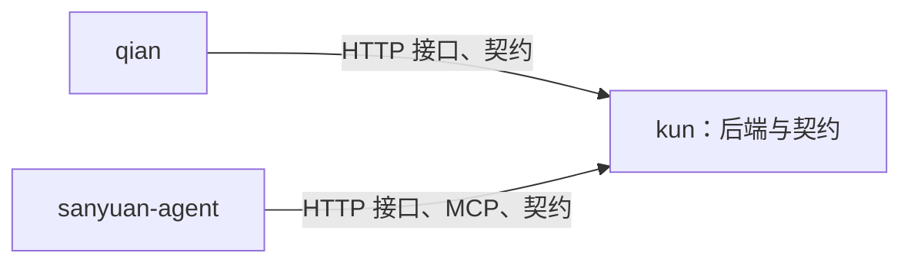

# 仓库与归属

> 状态：规划稿（2026-11-17）。数字取自 2026-11-17 的来源仓库。

以前的问题是乱：后端分在两个仓库里，Qian 精确钉住 Kun 的版本；前端、文档站、任务看板和后端挤在一个仓库，Agent 引擎又在另一个产品的仓库里。现在按「一个框架一个仓库、一种主语言」重新分，方便更多人各管一块。

## 1 新仓库

都在 [CavaiLAB](https://github.com/CavaiLAB) 组织下（已定）。

| 仓库 | 放什么 | 主语言 |
|---|---|---|
| [jiangxin](https://github.com/CavaiLAB/jiangxin) | 平台主页、理念、总体架构、路线、协作约定；把各仓库的文档聚到一起的文档站 | 文档 |
| [kun](https://github.com/CavaiLAB/kun) | 企业级后端框架 | C# |
| [qian](https://github.com/CavaiLAB/qian) | 前端框架 | TypeScript |
| [sanyuan-agent](https://github.com/CavaiLAB/sanyuan-agent) | 智能体引擎 | Python |

四个仓库已于 2026-11-17 改为公开。SanYuanAgent 的核心已于同日带历史迁入 `sanyuan-agent`；前端的框架库也已带历史导入 `qian`，名字还没有改；两个原仓库 `idadawn/kun` 与 `idadawn/qian` 也已带历史导入 `kun` 的过渡目录，还没有整理和归并；`jiangxin` 只有文档和文档站的工具。

## 2 现有代码去哪

### 2.1 并：两个后端并成 Kun

| 现在的位置 | 内容 | 去向 |
|---|---|---|
| `idadawn/kun` | 35 个 `Kun.*` 模块、示例、测试、文档 | `kun`。其中五个模块归档，不并入 |
| `idadawn/qian` 的 `packages/Qian.*` | 56 个 .NET 包项目：组件运行时、租户、身份、权限、数据、事件、审计、配置、文件、网关、调度、注册表、生命周期、profile、表面、能力目录、插件开发包 | `kun`，包名并为 `Kun.*` |
| `idadawn/qian` 的 `plugins/`、`profiles/`、`hosts/` | 39 个组件文件夹（其中 25 个还是骨架）、5 个 profile、2 个宿主 | `kun` |
| `idadawn/qian` 的 `contracts/`、`tck/`、`schemas/` | 冻结的跨服务契约、一致性测试、Schema | `kun` |

归并不是原样搬运：两边重叠的职责合成一份，合并之后共 84 个包。怎么并，见 [kun 仓库的迁移与归并](https://github.com/CavaiLAB/kun/blob/main/docs/migration.md)。

### 2.2 拆：`idadawn/qian` 的前端

| 现在的位置 | 内容 | 去向 |
|---|---|---|
| `packages/yue/` | 8 个前端包：设计令牌、界面契约、基础组件、开发包、外壳组件、数据组件、表单、业务选择器 | `qian`，更名（已定） |
| `apps/` | 应用外壳、组件靶场 | `qian`；提议 |
| `packages/qian-*` 里的运行时、插件开发包、外壳工具包 | TypeScript 运行时、前端插件开发包、外壳专有接线 | 提议随 `qian`，见第 4 节 |
| `packages/qian-*` 里的命令行与校验库 | `qian` 命令行、声明式表面的 TypeScript 校验库（命令行在用） | 提议留在 `kun`：两者不依赖任何前端包。见第 4 节 |
| `packages/qian-*` 里的界面包 | 身份页面、租户运营页面、租户开通页面。它们是平台组件自带的界面 | 待定：跟组件走还是跟前端走，见第 4 节 |
| `samples/` 里的界面部分 | 参考应用的远程模块 | 待定，同上 |

### 2.3 `idadawn/qian` 的其余部分

| 现在的位置 | 内容 | 去向 |
|---|---|---|
| `tests/`、`tools/`、`scripts/`、工作流 | 测试、工具、脚本、CI | 随 `kun`，与合并蓝图一致 |
| `docs/` | 决策清单、决策记录、需求与规格 | 现有的随 `kun`，与合并蓝图一致；跨框架的新决策提议记在 `jiangxin` |
| `deploy/` | 开发期工具的部署清单 | 随 `kun`，与合并蓝图一致 |
| `website/` | 文档站，用 Rspress 搭的：组件页、API 参考、示例、设计文档 | 继续用 Rspress（已定）。平台的文档站已经搭在 `jiangxin`；这里的内容怎么并过去待定，见第 4 节 |
| `pm/` | 任务文件与看板 | 待定，见第 4 节 |

### 2.4 拆：iClaw 里的 Agent 引擎

Python Agent 引擎迁入 `sanyuan-agent`，改名 SanYuanAgent（已定）。那个仓库的其余部分去向待定，不在这次迁入的范围里。

### 2.5 部署

部署清单和集群约定现在在单独的部署仓库里。是否在 CavaiLAB 下另建部署仓库，待定；代码迁入之前不动。

## 3 依赖方向

- `kun` 不依赖另外两个框架。跨服务的契约随 `kun`。
- `qian` 与 `sanyuan-agent` 只经运行时的接口和契约依赖 Kun 的服务，不引用 `kun` 的源码。
- `sanyuan-agent` 对 Kun 的依赖只在接入平台时才有。它是独立运行的 SDK（已定），不接平台也能用。
- 三个框架各自发包：Kun 发 NuGet 包，Qian 发 npm 包，SanYuanAgent 发 Python 包。使用方装包，不拉源码。
- 跨仓库的源码引用会把两边的构建绑在一起，一边改了另一边就坏。这是来源仓库里已经吃过的亏，新仓库不再这么做。

## 4 对已接受的合并蓝图的修订

后端的归并有一份合并蓝图：`idadawn/qian` 主干上的 `docs/adr/ADR-023-kun-qian-merge-blueprint.md`，2026-11-17 接受，裁定记在同一仓库的 `pm/tasks/S1-DEC-036.md`（D1–D14）。它按「全部并进一个仓库」来写目标布局：.NET 包、前端工作区、文档站、任务看板、契约、部署清单都在同一个仓库里，合并后的仓库写的是 `idadawn/kun`。

分成四个仓库、迁入 CavaiLAB、不再使用 Yi，是产品负责人同一天的裁定，它们改写了这份已接受的蓝图。修订项已登记为 `idadawn/qian` 的决策任务 S1-DEC-038（随 idadawn/qian#329、idadawn/qian#334 入库）。其中合并后的仓库与前端的去处已定（[平台级裁定](decisions/2026-11-17-platform.md) P20、P21），其余待产品负责人逐项确认。确认并回写之前，`idadawn/qian` 的 `AGENTS.md` 与蓝图里仍是原来的写法。

| 事项 | 蓝图的写法 | 现在的情况与提议 |
|---|---|---|
| 合并后的仓库 | `idadawn/kun`，把原 Qian 整棵树带历史导入它的一个子目录 | Kun 的家是 `CavaiLAB/kun`，迁移现在开始（已定，P20）。两个原仓库已于 2026-11-17 带历史导入；提议原仓库冻结、做完最后一次同步之后归档为只读；怎么分批见 `kun` 仓库的迁移计划 |
| 前端 | 留在后端仓库的前端工作区里，最后一批更名 | 前端有自己的仓库，现在开始迁入、在迁移中更名（已定，P21），不再等后端的最后一批 |
| TypeScript 运行时、前端插件开发包、外壳工具包 | 和前端在同一个工作区 | 提议随 `qian` |
| 命令行与声明式表面的校验库 | 同上 | 提议留在 `kun`：两者不依赖任何前端包，蓝图把命令行算在 Kun 的定位里 |
| 平台组件自带的界面、参考应用的界面 | 同上 | 待定，没有提议。跟组件走，`kun` 就要留一套前端工具链并钉前端包的版本；跟前端走，一个组件的表面就分在两个仓库里 |
| 文档站 | 随后端仓库，Kun 的文档改为同仓来源 | 继续用 Rspress，站点搭在 `jiangxin`，部署在内网（已定）。现在聚合四个仓库的框架级文档，各框架仓库的按钉住的提交取来源（做法是提议）。原文档站里的组件页、API 参考与示例迁不迁进来、怎么并，待定 |
| 决策记录 | 原 Qian 的保留编号，原 Kun 的移入子目录，新的接着编 | 现有的不变。提议跨框架的新决策记在 `jiangxin`，各框架自己的记在各自仓库 |
| 任务文件与看板 | 整体搬进后端仓库 | 待定，倾向任务跟代码走，各仓库各有任务目录，`jiangxin` 放汇总看板。见[协作约定](07-governance.md) |
| 前端包的作用域 | `@idadawn/qian-<原名>` | GitHub Packages 要求包的作用域与所有者同名。提议 `@cavailab/qian-<原名>`，名字的其余部分不变 |
| 平台档 NuGet 包的私有包源 | 在原所有者名下 | 跟所有者走，改到 CavaiLAB 名下 |
| 指向 `idadawn/qian` 的地址与历史 PR 编号 | 地址改指 `idadawn/kun`；原 Qian 的历史编号改写成带仓库名的形式 | 地址改指新仓库；原 Kun 自己的历史编号也要改写成带仓库名的形式 |
| 平台的名字 | 平台发行版不单独起名，总名另议 | 定名「匠心智能体平台」（已定） |

拆开之后的代价要记在账上：后端与前端之间又要跨仓库钉版本，蓝图里「跨层的修复在一个 PR 里完成」对前后端不再成立；外壳的真实栈端到端测试现在靠原仓库里的开发宿主工具从源码拉起后端，拆仓后要改用发布出来的镜像或包。

## 5 名字的变化

详见[术语与名称对照](glossary.md)：

- 平台的总名定为「匠心智能体平台」，此前的总名 Yi 不再使用。
- Qian 以前指基于 Kun 的平台层，现在只作前端框架的名字（原 yue）。原来叫 Qian 的后端并入 Kun。
- iClaw 的 Python Agent 引擎改名 SanYuanAgent。
- 组件 id 前缀 `qian.`、清单与配置的文件名这些运行期字面当作历史字面保留，不再表示产品名；`qian` 命令行与 `@qian/*` 导入名本次不改。

## 6 旧仓库与旧地址

- `idadawn/kun`、`idadawn/qian`：已带历史导入 `kun`。归档之前怎么收口、什么时候冻结，以 `kun` 仓库的迁移计划为准；归档为只读之后，说明文档指向新仓库。
- iClaw 仓库：只删去引擎目录并指向新仓库，其余部分的去向待定，见 2.4 节。
- 旧文档和任务文件里的 PR 编号：迁入时改写成带仓库名的完整形式，例如 `idadawn/qian#123`，避免和新仓库的编号混淆。
- `CavaiLAB/kun` 这个地址：2026-10 Kun 仓库迁到 `idadawn/kun` 之后，这个地址一直跳转过去。新的 `CavaiLAB/kun` 建立之后跳转失效。还在用旧地址取 Kun 源码的地方，要改成 `idadawn/kun`。
