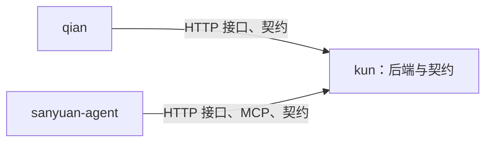

# 仓库与归属

> 状态：规划稿（2026-11-17）。数字取自 2026-11-17 的来源仓库。

以前的问题是乱：后端分在两个仓库里互相精确钉版本，前端、文档站、任务看板和后端挤在一个仓库，Agent 引擎和它的业务服务、各端应用又在另一个仓库。现在按「一个框架一个仓库、一种主语言」重新分，方便更多人各管一块。

## 1 新仓库

都在 [CavaiLAB](https://github.com/CavaiLAB) 组织下（已定）。

| 仓库 | 放什么 | 主语言 |
|---|---|---|
| [jiangxin](https://github.com/CavaiLAB/jiangxin) | 平台主页、理念、总体架构、路线、协作约定 | 文档 |
| [kun](https://github.com/CavaiLAB/kun) | 企业级后端框架 | C# |
| [qian](https://github.com/CavaiLAB/qian) | 前端框架 | TypeScript |
| [sanyuan-agent](https://github.com/CavaiLAB/sanyuan-agent) | 智能体引擎 | Python |

四个仓库现在是私有的，组织成员可读；目前只有文档。

## 2 现有代码去哪

### 2.1 并：两个后端并成 Kun

| 现在的位置 | 内容 | 去向 |
|---|---|---|
| `idadawn/kun` | 35 个 `Kun.*` 模块、示例、测试、文档 | `kun`。其中五个模块归档，不并入 |
| `idadawn/qian` 的 `packages/Qian.*` | 56 个 .NET 包项目：组件运行时、租户、身份、权限、数据、事件、审计、配置、文件、网关、调度、注册表、生命周期、profile、表面、能力目录、插件开发包 | `kun`，包名并为 `Kun.*` |
| `idadawn/qian` 的 `plugins/`、`profiles/`、`hosts/` | 41 个组件文件夹、5 个 profile、2 个宿主 | `kun` |
| `idadawn/qian` 的 `contracts/`、`tck/`、`schemas/` | 冻结的跨服务契约、一致性测试、Schema | `kun` |

归并不是原样搬运：两边重叠的职责合成一份，合并之后共 84 个包。怎么并，见 [kun 仓库的迁移与归并](https://github.com/CavaiLAB/kun/blob/main/docs/migration.md)。

### 2.2 拆：`idadawn/qian` 的前端

| 现在的位置 | 内容 | 去向 |
|---|---|---|
| `packages/yue/` | 8 个前端包：设计令牌、界面契约、基础组件、开发包、外壳组件、数据组件、表单、业务选择器 | `qian`，更名（已定） |
| `apps/` | 应用外壳、组件靶场 | `qian` |
| `packages/qian-*` 里的页面与外壳接线 | 外壳专有接线、身份页面、租户页面、租户开通页面 | `qian`；提议 |
| `samples/` 里的界面部分 | 参考应用的远程模块 | `qian`；提议 |
| `packages/qian-*` 里的运行时、插件开发包、命令行 | TypeScript 运行时、前端插件开发包、`qian` 命令行 | 待定，见第 4 节 |

### 2.3 `idadawn/qian` 的其余部分

| 现在的位置 | 内容 | 去向 |
|---|---|---|
| `website/` | 文档站 | 待定，见第 4 节 |
| `docs/` | 决策清单、决策记录、需求与规格 | 待定，见第 4 节 |
| `pm/` | 任务文件与看板 | 待定，见第 4 节 |
| `deploy/` | 开发期工具的部署清单 | 待定 |

### 2.4 拆：iClaw 里的 Agent 引擎

| 内容 | 去向 |
|---|---|
| Python Agent 引擎：核心、服务层、媒体适配层 | `sanyuan-agent`，改名 SanYuanAgent（已定） |
| C# 服务层 | 待定。与 Kun 重叠的职责（租户、身份、权限、文件、通知、网关）怎么归并，Agent 相关的业务服务（会话、Agent 定义、技能登记、模型治理、自动化）放在哪里，都还没有定 |
| 各端应用 | 待定。提议作为建在平台之上的产品继续存在 |

### 2.5 部署

部署清单和集群约定现在在单独的部署仓库里。是否在 CavaiLAB 下另建部署仓库，待定；代码迁入之前不动。

## 3 依赖方向

- `kun` 不依赖另外两个框架。跨服务的契约随 `kun`。
- `qian` 与 `sanyuan-agent` 只经运行时的接口和契约依赖 Kun 的服务，不引用 `kun` 的源码。
- 三个框架各自发包：Kun 发 NuGet 包，Qian 发 npm 包，SanYuanAgent 发 Python 包。使用方装包，不拉源码。
- 跨仓库的源码引用会把两边的构建绑在一起，一边改了另一边就坏。这是来源仓库里已经吃过的亏，新仓库不再这么做。

## 4 与合并蓝图的出入

后端的归并有一份合并蓝图，写于决定分仓库之前。它按「全部并进一个仓库」来写目标布局：.NET 包、前端工作区、文档站、任务看板、契约、部署清单都在同一个仓库里。现在前端单独一个仓库，又多了平台总览仓库，下面几项要重定：

| 事项 | 蓝图的写法 | 提议 |
|---|---|---|
| 合并后的仓库 | `idadawn/kun` | 改为 `CavaiLAB/kun`（已定） |
| 前端 | 留在后端仓库的前端工作区里，最后一批更名 | 最后一批更名时一并迁入 `qian` 仓库 |
| TypeScript 运行时、前端插件开发包、命令行 | 和前端在同一个工作区 | 运行时与前端插件开发包随 `qian`；命令行属于 Kun 的组成部分，但它是 TypeScript 写的，放 `kun` 还是 `qian`，待定 |
| 文档站、决策记录与规格 | 随后端仓库 | 框架内的随各框架；平台级的放 `jiangxin`；文档站放哪里待定 |
| 任务文件与看板 | 整体搬进后端仓库 | 待定，见[协作约定](07-governance.md) |
| 前端的包名前缀 | 跟原所有者 | 所有者换成 CavaiLAB 之后前缀要重定 |

## 5 名字的变化

详见[术语与名称对照](glossary.md)：

- 平台的总名定为「匠心智能体平台」，此前的总名 Yi 不再使用。
- Qian 以前指基于 Kun 的平台层，现在只作前端框架的名字（原 yue）。原来叫 Qian 的后端并入 Kun。
- NeuroAgent 改名 SanYuanAgent。
- 组件 id 前缀 `qian.`、清单与配置的文件名、`qian` 命令行这些字面保留不改，它们只是历史字面，不再表示产品名。

## 6 旧仓库与旧地址

- `idadawn/kun`、`idadawn/qian` 和 iClaw 仓库：对应部分迁入完成之前照常开发；迁入完成之后归档为只读，说明文档指向新仓库。
- 旧文档和任务文件里的 PR 编号：迁入时改写成带仓库名的完整形式，例如 `idadawn/qian#123`，避免和新仓库的编号混淆。
- `CavaiLAB/kun` 这个地址：2026-10 Kun 仓库迁到 `idadawn/kun` 之后，这个地址一直跳转过去。新的 `CavaiLAB/kun` 建立之后跳转失效。还在用旧地址取 Kun 源码的地方，要改成 `idadawn/kun`。
