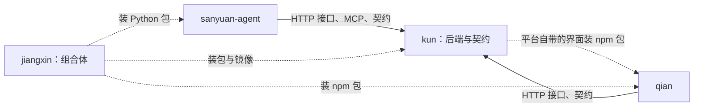

# 仓库与归属

> 状态：规划稿（2026-11-17）。数字取自 2026-11-17 的来源仓库。
>
> 2026-11-19 补：`jiangxin` 仓库就是组合体（已定，[2026-11-19 平台级裁定](decisions/2026-11-19-platform.md) P23），见第 1.1 节。

以前的问题是乱：后端分在两个仓库里，平台层精确钉住框架的版本；前端、文档站、任务看板和后端挤在一个仓库，Agent 引擎又在另一个产品的仓库里。现在按「一个框架一个仓库、一种主语言」重新分，方便更多人各管一块。

## 1 新仓库

都在 [CavaiLAB](https://github.com/CavaiLAB) 组织下（已定）。

| 仓库 | 放什么 | 主语言 |
|---|---|---|
| [jiangxin](https://github.com/CavaiLAB/jiangxin) | 组合体：把 Agent 框架与企业级框架拼成一个产品（已定，2026-11-19；内容是规划，见第 1.1 节）。同时是平台主页与文档站：理念、总体架构、路线、协作约定，以及把各仓库的文档聚到一起的站点 | 现在只有文档 |
| [kun](https://github.com/CavaiLAB/kun) | 企业级后端框架 | C# |
| [qian](https://github.com/CavaiLAB/qian) | 前端框架 | TypeScript |
| [sanyuan-agent](https://github.com/CavaiLAB/sanyuan-agent) | 智能体引擎 | Python |

四个仓库已于 2026-11-17 改为公开。SanYuanAgent 的核心已于同日带历史迁入 `sanyuan-agent`；前端的框架库也已带历史导入 `qian`，发布了 0.2.0；后端的两个来源仓库也已带历史迁入 `kun`，同日归档为只读；`Kun.*` 已提到仓库根，其余还在过渡目录 `_import/qian/`，归并还没有做；`jiangxin` 只有文档和文档站的工具。

### 1.1 组合体

已定（[2026-11-19 平台级裁定](decisions/2026-11-19-platform.md) P23、P24）：

- 平台开发交付两样东西，一个 Agent 框架，一个企业级应用平台。最终是一体化的产品，`jiangxin` 仓库就是组合体。
- 最终用户的使用界面是 Agent 平台，它的客户端基于企业级框架。企业级应用平台不另做一套入口。

主页与文档站照旧在 `jiangxin`。组合体里放什么是提议：

| 放什么 | 说明 |
|---|---|
| Agent 平台的客户端 | 三栏的工作台，网页、桌面、移动三种端。界面用 `qian` 发布的包搭，身份、权限、应用与能力来自 `kun`，智能来自 `sanyuan-agent`。见[角色与产品形态](09-roles-and-product.md)第 4 节 |
| 产品的组装 | 整套产品由哪些组件组成；哪个版本的 Kun 配哪个版本的 Qian 与 SanYuanAgent，即[协作约定](07-governance.md)第 7 节的版本矩阵 |
| 两种交付版本的装配 | 多租户的版本与单租户的版本各装什么，见[总体架构](02-architecture.md)第 5.1 节 |
| 端到端的验收 | 把三个框架装在一起跑的测试，例如路线里每个里程碑的完成标志 |

组合体只装三个框架发布出来的包与镜像，不引用它们的源码；三个框架都不依赖组合体。这一条照第 3 节的规矩，是提议。

待定：

| 事项 | 提议 |
|---|---|
| 现有的应用外壳怎么并进 Agent 平台的客户端 | 应用外壳现在在 `kun`，是平台自己的界面应用，见第 2.2 节。提议：它里面通用的部分（会话、启动聚合、能力导航、按需装载页面）留在企业级框架里，以包的形式发布；Agent 平台的客户端在 `jiangxin` 里用这些包组装 |
| 组合体的代码什么时候进 `jiangxin` | 里程碑 M1 开始，见[路线与迁移](06-roadmap.md)第 2.1 节 |
| 内置内容（智能体模板、知识库模板、应用模板、连接器模板）放在哪 | 没有提议。官方市场仓库本身还是规划，见[一切皆插件](03-plugin-model.md)第 5 节 |
| 部署清单放在哪 | 没有提议，随第 2.5 节一起定 |

## 2 现有代码去哪

后端的两个来源仓库已于 2026-11-17 带历史迁入 `kun`：`Kun.*` 已提到仓库根，文档与决策记录也已整理进 `docs/`；其余在过渡目录 `_import/qian/` 下。第 2.1 节表里「现在的位置」是 `kun` 里的路径，第 2.3 节的是 `_import/qian/` 下的路径。

### 2.1 并：两个后端并成 Kun

| 现在的位置 | 内容 | 去向 |
|---|---|---|
| 仓库根 | 35 个 `Kun.*` 模块、示例、测试、文档 | `kun`。其中五个模块归档，不并入 |
| `_import/qian/packages/Qian.*` | 56 个 .NET 包项目：组件运行时、租户、身份、权限、数据、事件、审计、配置、文件、网关、调度、注册表、生命周期、profile、表面、能力目录、插件开发包 | `kun`，包名并为 `Kun.*` |
| `_import/qian/` 下的 `plugins/`、`profiles/`、`hosts/` | 39 个组件文件夹（其中 25 个还是骨架）、5 个 profile、2 个宿主 | `kun` |
| `_import/qian/` 下的 `contracts/`、`tck/`、`schemas/` | 冻结的跨服务契约、一致性测试、Schema | `kun` |

归并不是原样搬运：两边重叠的职责合成一份，合并之后共 84 个包。怎么并，见 [kun 仓库的迁移与归并](https://github.com/CavaiLAB/kun/blob/main/docs/migration.md)。

### 2.2 拆：后端仓库里的前端

范围已定：只迁框架库（产品负责人 2026-11-17 选定）。框架库已于同日迁入 `qian`；平台自己的界面应用留在后端，已改为装 `qian` 发布的包（按版本目录钉在 0.2.1），后端仓库里不再留框架库的源码。逐条路径见 qian 仓库的[迁移文档](https://github.com/CavaiLAB/qian/blob/main/docs/migration.md)第 2 节。

| 内容 | 现在在哪 |
|---|---|
| 8 个层包：设计令牌、界面契约、基础组件、开发包、外壳组件、数据组件、表单、业务选择器 | `qian` 的 `packages/qian/`，包名 `@cavailab/qian-<名>` |
| 组件靶场：组件演练场，也是可访问性、首屏性能与视觉回归的靶场 | `qian` |
| TypeScript 运行时、前端插件开发包 | `qian`，包名 `@cavailab/qian-runtime`、`@cavailab/qian-plugin-sdk` |
| 应用外壳，平台自己的界面应用 | `kun` |
| 外壳工具包：应用外壳对接平台的专有接线 | `kun` |
| `qian` 命令行、声明式表面的 TypeScript 校验库（命令行在用） | `kun`：两者不依赖任何前端包 |
| 界面包：身份页面、租户运营页面、租户开通页面，是平台组件自带的界面 | `kun`：它们是平台自己的界面应用，不是框架库 |
| 参考应用的远程模块 | `kun`，同上 |

2026-11-19 补：最终用户的入口是 Agent 平台（已定）。上表里的应用外壳怎么并进 Agent 平台的客户端，待定，见第 1.1 节；定下来之前，它照旧在 `kun`。

### 2.3 过渡目录 `_import/qian/` 里的其余部分

| 现在的位置 | 内容 | 去向 |
|---|---|---|
| `tests/`、`tools/`、`scripts/`、工作流 | 测试、工具、脚本、CI | 随 `kun`，与合并蓝图一致 |
| `docs/` | 决策清单、决策记录、需求与规格 | 现有的随 `kun`，与合并蓝图一致；跨框架的新决策提议记在 `jiangxin` |
| `deploy/` | 开发期工具的部署清单 | 随 `kun`，与合并蓝图一致 |
| `website/` | 文档站，用 Rspress 搭的：组件页、API 参考、示例、设计文档 | 先留在后端，随 `kun`（已定，前端只迁框架库）。继续用 Rspress（已定）。前端组件页由该站按 `qian` 的发布标签生成定稿（已定，2026-11-20）。其余 API 参考与示例的归属见第 4 节 |
| `pm/` | 任务文件与看板 | 待定，见第 4 节 |

### 2.4 拆：私有产品里的 Agent 引擎

Python Agent 引擎迁入 `sanyuan-agent`，即 SanYuanAgent（已定）。那个私有仓库的其余部分去向待定，不在这次迁入的范围里。

### 2.5 部署

部署清单和集群约定现在在单独的部署仓库里。是否在 CavaiLAB 下另建部署仓库，待定；代码迁入之前不动。

## 3 依赖方向

- Kun 的框架包不依赖另外两个框架。跨服务的契约随 `kun`。
- `jiangxin` 作为组合体，按钉住的版本装三个框架发布出来的包与镜像，不引用它们的源码；三个框架都不依赖 `jiangxin`（提议，见第 1.1 节）。
- 留在 `kun` 仓库里的平台自带界面（应用外壳、组件自带的界面、参考应用的界面）按钉住的版本装 `qian` 发布的 npm 包，不引用 `qian` 的源码，见第 2.2 节。
- `qian` 与 `sanyuan-agent` 只经运行时的接口和契约依赖 Kun 的服务，不引用 `kun` 的源码。
- `sanyuan-agent` 对 Kun 的依赖只在接入平台时才有。它是独立运行的 SDK（已定），不接平台也能用。
- 三个框架各自发包：Kun 发 NuGet 包，Qian 发 npm 包，SanYuanAgent 发 Python 包。使用方装包，不拉源码。
- 跨仓库的源码引用会把两边的构建绑在一起，一边改了另一边就坏。这是来源仓库里已经吃过的亏，新仓库不再这么做。

## 4 对已接受的合并蓝图的修订

后端的归并有一份合并蓝图：`kun` 过渡目录里的 [`_import/qian/docs/adr/ADR-023-kun-qian-merge-blueprint.md`](https://github.com/CavaiLAB/kun/blob/71cbd5b4fb8f9f813684940a192ca15ea5feaac3/_import/qian/docs/adr/ADR-023-kun-qian-merge-blueprint.md)，2026-11-17 接受，裁定记在同一目录的 [`_import/qian/pm/tasks/S1-DEC-036.md`](https://github.com/CavaiLAB/kun/blob/71cbd5b4fb8f9f813684940a192ca15ea5feaac3/_import/qian/pm/tasks/S1-DEC-036.md)（D1–D14）。它按「全部并进一个仓库」来写目标布局：.NET 包、前端工作区、文档站、任务看板、契约、部署清单都在同一个仓库里。

分成四个仓库、迁入 CavaiLAB、定下平台的总名，是产品负责人同一天的裁定，它们改写了这份已接受的蓝图。修订项已登记为决策任务 S1-DEC-038，在 `kun` 的 `_import/qian/pm/tasks/` 下。其中合并后的仓库与前端的去处已定（[平台级裁定](decisions/2026-11-17-platform.md) P20、P21），其余待产品负责人逐项确认。确认并回写之前，蓝图里没有确认的各项仍是原来的写法。

| 事项 | 蓝图的写法 | 现在的情况与提议 |
|---|---|---|
| 合并后的仓库 | Kun 当时所在的仓库，把平台层整棵树带历史导入它的一个子目录 | Kun 的家是 `CavaiLAB/kun`，迁移现在开始（已定，P20）。两个来源仓库已于 2026-11-17 带历史导入，同日冻结、归档为只读，最后一次同步也已合入 `kun`；之后怎么分批整理与归并，见 `kun` 仓库的迁移计划 |
| 前端 | 留在后端仓库的前端工作区里，放在最后一批 | 前端有自己的仓库，现在开始迁入（已定，P21），不再等后端的最后一批。范围只迁框架库（已定，产品负责人 2026-11-17 选定）；框架库已于同日迁入 `qian` |
| TypeScript 运行时、前端插件开发包、外壳工具包 | 和前端在同一个工作区 | 运行时与插件开发包算框架库，已随 `qian`；外壳工具包是应用外壳对接平台的专有接线，留在后端 |
| 命令行与声明式表面的校验库 | 同上 | 留在后端，随 `kun`：两者不依赖任何前端包，蓝图把命令行算在 Kun 的定位里 |
| 平台组件自带的界面、参考应用的界面 | 同上 | 留在后端，随 `kun`：它们是平台自己的界面应用，不是框架库。代价是 `kun` 要留一套前端工具链，并钉前端包的版本 |
| 文档站 | 随后端仓库，Kun 的文档改为同仓来源 | 继续用 Rspress，站点搭在 `jiangxin`，部署在内网（已定）。现在聚合四个仓库的框架级文档，各框架仓库的按钉住的提交取来源（做法是提议）。原文档站先留在后端仓库（已定，前端只迁框架库）；Qian 组件页继续由组件站按前端仓库发布标签生成定稿，其他 API 参考与示例如何并入平台站待定 |
| 决策记录 | 平台层的保留编号，Kun 自己的移入子目录，新的接着编 | 现有的不变。提议跨框架的新决策记在 `jiangxin`，各框架自己的记在各自仓库 |
| 任务文件与看板 | 整体搬进后端仓库 | 待定，倾向任务跟代码走，各仓库各有任务目录，`jiangxin` 放汇总看板。见[协作约定](07-governance.md) |
| 前端包的作用域 | 跟着当时的所有者 | GitHub Packages 要求包的作用域与所有者同名，现在用 `@cavailab`，包名是 `@cavailab/qian-<名>`；0.2.0 起都在这个作用域下发布 |
| 平台档 NuGet 包的发布位置 | 在当时的所有者名下 | 首个合并版的包发在 CavaiLAB 的公开 GitHub Packages，并关联 `CavaiLAB/kun` |
| 指向来源仓库的地址与历史 PR 编号 | 地址改指合并后的仓库；平台层的历史编号改写成带仓库名的形式 | 地址改指新仓库；Kun 自己的历史编号也要改写成带仓库名的形式 |
| 平台的名字 | 平台发行版不单独起名，总名另议 | 定名「匠心智能体平台」（已定） |

拆开之后的代价要记在账上：后端与前端之间又要跨仓库钉版本，蓝图里「跨层的修复在一个 PR 里完成」对前后端不再成立；外壳的真实栈端到端测试现在靠开发宿主工具从源码拉起后端，拆仓后要改用发布出来的镜像或包。

2026-11-19 的平台级裁定另有几处与过渡目录里已接受的决策记录有出入：加 Agent 一级的范围、新增知识库这种内容、设计器缓做、智能体主体提前启用。它们列在 [2026-11-19 平台级裁定](decisions/2026-11-19-platform.md)第 4 节，已登记进 S1-DEC-038（D22–D26）。

## 5 名字

平台叫「匠心智能体平台」；后端框架叫 Kun，前端框架叫 Qian，智能体引擎叫 SanYuanAgent（已定）。各指什么见[术语表](glossary.md)。

组件 id 前缀 `qian.`、清单与配置的文件名这些运行期字面保留不改，不表示产品名；`qian` 命令行与 `@qian/*` 导入名暂不改。

## 6 来源仓库

- 后端的两个来源仓库：已于 2026-11-17 归档为只读，说明文档指向新仓库；归档时的内容已由最后一次同步带进 `kun`。
- 引擎原来所在的私有仓库：只删去引擎目录并指向新仓库，其余部分的去向待定，见 2.4 节。
- 迁入的旧文档和任务文件里的 PR 编号，改写成带仓库名的完整形式，避免和新仓库的编号混淆。
