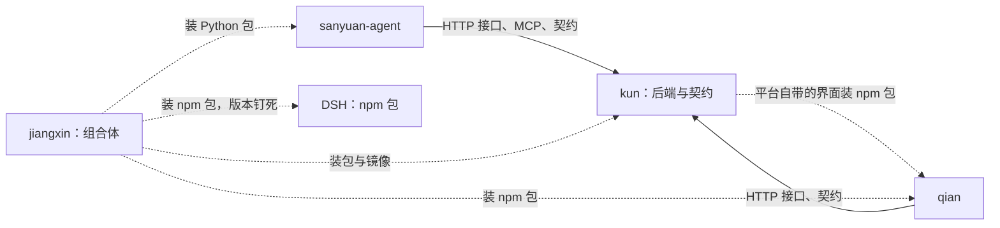

# 仓库与归属

> 状态：规划稿（2026-11-17）。数字取自 2026-11-17 的来源仓库。
>
> 2026-11-19 补：`jiangxin` 仓库就是组合体（已定，[2026-11-19 平台级裁定](decisions/2026-11-19-platform.md) P23），见第 1.1 节。
>
> 2026-11-20 补：Agent 运行时与界面外壳改用 DSH，组合体的代码放进 `jiangxin`（已定，[2026-11-20 产品裁定](decisions/2026-11-20-product.md) P37 至 P41）。第 1.1 节按这几条改写过。
>
> 2026-11-24 更新：第 2 节列出 Kun 归并后的路径，以及当前稳定版的包源和安装入口。导入时的布局另注明日期。
>
> 2026-11-24 补：平台名统一为「匠心工业智能体平台」；产品族的所有者、新决策记录的位置、任务与看板、组件站的其余内容、前端包的作用域已定；SanYuanAgent 暂缓开发，现在使用 DSH（已定，[2026-11-24 平台级裁定](decisions/2026-11-24-platform.md) P45、P48 至 P53）。第 1、1.1、2.4、4、5 节按这几条改写过。
>
> 2026-11-25 补：Kun 与匠心各管什么、部署清单放哪、每人一个 DSH 实例、Web 端的形状已定（[2026-11-25 平台级裁定](decisions/2026-11-25-platform.md) P60 至 P64）。第 1.1、2.5 节按这几条标注过。

以前的问题是乱：后端分在两个仓库里，平台层精确钉住框架的版本；前端、文档站、任务看板和后端挤在一个仓库，Agent 引擎又在另一个产品的仓库里。现在按「一个框架一个仓库、一种主语言」重新分，方便更多人各管一块。

## 1 新仓库

都在 [CavaiLAB](https://github.com/CavaiLAB) 组织下（已定）。产品族的所有者是 CavaiLAB（2026-11-24 定，P48）。

| 仓库 | 放什么 | 主语言 |
|---|---|---|
| [jiangxin](https://github.com/CavaiLAB/jiangxin) | 组合体：把 Agent 框架与企业级框架拼成一个产品（已定，2026-11-19），现在放的是基于 DSH 的匠心工业智能体平台（2026-11-20，见第 1.1 节）。同时是平台主页与文档站：理念、总体架构、路线、协作约定，以及把各仓库的文档聚到一起的站点 | 文档；组合体的代码是 TypeScript 与 JavaScript |
| [kun](https://github.com/CavaiLAB/kun) | 企业级后端框架 | C# |
| [qian](https://github.com/CavaiLAB/qian) | 前端框架 | TypeScript |
| [sanyuan-agent](https://github.com/CavaiLAB/sanyuan-agent) | 智能体引擎 | Python |

四个仓库已于 2026-11-17 改为公开。SanYuanAgent 的核心已于同日带历史迁入 `sanyuan-agent`；前端的框架库也已带历史导入 `qian`，发布了 0.2.0；后端的两个来源仓库也已带历史迁入 `kun`，同日归档为只读；Kun 已完成按域归并，当前目录见第 2 节；`jiangxin` 里是文档、文档站的工具，以及 2026-11-20 放进来的组合体代码（P41）。

### 1.1 组合体

已定（[2026-11-19 平台级裁定](decisions/2026-11-19-platform.md) P23、P24）：

- 平台开发交付两样东西，一个 Agent 框架，一个企业级应用平台。最终是一体化的产品，`jiangxin` 仓库就是组合体。
- 最终用户的使用界面是 Agent 平台，它的客户端基于企业级框架。企业级应用平台不另做一套入口。这一条 2026-11-20 被部分取代，见下。

已定（[2026-11-20 产品裁定](decisions/2026-11-20-product.md) P37 至 P41）：

- Agent 运行时用 DSH（P37）。界面外壳用 DSH 自己的客户端，网页与桌面都是；Qian 冻结在 0.2.1，组件以后缺哪个，按 DSH 的写法迁进自己的界面包（P38）。
- 客户可能用到两个端：Web 端和客户端（桌面）。管理端先不做，目录先建好（P39）。
- 产品名「匠心工业智能体平台」，用匠心的 logo，产品版本号用日历版本号（P40）。
- 这批产品代码放进 `jiangxin`（P41）。

由此，P24 里「客户端基于企业级框架」和据它写的「界面用 Qian 搭」被部分取代，这里原来的几条提议也跟着改写。逐条见那份裁定的第 2 节，没定的事在它的第 3 节。

已定（[2026-11-25 平台级裁定](decisions/2026-11-25-platform.md) P60 至 P64）：

- Kun 是通用的组件，不负责任何业务。匠心首先是一套企业级的管理系统加 Agent；最终的界面放在匠心，也可以放到另一个仓库（P60）。
- 产品的部署清单放本仓库的 `deploy/`，各环境的差异留在部署仓库（P61，产品负责人交给蓝图的整理者定下的）。目录还没有建。
- 每人一个 DSH 实例，客户端（桌面）的跑在各人自己的电脑上（P62）。Web 端分成管理系统与按需托管的 Agent 工作区两块；把登录的人送进他自己的实例，由匠心的工作区服务做，它直接接工作区的域名（P63、P64）。管理系统与工作区服务都还没有实现。

主页与文档站照旧在 `jiangxin`。组合体里现在有的东西都在仓库根下，都还没有发布过：

| 目录 | 放什么 | 约定的入口 |
|---|---|---|
| `distribution/` | 发行目录，Web 端和桌面客户端共用：钉死版本的 DSH（`0.2.2-rc.5`）、以 tarball 装入的品牌包与插件包、按文件名叠加的配置补丁、启动器和启动前检查 | [distribution/README.md](https://github.com/CavaiLAB/jiangxin/blob/main/distribution/README.md)，用 npm |
| `apps/web/` | Web 端：启动脚本，放在反向代理后面的配置与验证 | [apps/web/README.md](https://github.com/CavaiLAB/jiangxin/blob/main/apps/web/README.md) |
| `apps/desktop/` | 客户端（桌面）：一个薄的 Electron 壳的原型，里面跑发行目录里的 DSH | [apps/desktop/README.md](https://github.com/CavaiLAB/jiangxin/blob/main/apps/desktop/README.md)，用 npm |
| `apps/console/` | 管理端，先不做，目录占位（P39） | [apps/console/README.md](https://github.com/CavaiLAB/jiangxin/blob/main/apps/console/README.md) |
| `packages/` | 品牌包 `@jx/brand-theme`；企业插件的样板 `@jx/enterprise-workbench`，数据是假的；界面组件包 `@jx/ui-kit`，按 DSH 的写法迁组件的地方 | [packages/README.md](https://github.com/CavaiLAB/jiangxin/blob/main/packages/README.md)，各包各用 pnpm |
| `tests/egress/` | 外联检查：在不通外网的容器网络里看实例想连哪些地址 | [tests/egress/README.md](https://github.com/CavaiLAB/jiangxin/blob/main/tests/egress/README.md) |
| `tools/mock-model/` | 本机的假模型服务，本机试用和测试不需要真的模型与密钥 | [tools/mock-model/README.md](https://github.com/CavaiLAB/jiangxin/blob/main/tools/mock-model/README.md) |
| `patches/` | 对 DSH 源码的改动，一处一个补丁文件。现在只有两个样例 | [patches/README.md](https://github.com/CavaiLAB/jiangxin/blob/main/patches/README.md) |
| `contracts/` | 以后从后端契约生成的类型，占位 | [contracts/README.md](https://github.com/CavaiLAB/jiangxin/blob/main/contracts/README.md) |
| `brand/` | 匠心 logo 的原图 | [brand/README.md](https://github.com/CavaiLAB/jiangxin/blob/main/brand/README.md) |

做法上的几条：我们的东西只有自己写的插件包和叠在 DSH 配置上的补丁，不改 DSH 的源码，绕不过去的改动一处一个补丁放进 `patches/`；DSH 的版本钉死，不写范围；以后直接引用 DSH 内部接口的代码收进一个包（提议名 `dsh-compat`），其余的包只引用它。这几条是工程上的做法，属于提议，不是产品负责人的裁定。

组合体里还要放什么，是提议：

| 放什么 | 说明 |
|---|---|
| Agent 平台的客户端 | Web 端和客户端（桌面），外壳与 Agent 运行时都是 DSH（P37 至 P39）。登录、租户、策略、审计由哪个后端提供，SanYuanAgent 以后怎么接，待定；SanYuanAgent 2026-11-24 起暂缓开发（P53）。2026-11-25 补：登录用 Kun 的身份服务（已定，P57、P64），租户、策略、审计还没有记成裁定。[角色与产品形态](09-roles-and-product.md)第 4 节讲的三栏工作台写于 2026-11-20 之前 |
| 产品的组装 | 整套产品由哪些组件组成；DSH 与 Kun、Qian、SanYuanAgent 各用哪个版本，即[协作约定](07-governance.md)第 7 节的版本矩阵 |
| 两种交付版本的装配 | 多租户的版本与单租户的版本各装什么，见[总体架构](02-architecture.md)第 5.1 节 |
| 端到端的验收 | 把各部分装在一起跑的测试，例如路线里每个里程碑的完成标志 |

组合体只装发布出来的包与镜像（现在装的是 npm 上的 DSH），不引用别的仓库的源码；三个框架都不依赖组合体。这一条照第 3 节的规矩，是提议。

待定：

| 事项 | 提议 |
|---|---|
| 旧应用外壳代码以后的用途 | 外壳代码在 `kun`，见第 2.2 节。本次迁移保留现网和数据，按 Qian `0.2.1` 归档验收（[P42](decisions/2026-11-21-shell-migration.md)）。产品客户端采用 DSH（P38），旧外壳代码以后的用途待定 |
| 内置内容（智能体模板、知识库模板、应用模板、连接器模板）放在哪 | 没有提议。官方市场仓库本身还是规划，见[一切皆插件](03-plugin-model.md)第 5 节 |
| 部署清单放在哪 | 已定（2026-11-25，P61）：产品的清单放本仓库的 `deploy/`，各环境的差异留在部署仓库。目录还没有建。是否另建部署仓库仍待定，见第 2.5 节 |
| 统一的工作区 | 现在各项目各管各的清单和锁文件：`packages/` 下的包各用 pnpm，`distribution/` 与 `apps/desktop/` 用 npm。仓库根不放 `package.json` 和 `pnpm-workspace.yaml`，免得影响 `website/` 的安装。合成一个工作区是以后的事 |
| 一个用户一个 DSH 实例，以及实例外面的门户 | 已定（2026-11-25，P62 至 P64）：每人一个 DSH 实例；Web 端每个正在用的人一个托管实例，把人送进实例的那一段是匠心的工作区服务。细则仍是提议，见 [2026-11-25 平台级裁定](decisions/2026-11-25-platform.md)第 6 节 |

## 2 现有代码去哪

两个来源仓库于 2026-11-17 带历史迁入 `kun`。当时平台侧代码临时放在 `_import/qian/`；[Kun #110](https://github.com/CavaiLAB/kun/pull/110) 已移除最后的过渡入口。以下现行路径均从各仓库的根目录算起。

### 2.1 并：两个后端并成 Kun

| 2026-11-17 导入时的位置 | 内容 | 归并后在 Kun 的位置 |
|---|---|---|
| 仓库根 | 当时的 35 个 `Kun.*` 模块、示例、测试、文档 | `src/`、`samples/`、`tests/`、`docs/`；五个模块按蓝图归档 |
| `_import/qian/packages/Qian.*` | 当时的 56 个 .NET 包项目 | `src/`，与职责重叠的模块按域归并 |
| `_import/qian/` 下的 `plugins/`、`profiles/`、`hosts/` | 组件清单、profile、宿主 | `plugins/`、`profiles/`、`hosts/` |
| `_import/qian/` 下的 `contracts/`、`tck/`、`schemas/` | 跨服务契约、一致性测试、Schema | `contracts/`、`tck/`、`schemas/` |

[首个合并稳定版 `2026.11.21`](https://github.com/CavaiLAB/kun/releases/tag/v2026.11.21) 于 2026-11-23 发布，当前稳定版是 2026-11-24 发布的 [`2026.11.24`](https://github.com/CavaiLAB/kun/releases/tag/v2026.11.24)。42 个内核包从 nuget.org 还原，43 个平台包从 CavaiLAB 的公开 GitHub Packages 还原。使用当前稳定版的 [NuGet.config](https://github.com/CavaiLAB/kun/releases/download/v2026.11.24/NuGet.config) 配置两个包源，再按[逐包清单](https://github.com/CavaiLAB/kun/releases/download/v2026.11.24/release-packages.json)选择依赖。54 个旧 `Qian.*` 包的替代项与安装步骤见[包迁移指南](https://github.com/CavaiLAB/kun/blob/main/docs/guides/package-migration.md)。

此前的[合并预览版 `2026.11.20-beta.1`](https://github.com/CavaiLAB/kun/releases/tag/v2026.11.20-beta.1) 在 GitHub Packages 发布了全部 85 个包。发布记录见 [Kun #115](https://github.com/CavaiLAB/kun/pull/115)。

### 2.2 拆：后端仓库里的前端

范围已定：只迁框架库（产品负责人 2026-11-17 选定）。框架库已于同日迁入 `qian`；平台自己的界面应用留在后端，已改为装 `qian` 发布的包（按版本目录钉在 0.2.1），后端仓库里不再留框架库的源码。逐条路径见 qian 仓库的[迁移文档](https://github.com/CavaiLAB/qian/blob/main/docs/migration.md)第 2 节。

| 内容 | 现在在哪 |
|---|---|
| 8 个层包：设计令牌、界面契约、基础组件、开发包、外壳组件、数据组件、表单、业务选择器 | `qian` 的 `packages/qian/`，包名 `@cavailab/qian-<名>` |
| 组件靶场：组件演练场，也是可访问性、首屏性能与视觉回归的靶场 | `qian` |
| TypeScript 运行时、前端插件开发包 | `qian`，包名 `@cavailab/qian-runtime`、`@cavailab/qian-plugin-sdk` |
| 应用外壳，平台自己的界面应用 | `kun` |
| 外壳工具包：应用外壳对接平台的专有接线 | `kun` |
| `qian` 命令行、声明式表面的 TypeScript 校验库（命令行在用） | `kun`：两者不依赖任何前端包 |
| 界面包：身份页面、租户运营页面、租户开通页面，是平台组件自带的界面 | `kun`：它们是平台自己的界面应用，不是框架库 |
| 参考应用的远程模块 | `kun`，同上 |

2026-11-19 补：最终用户的入口是 Agent 平台（已定）。上表里的应用外壳怎么并进 Agent 平台的客户端，待定，见第 1.1 节；定下来之前，它照旧在 `kun`。

2026-11-21 补：本次迁移的验收方式已由 [P42](decisions/2026-11-21-shell-migration.md) 确认。

### 2.3 过渡目录 `_import/qian/` 里的其余部分

2026-11-17 随平台侧一同导入的开发工具、组件站与看板现在位于以下目录。

| Kun 根目录下的位置 | 内容 | 归属 |
|---|---|---|
| `tests/`、`tools/`、`scripts/`、工作流 | 测试、工具、脚本、CI | 随 `kun`，与合并蓝图一致 |
| `docs/` | 决策清单、决策记录、需求与规格 | 现有的随 `kun`，与合并蓝图一致；跨框架的新决策提议记在 `jiangxin` |
| `deploy/` | 开发期工具的部署清单 | 随 `kun`，与合并蓝图一致 |
| `website/` | 文档站，用 Rspress 搭的：组件页、API 参考、示例、设计文档 | 先留在后端，随 `kun`（已定，前端只迁框架库）。继续用 Rspress（已定）。前端组件页由该站按 `qian` 的发布标签生成定稿（已定，2026-11-20）。其余 API 参考与示例的归属见第 4 节 |
| `pm/` | Kun 任务文件与看板 | 看板从 Kun 主干的 `pm/tasks/` 生成；跨仓库任务与汇总看板的归属见第 4 节 |

### 2.4 拆：私有产品里的 Agent 引擎

Python Agent 引擎迁入 `sanyuan-agent`，即 SanYuanAgent（已定）。那个私有仓库的其余部分去向待定，不在这次迁入的范围里。SanYuanAgent 2026-11-24 起暂缓开发，现在使用 DSH（P53）。

### 2.5 部署

部署清单和集群约定现在在单独的部署仓库里。是否在 CavaiLAB 下另建部署仓库，待定；代码迁入之前不动。

2026-11-25 补：产品的部署清单（base，加各版本的装配）定在 `jiangxin` 的 `deploy/`，各环境的差异仍在部署仓库（已定，[2026-11-25 平台级裁定](decisions/2026-11-25-platform.md) P61）。目录还没有建。

## 3 依赖方向

- Kun 的框架包不依赖另外两个框架。跨服务的契约随 `kun`。
- `jiangxin` 作为组合体，按钉住的版本装三个框架发布出来的包与镜像，不引用它们的源码；三个框架都不依赖 `jiangxin`（提议，见第 1.1 节）。2026-11-20 起它还按钉死的版本装 npm 上的 DSH（P37、P38）。
- 留在 `kun` 仓库里的平台自带界面（应用外壳、组件自带的界面、参考应用的界面）按钉住的版本装 `qian` 发布的 npm 包，不引用 `qian` 的源码，见第 2.2 节。
- `qian` 与 `sanyuan-agent` 只经运行时的接口和契约依赖 Kun 的服务，不引用 `kun` 的源码。
- `sanyuan-agent` 对 Kun 的依赖只在接入平台时才有。它是独立运行的 SDK（已定），不接平台也能用。
- 三个框架各自发包：Kun 发 NuGet 包，Qian 发 npm 包，SanYuanAgent 发 Python 包。使用方装包，不拉源码。
- 跨仓库的源码引用会把两边的构建绑在一起，一边改了另一边就坏。这是来源仓库里已经吃过的亏，新仓库不再这么做。

## 4 对已接受的合并蓝图的修订

后端归并蓝图的 2026-11-17 快照见 [`_import/qian/docs/adr/ADR-023-kun-qian-merge-blueprint.md`](https://github.com/CavaiLAB/kun/blob/71cbd5b4fb8f9f813684940a192ca15ea5feaac3/_import/qian/docs/adr/ADR-023-kun-qian-merge-blueprint.md)，2026-11-17 接受，当时的裁定记在 [`_import/qian/pm/tasks/S1-DEC-036.md`](https://github.com/CavaiLAB/kun/blob/71cbd5b4fb8f9f813684940a192ca15ea5feaac3/_import/qian/pm/tasks/S1-DEC-036.md)（D1–D14）。它按「全部并进一个仓库」来写目标布局：.NET 包、前端工作区、文档站、任务看板、契约、部署清单都在同一个仓库里。

分成四个仓库、迁入 CavaiLAB、定下平台的总名，是产品负责人同一天的裁定，它们改写了这份已接受的蓝图。修订项登记在 Kun 根目录的[决策任务 S1-DEC-038](https://github.com/CavaiLAB/kun/blob/main/pm/tasks/S1-DEC-038.md)。其中合并后的仓库与前端的去处已定（[平台级裁定](decisions/2026-11-17-platform.md) P20、P21），其余各项已于 2026-11-24 定下（[2026-11-24 平台级裁定](decisions/2026-11-24-platform.md) P45、P48 至 P52）。回写到蓝图之前，以本表与平台级裁定为准。

| 事项 | 蓝图的写法 | 现在的情况与提议 |
|---|---|---|
| 合并后的仓库 | Kun 当时所在的仓库，把平台层整棵树带历史导入它的一个子目录 | P20 指定 `CavaiLAB/kun`。两个来源仓库在 2026-11-17 带历史导入后冻结、归档；现行布局见第 2 节，[迁移计划](https://github.com/CavaiLAB/kun/blob/main/docs/migration-plan.md)记录各批次的工作 |
| 前端 | 留在后端仓库的前端工作区里，放在最后一批 | 前端有自己的仓库，现在开始迁入（已定，P21），不再等后端的最后一批。范围只迁框架库（已定，产品负责人 2026-11-17 选定）；框架库已于同日迁入 `qian` |
| TypeScript 运行时、前端插件开发包、外壳工具包 | 和前端在同一个工作区 | 运行时与插件开发包算框架库，已随 `qian`；外壳工具包是应用外壳对接平台的专有接线，留在后端 |
| 命令行与声明式表面的校验库 | 同上 | 留在后端，随 `kun`：两者不依赖任何前端包，蓝图把命令行算在 Kun 的定位里 |
| 平台组件自带的界面、参考应用的界面 | 同上 | 留在后端，随 `kun`：它们是平台自己的界面应用，不是框架库。代价是 `kun` 要留一套前端工具链，并钉前端包的版本 |
| 文档站 | 随后端仓库，Kun 的文档改为同仓来源 | 继续用 Rspress，站点搭在 `jiangxin`，部署在内网（已定）。现在聚合四个仓库的框架级文档，各框架仓库的按钉住的提交取来源（做法是提议）。原文档站先留在后端仓库（已定，前端只迁框架库）；Qian 组件页继续由组件站按前端仓库发布标签生成定稿；其他 API 参考与示例先不并进平台站，平台站链接过去（已定，2026-11-24，P51） |
| 决策记录 | 平台层的保留编号，Kun 自己的移入子目录，新的接着编 | 现有的不变。跨框架的新决策记在 `jiangxin` 的 `docs/decisions/`，各框架自己的记在各自仓库，Kun 的登记成决策任务（已定，2026-11-24，P49） |
| 任务文件与看板 | 整体搬进后端仓库 | 任务跟代码走，各仓库各有任务目录，`jiangxin` 放汇总看板（已定，2026-11-24，P50）；现在只有 Kun 有任务目录，汇总看板还没有建。见[协作约定](07-governance.md) |
| 前端包的作用域 | 跟着当时的所有者 | GitHub Packages 要求包的作用域与所有者同名，现在用 `@cavailab`，包名是 `@cavailab/qian-<名>`；0.2.0 起都在这个作用域下发布（已定，2026-11-24，P52） |
| 平台档 NuGet 包的发布位置 | 在当时的所有者名下 | 首个合并版的包发在 CavaiLAB 的公开 GitHub Packages，并关联 `CavaiLAB/kun` |
| 指向来源仓库的地址与历史 PR 编号 | 地址改指合并后的仓库；平台层的历史编号改写成带仓库名的形式 | 地址改指新仓库；Kun 自己的历史编号也要改写成带仓库名的形式 |
| 平台的名字 | 平台发行版不单独起名，总名另议 | 叫「匠心工业智能体平台」（已定，P1、P45） |

拆开之后的代价要记在账上：后端与前端之间又要跨仓库钉版本，蓝图里「跨层的修复在一个 PR 里完成」对前后端不再成立；外壳的真实栈端到端测试现在靠开发宿主工具从源码拉起后端，拆仓后要改用发布出来的镜像或包。

2026-11-19 的平台级裁定另有几处与过渡目录里已接受的决策记录有出入：加 Agent 一级的范围、新增知识库这种内容、设计器缓做、智能体主体提前启用。它们列在 [2026-11-19 平台级裁定](decisions/2026-11-19-platform.md)第 4 节，已登记进 S1-DEC-038（D22–D26）。

## 5 名字

平台叫「匠心工业智能体平台」，组合体交付的产品也叫这个名字（已定，2026-11-24，P45）；后端框架叫 Kun，前端框架叫 Qian，智能体引擎叫 SanYuanAgent（已定）。英文写法先用拼音 Jiangxin，对外发布前再定（已定，2026-11-24，P47）。各指什么见[术语表](glossary.md)。

组件 id 前缀 `qian.`、清单与配置的文件名这些运行期字面保留不改，不表示产品名；`qian` 命令行与 `@qian/*` 导入名暂不改。

## 6 来源仓库

- 后端的两个来源仓库：已于 2026-11-17 归档为只读，说明文档指向新仓库；归档时的内容已由最后一次同步带进 `kun`。
- 引擎原来所在的私有仓库：只删去引擎目录并指向新仓库，其余部分的去向待定，见 2.4 节。
- 迁入的旧文档和任务文件里的 PR 编号，改写成带仓库名的完整形式，避免和新仓库的编号混淆。
