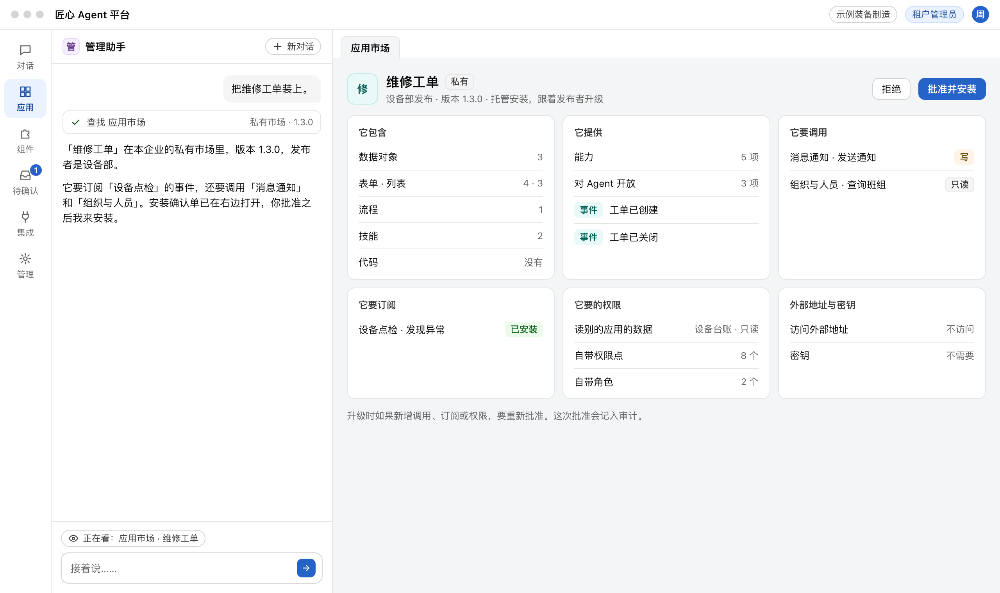

# 应用互通

> 状态：规划稿，2026-11-26 按收拢后的方向改过。已定的是第 1 节的两条；其余是提议，待产品负责人确认。「已有」指在 Kun 里已经实现，「已有决策」指 Kun 里已接受的决策记录，不代表已经实现。

## 1 已定

1. 所有发布的应用之间可以互相通讯。应用就是插件，见[一切皆插件](05-plugin-model.md)。
2. 缺省：同一个租户里，应用提供的能力与事件在目录里看得到；调用与订阅按声明、经批准放行。不做「装上就全通」。

本文回答怎么落：互通有哪几种方式、在哪里声明、谁来批准、调用时带什么身份、被依赖的应用变了怎么办。

## 2 四种方式

提议把「可以互通」落成一条规则：应用之间不直接连对方的数据库，不引用对方的代码；互通只有下面四种方式，全部经过平台。

| 方式 | 做什么 | 现状 |
|---|---|---|
| 能力调用 | 同步。调用对方登记在能力目录里的能力，过权限判定，留审计 | 能力目录与权限判定已有 |
| 事件 | 异步。订阅对方发布的事件。业务数据和事件同事务落库，可靠投递 | 事件信封与可靠投递已有。事件目录现在只有进程内的登记；对外的查询接口、由清单里的发布与订阅声明生成主题的权限，是已有决策，还没有实现 |
| 数据引用 | 自己的表单字段引用对方的记录。读取时按对方的数据权限，不复制数据 | 访问别的组件的数据要在清单里声明，已有规格；关联字段是规划 |
| 界面引用 | 把对方的页面挂进自己的菜单，把对方的控件放进自己的页面 | 跨应用引用挂菜单是已有决策；界面清单已有 |

为什么全部经过平台：

- **看得见。** 谁依赖谁，安装之前就列得出来，卸载之前也查得到。
- **管得住。** 每一次调用都过同一个权限判定，没批准的往来和不存在一样。
- **查得到。** 每一次调用、每一个事件都带租户与追踪标识，两边的审计各记一笔。
- **换得了。** 依赖的是对方公开的能力与事件，不是它的表结构和代码；对方升级或换实现，依赖方不用改。

## 3 一个例子

三个应用互不知道对方的实现。维修工单在自己的清单里声明：订阅设备点检的「发现异常」事件，调用消息通知的「发送通知」能力。租户管理员在安装时批准这两项，运行时每一步都过权限判定并留审计。

## 4 声明与批准

现有的清单把两个方向的权限分开（已有）：

- 一个方向是组件自己定义的权限点，供管理员授给别人。
- 另一个方向是组件向平台申请的东西，分五类：平台能力、别的组件的数据、密钥、界面能连的地址、出网地址。

开通和升级时由租户管理员逐项批准的接口已有，升级只在新增申请时重新批准。批准记录现在只卡开通与升级这两步。批准用的界面是规划。

互通要用的东西，有一部分已经在这套申请里：

- 调用平台组件的能力，例如发送通知、读取人员，已经算在「平台能力」这一类里（已有）。
- 事件的发布与订阅写在清单里、由它生成主题的权限，是已有决策，还没有实现。
- 跨应用引用的白名单，Kun 里已有规划。

提议在这个基础上补三件事：

1. 把「调用别的应用的哪些能力」明确列进同一份申请：现有的申请管到平台组件，还没有管到应用一级的能力。把「订阅别的应用的哪些事件」并进同一张批准单。
2. 安装确认单把这些一次列清：它包含什么、它提供什么、它要调用谁、它要订阅谁、它要什么权限、它访问哪些外部地址。
3. 运行时按批准的内容放行。没批准的调用和订阅，和不存在一样。

安装确认单的示意。图是 2026-11-19 画的，不是最终设计，窗口的标题是当时对 Agent 工作区的叫法；图里的企业、人名与数据是虚构的：

## 5 调用时带什么身份

| 场景 | 身份 | 有效权限 | 现状 |
|---|---|---|---|
| 用户在页面上操作，触发对另一个应用的调用 | 应用代用户行事，带委托链；不转交用户的令牌 | 用户的权限 ∩ 这个应用被批准的范围 | 提议。现行的规则不许服务主体转交用户的令牌 |
| 定时任务或事件触发的调用 | 应用的服务身份 | 这个应用被批准的范围 | 内部调用走服务身份是已有决策 |
| Agent 代人调用 | 智能体主体，带委托链 | 主人的权限 ∩ 授给这个 Agent 的范围 | 已有决策，还没有启用 |

三种场景的判定都在同一个强制执行点上做。主体模型见[总体架构](04-architecture.md)第 3 节。

## 6 缺省与兼容

- **缺省（已定）。** 同一个租户里，应用提供的能力和事件在目录里看得到；调用和订阅要声明并经批准。
- **「看得到」对谁。** 提议：看得到的是本租户里做构建与安装的人，以及替他们干活的 Agent，用来写声明。运行时不变：每个主体看到的目录与工具照旧按范围过滤，被过滤掉的项不出现在目录和提示词里，调用也被拒绝（已有决策）。
- **契约只做加法。** 照已有决策：契约定稿之后只做加法；破坏性的变更开新版本，旧版本保留一个弃用窗口；能力的描述或输入一变，旧的授权失效，已经上架的要重新审核。
- **停用与卸载。** 提议被依赖的应用停用或卸载时，依赖方收到结构化的错误，自己降级；卸载之前提示谁在依赖它。
- **追踪与审计。** 提议一次跨应用的调用，从页面到对方应用串成一条追踪，两边的审计各记一笔。

## 7 Agent 用的是同一份目录

Agent 跨应用办事，用的也是这份能力目录，没有另一条通道。照已有决策，Agent 调平台的能力一律经 MCP 路由，工具的定义由能力目录生成。所以：

- 一个应用上架之后，不用再为 Agent 做一遍接入。
- 能力条目上写明副作用等级、是否对 Agent 开放、是否要人确认（已有，在冻结的契约里）。标了不对 Agent 开放的，不会成为 Agent 的工具。
- Agent 的有效权限不超过主人的权限与授给它的范围的交集（已有决策，还没有启用）。

历史系统经连接器登记的能力与事件，也进同一份目录，见[历史系统接入](07-legacy-systems.md)。

## 8 各部分由谁承担

| 部分 | 由谁承担 | 现状 |
|---|---|---|
| 能力目录、事件、权限判定、审计；清单里的互通声明、安装确认的接口、运行时按批准放行 | Kun | 能力目录、事件的信封与可靠投递、权限判定、审计已有；事件目录的查询接口与主题的权限、互通声明、按批准放行是规划 |
| 安装确认单的界面；关联字段的控件；装载别的应用的页面与控件 | 界面不由 Kun 承担（已定），现在放匠心；管理端的页面是只有浏览器一半的 Cordis 插件（已定）。怎么做没有定 | 规划 |
| Agent 把应用的能力当工具用 | Agent 运行时是 DSH（已定）。照 Kun 已有的决策，它调平台的能力一律经 MCP 路由，工具的定义由能力目录生成，见第 7 节 | 规划 |
| 契约：应用互通的声明 | 随 Kun 的契约 | 规划 |

## 9 待定

| 事项 | 提议 |
|---|---|
| 互通的声明写在清单的哪里 | 列进现有的「组件向平台申请」一组，和现有五类一起批准，见第 4 节 |
| 用户在页面上触发的跨应用调用带什么身份 | 应用代用户行事，带委托链；有效权限取用户的权限与这个应用被批准的范围的交集，见第 5 节 |
| 「目录里看得到」对谁、在哪个目录 | 对本租户里做构建与安装的人和替他们干活的 Agent；运行时的目录照旧按范围过滤，见第 6 节 |
| 被依赖的应用停用或卸载时怎么办 | 依赖方收到结构化的错误，自己降级；卸载之前提示谁在依赖它 |
| 不同租户的应用之间要不要互通 | 不做。互通只在同一个租户里 |
| 关联字段的 Schema | 没有提议，随表单与列表的 Schema 一起定 |
