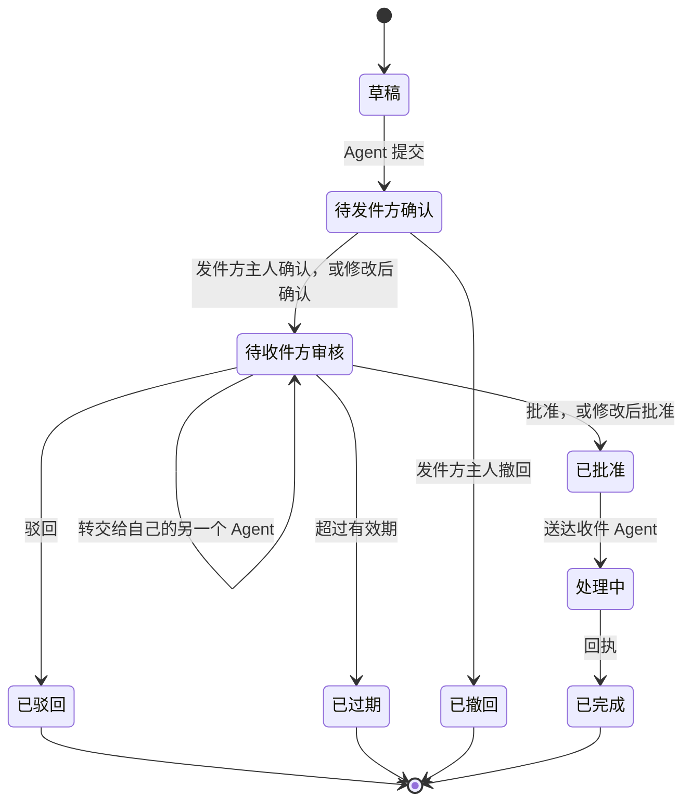
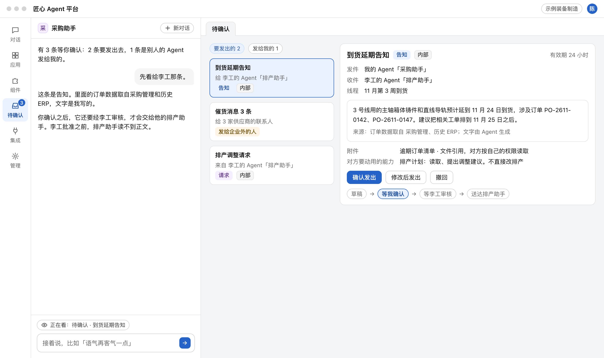
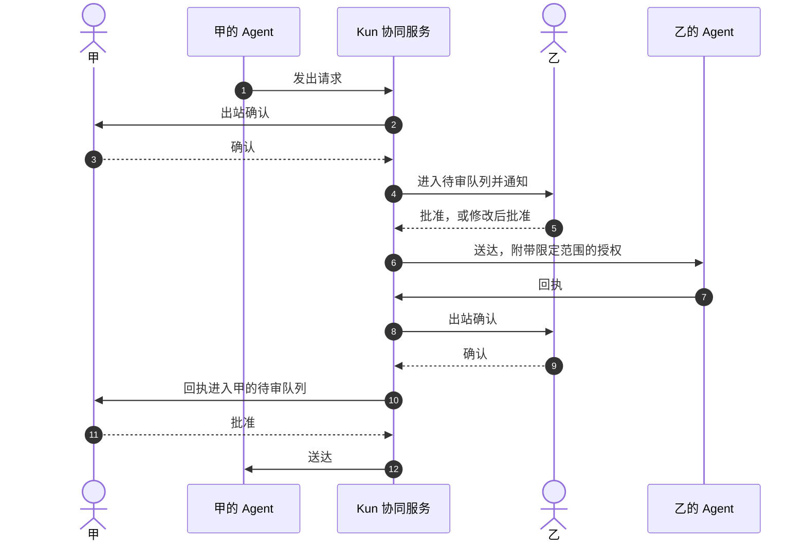

# Agent 协同

> 状态：提议，2026-11-26 按收拢后的方向改过。已定的有五条，见第 1 节；确认卡与「待确认」另有几条已定，见第 4.2、6 节；其余都是提议，待产品负责人确认。标法见[平台做什么与设计理念](01-vision.md)开头。
>
> 本文说的能力都还没有实现。Agent 之间的协同排在[路线](13-roadmap.md)第 2.1 节的里程碑 M7（已定，P54）；对话里的确认卡排在 M2。

## 1 目标

已定（产品负责人，2026-11-17，P7）：

1. 每个人有一个或多个 Agent。
2. Agent 与 Agent 之间怎么沟通，由平台定义。
3. 发给每个 Agent 的内容，要由人审核。

已定（产品负责人，2026-11-19，见 [2026-11-19 平台级裁定](decisions/2026-11-19-platform.md) P28）：

4. 每个 Agent 发出去的内容，都要由人审核。「发出去」包括三类：发给别的 Agent、发给别人、写外部系统。
5. 起步出站、入站两道都必审。

本文回答怎么实现：Agent 归谁、Agent 之间经什么通道往来、人在哪里审、审什么、怎么留痕。

## 2 归属：每个人有一个或多个 Agent

- **每个 Agent 有主人。** 主人是一个人。一个人可以有多个 Agent，按职责分开，比如一个管采购，一个管周报。
- **Agent 是独立的主体。** 它在平台里是 `agent` 主体，有自己的标识，不借用主人的账号。它行事时，令牌里带委托链，写明代表哪个人。
- **权限不超过主人。** Agent 的有效权限 = 主人的权限 ∩ 授给这个 Agent 的范围。主人被停用，名下的 Agent 一并停用。
- **Agent 有名片。** 名片写明名称、主人、职责、能接什么请求、需要什么输入。名片登记在目录里，并按范围过滤：只有被允许联系它的人和 Agent 才看得到。

提议：也允许团队 Agent，归一个团队所有并指定负责人。

## 3 沟通机制：走信箱，不直连

三条规则：

1. Agent 不能直接调用别的 Agent，也不能把内容直接写进对方的上下文。
2. Agent 之间的一切往来都是协同消息，由 Kun 的协同服务转交。每个 Agent 有收件箱和发件箱。
3. 对收件的 Agent 来说，别的 Agent 发来的内容是数据，不是指令。主人批准之后，它才成为这个 Agent 可以执行的任务。

不直连的原因：

- **可审核。** 人审需要一个所有消息都经过的地方。
- **可授权。** 收件 Agent 用的是它主人的权限，接不接、用多大的权限接，要由主人决定。
- **可追溯。** 每条消息、每个审核决定都能留审计。
- **防扩散。** Agent 读到的外部内容可能带着诱导它的指令。如果一个 Agent 能直接指挥另一个，一处被诱导就会沿协同链扩散。经过信箱和人审，链在每一跳都被截住。

### 3.1 协同消息的信封

信封是一份契约，协同服务、Agent 运行时一侧和界面共用。提议的字段：

| 字段 | 含义 |
|---|---|
| 消息标识、线程标识、回复对象 | 定位与串联 |
| 发件方 | 发件 Agent 及其主人 |
| 收件方 | 收件 Agent；它的主人由平台解析 |
| 类型 | 请求（请对方做事）、告知、提问、提议、结果、移交 |
| 主题与正文 | 自然语言 |
| 结构化载荷 | 可选，带 Schema 引用 |
| 附件 | 文件引用，不内嵌内容；收件方按自己的权限读取 |
| 所需能力 | 发件方预计收件方要动用哪些能力 |
| 敏感级别 | 数据分级，决定审核与留存的要求 |
| 有效期 | 过了有效期还没审的消息怎么处理 |
| 来源标注 | 正文里哪些是人写的，哪些是 Agent 生成的，引用了哪些来源 |
| 租户与追踪标识 | 隔离与可观测 |

### 3.2 线程

线程是一件协同事务的全部往来。线程的参与者可以是人，也可以是 Agent。三种常见的情形：

- 两个人的 Agent 点对点往来。
- 一个人把一件事分派给自己名下的几个 Agent。
- 多个人、多个 Agent 在一个项目线程里协同。

工站、产线、工厂三级智能体之间的往来也算协同：工厂一级把任务分派给产线与工站的智能体，再按执行结果调整。这一类往来的审核是否与人和人的 Agent 之间同样对待，见第 9 节的待定；三级见[工业智能制造](02-industrial-forms.md)。

设备上的智能体经同一个信箱收发。连接由设备发起；断网时发给它的消息在平台一侧等着，联网后再取。设备怎么接平台是提议，见[工业智能制造](02-industrial-forms.md)第 5 节。

## 4 人审

### 4.1 消息的状态

上图画的是发给别的 Agent 的消息。发给人的内容、往外部系统里写的动作，只过出站确认这一道，见第 4.2 节。

### 4.2 两道关口

起步两道都必审（已定，P28）。

- **出站确认。** Agent 代表主人往外发之前，先让主人确认。主人可以确认、修改后确认，或者撤回。它对应「发出去的内容要人审」。
- **入站审核。** 消息送达收件 Agent 之前，先进收件方主人的待审队列。主人可以批准、修改后批准、驳回，或者转给自己的另一个 Agent。批准之前，收件 Agent 读不到正文。它对应「发给 Agent 的内容要人审」：收件 Agent 用的是收件方主人的权限，后果由他承担，所以由他决定接不接。

回执与结果也是消息，同样走这两道关口。

「发出去」包括三类（已定，P28）。每一类由谁确认、不算的有哪些，是提议：

| | 例子 | 过哪道关口 | 谁确认 |
|---|---|---|---|
| 发给别的 Agent | 请对方的 Agent 办事、告知、回执 | 出站确认，再加对方的入站审核 | 发件方的主人；收件方的主人 |
| 发给别人 | 消息、邮件、评论、审批意见 | 出站确认 | 发件方的主人 |
| 写外部系统 | 经连接器往历史系统里写 | 出站确认 | 发起的人 |
| 不算 | 主人和自己的 Agent 对话；Agent 读数据；Agent 改主人自己的草稿 | 不过 | 不用确认 |

后两类不经信箱：Agent 在对话里出一张确认卡，人点了才执行。往历史系统里写，见[历史系统接入](07-legacy-systems.md)第 6 节。

确认卡这一段已定了几条（[2026-11-25 平台级裁定](decisions/2026-11-25-platform.md) P68、P69、P73、P74）：

- 等人点头的事记在平台，平台来的审批任务与 Agent 要办的、要人确认的事都在内。确认卡的点击由浏览器带着这个人自己的登录直接交给平台，不经过模型，也不经过 DSH 实例。DSH 自带的问人接口只用于实例里面的动作。（P68）
- 审批时模型默认不参与，人点了才让它看。（P69）
- 标了要人确认的能力，调用方不是人本人时，平台自己不执行，先生成一条等人输入的任务，等人点；人点了，平台才执行。人自己在界面上直接调同一个能力，不拦。（P73）
- 等人点头的任务上的动作，缺省只能人做。Agent 代办不是缺省，以后要用再单独放开；怎么放开没有定。（P74）

后两条与 Kun 原先的写法有出入，已回写到 Kun，见那份裁定第 3.7、5 节。这几条都还没有实现。卡片的样子与位置、接口的形状仍是提议。

确认卡的最小一圈不等里程碑 M1 的智能体主体与 MCP 路由，先用替身演示，和 M1 并行；M1 做好以后替身撤掉（已定，P75）。替身期间，实例里的工具调匠心的工作区服务，由它用自己的服务身份调平台，写明代谁提出；平台照样不执行，等人点。这是过渡，还没有实现；做法与接口的形状是提议，见那份裁定第 3.9 节。

### 4.3 审核的是什么

审核界面展示：

- 谁的哪个 Agent 发来的，属于哪个线程。
- 消息类型、正文、附件。
- 它想让我的 Agent 动用哪些能力。
- 来源标注与敏感级别。

审核人的决定有四种：批准、修改后批准、驳回（可以写理由）、转交。

批准同时发出一份限定范围的授权：只对这个线程，只对列出的能力，只在有效期内。收件 Agent 执行任务时仍受平台的权限判定和 Agent 运行时自己的工具策略约束；高风险动作另外要人确认。

待确认的界面示意。图是 2026-11-19 画的，不是最终设计，窗口的标题是当时对 Agent 工作区的叫法；图里的企业、人名与数据是虚构的。发件方的主人看得到谁发给谁、正文、数据来源、对方要动用哪些能力：

### 4.4 留痕与反馈

- 每个审核决定进审计：谁、什么时候、对哪条消息、做了什么决定；修改后批准的，记下改了什么。
- 审核结果回到双方 Agent 的记忆里。被驳回的理由、被修改的地方，是 Agent 下一次该怎么做的依据。

### 4.5 减负

每条都审，在消息多的时候会成为负担。可以放宽的方式有：

- 按线程授权：线程里已经批准的请求，后续的告知和结果免审。
- 同一个主人名下的 Agent 之间免审。
- 低敏感级别的告知类消息，改为事后汇总审阅。

起步两道都必审（已定），上面三种都不开。提议积累数据之后再定放不放宽；以后开放的每一种放宽都要显式配置，并留审计。

工站、产线、工厂三级之间分派任务，节拍比人审快。要不要由人预先批准一类任务、之后按策略放行，没有提议，见第 9 节。

## 5 一次协同怎么走

甲的 Agent 请乙的 Agent 办一件事：

## 6 各部分由谁承担

| 部分 | 由谁承担 | 依据与现状 |
|---|---|---|
| Agent 的身份与归属、Agent 目录；协同服务：信箱、线程、信封校验、审核流程与策略、限定范围的授权、通知、审计 | Kun。协同服务放在 Kun 是提议，见第 9 节 | 规划 |
| 等人点头的任务：记录、推送、收到点击时的核对 | 平台，也就是 Kun 的平台服务（已定，P68） | 规划 |
| Agent 这一头：收发协同消息的工具；只把已批准的消息转成任务；把审核结果带回 Agent；一个主人名下多个 Agent 的编排 | Agent 运行时一侧。运行时是 DSH（已定，P37）；这几样在 DSH 里怎么做，没有定 | 规划 |
| 「待确认」 | 页面插件，DSH 的右侧和管理端装同一份；在管理端里它就是待办页（已定，P71） | 规划。里面列什么是提议：要发出的可以确认、修改、撤回，发给我的可以批准、修改、驳回、转交 |
| 对话里的确认卡 | 界面不由 Kun 承担（已定，P60），现在放匠心；点击由浏览器直接交给平台（已定，P68） | 规划。样子与位置是提议 |
| 管理我的 Agent、线程视图、提醒 | 界面不由 Kun 承担（已定，P60），现在放匠心。怎么做没有定 | 规划 |
| 契约：协同消息信封、审核状态、相关事件 | 随 Kun 的契约 | 规划 |

## 7 可以承接的能力

已定的是一句话：可以承接私有产品里已有的实现（P7）。下表是当时按类别列的。Agent 运行时改用 DSH 以后（P37、P53），哪些还接得上、接到哪里，没有重新核对。

| 能力类别 | 用在哪里 |
|---|---|
| 子 Agent 与工作流的编排 | 一个人名下多个 Agent 的分派；协同任务内部的拆解 |
| Agent 运行时一侧的安全约束：工具策略，技能的签名与信任 | Agent 执行已批准的任务时的补充约束 |
| 记忆的访问范围与上下文层级 | 协同线程的记忆归谁；审核结果写进哪一层 |
| 运行时的授权 | 限定范围的授权的基础 |
| 自动化任务 | 定时触发的协同 |
| 确认流程与通知 | 审核状态的设计参照；待审提醒 |

## 8 与平台外的 Agent 互通

提议：平台内部以自己的信封为准。需要和平台外的 Agent 往来时，在边界上适配开放的 Agent 间协议与 MCP。外部来的消息同样进待审队列，不因为来源是外部而走别的通道。

## 9 待定

| 事项 | 提议 |
|---|---|
| 人审以后怎么放宽 | 起步两道都必审已定。以后放不放宽、先放哪一种，积累数据之后再定，见第 4.5 节 |
| 「发出去」的三类各由谁确认，哪些不算 | 见第 4.2 节的表 |
| 发给人的内容经什么通道发 | 经平台的消息通知发，发出之前先出确认卡 |
| 是否允许团队 Agent，审核人怎么定 | 允许；审核人是团队指定的负责人 |
| 审核超时怎么处理 | 过期视为未批准，通知发件方 |
| 协同服务放在哪里 | 作为 Kun 的一个插件 |
| Agent 这一头的几样在 DSH 里怎么做 | 没有提议。见第 6 节 |
| 工站、产线、工厂三级智能体之间的任务分派要不要逐条人审 | 没有提议，待产品负责人定。已定的规则是发给每个 Agent 的内容、每个 Agent 发出去的内容都要由人审核，起步两道都必审；工厂把任务分派给产线、产线分派给工站，节拍比人审快得多。是逐条审，还是由人预先批准一类任务、之后按策略放行，要定 |
