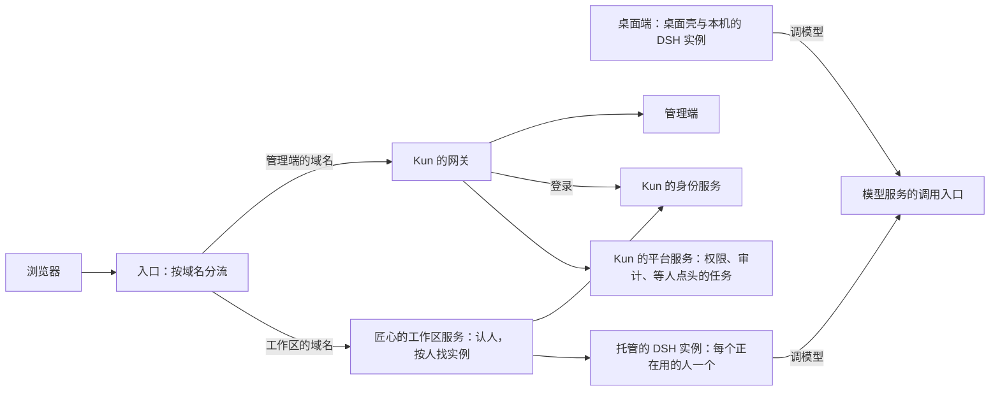

# DSH 与企业级平台的对接

> 状态：2026-11-26 新写。产品负责人要文档写清楚四件事（已定，2026-11-26，P85），本文答其中一件：DSH 怎么与企业级平台交互；登录、模型服务这些由企业级平台提供的东西，DSH 一侧怎么用。
>
> 每一项按「企业级平台提供什么、DSH 一侧怎么用、现在到哪一步」来写，并标四种状态之一：
>
> - **已有**：仓库里有代码或脚本，对着文件核对过。说 Kun 的东西已有，指它在 Kun 的仓库里已经实现。
> - **已定、没有实现**：产品负责人裁定过，代码还没有。
> - **提议**：有做法，没有裁定。
> - **待定**：没有提议，或者没有问过。
>
> 实情：这一部分几乎只有裁定和提议。已有的分两头。Kun 一头：身份服务、登录组件、进程内的权限判定、审计。DSH 一头：模型地址由一个环境变量指定并在界面上锁住；往上游发数据的功能已经关掉；实例放在反向代理后面的验证；桌面壳与本机实例之间的凭据交接；品牌包。把两头接起来的东西都还没有实现：工作区服务、托管实例、管理端、确认卡、平台上等人点头的任务、模型服务的调用入口。
>
> 文中 P 加数字是平台级裁定的编号：P14 在 [2026-11-17 平台级裁定](decisions/2026-11-17-platform.md)，P33 在 [2026-11-19 平台级裁定](decisions/2026-11-19-platform.md)，P37 至 P41 在 [2026-11-20 产品裁定](decisions/2026-11-20-product.md)，P57 至 P77 在 [2026-11-25 平台级裁定](decisions/2026-11-25-platform.md)，P78 至 P87 在 [2026-11-26 平台级裁定](decisions/2026-11-26-platform.md)。

## 1 一张表

| 事项 | 企业级平台提供什么 | DSH 一侧怎么用 | 现在到哪一步 |
|---|---|---|---|
| 登录 | Kun 的身份服务认人；Kun 发布的登录组件 | Web 端：匠心的工作区服务用登录组件认人，把人送进他自己的托管实例。桌面端：实例在本人的电脑上 | 身份服务与登录组件已有。Web 端的形状已定、没有实现。桌面端怎么登录平台待定 |
| 模型服务 | 一套标准接口：一个调用入口、平台发的凭据、模型目录 | 实例的模型地址只指平台，用的人改不了；模型列表由平台下发 | 「地址由环境变量给、界面上锁住」已有，现在指向本机的假模型。平台一侧要留一套标准接口已定，怎么分是提议，Kun 里只有骨架。模型列表下发是提议 |
| 权限 | 权限都走 Kun 这一套：平台上的系统判权限只问 Kun，不各做一套 | 实例里面的动作归 DSH 自己管；平台上的事由 Kun 判，不听实例的 | 规矩已定。Kun 进程内的判定已有；远程的授权接口、智能体主体与委托是规划 |
| 审计 | Kun 的审计 | 经平台办的事由平台自己记；实例里面的事现在不出实例 | Kun 的审计已有。实例里面的事送不送到平台待定 |
| 等人点头的任务与确认卡 | 平台上的一条任务；标了要人确认的能力，平台自己停下来等人点 | 对话里出确认卡，点击由浏览器直接交给平台；「待确认」的页面两边装同一份 | 已定，没有实现 |
| 品牌 | 现在没有。以后在管理端里维护是提议 | 品牌包换掉界面上的名称、标志、主题色 | 品牌包已有 |
| 升级 | 不涉及 | DSH 的版本钉死，升级时把上面各项逐项重验 | 见 [DSH 更新之后做什么](10-dsh-upgrade.md) |

## 2 匠心、Kun 与 DSH

- **匠心**（本仓库）是产品：Agent 工作区的 Web 端与桌面端、管理端、产品的插件、部署清单。
- **Kun** 是企业级框架：登录、权限、多租户、数据、事件、审计、模型服务的接口，以插件的形式装配。
- **DSH** 是上游的 Agent 运行时：版本钉死，不改它的源码。

本文说的「企业级平台」，指 DSH 实例外面、由我们自己提供的那一侧：Kun 的各项能力，加上匠心在它上面做的两样，工作区服务和管理端。Kun 是通用的组件，不带业务；「把人送进他的实例」这类和 Agent 有关的逻辑放在匠心（已定，P60、P64）。

对接成什么形状，是 DSH 的几条事实决定的。前三条在现在钉的版本上核对过，出处见[核对过的 DSH 事实](https://github.com/CavaiLAB/jiangxin/blob/main/distribution/docs/dsh-facts.md)：

| DSH 的事实 | 由此 |
|---|---|
| 一个实例只有一种调用方身份，就是实例的主人。会话里不分人和租户，设置、插件、凭据整个实例共用 | 每人一个实例（已定，P62）。多个人靠实例之间隔开 |
| 现在钉的版本里没有能单独替换的认证接缝；上游的主干上有 | 登录只能从实例外面接：外面的服务认人，再把人送进实例 |
| 配置是一层层叠出来的。放在命令行那一层的设置，界面上改不动 | 要由平台说了算的设置放进发行目录的配置补丁：模型走哪里，哪些往外发数据的功能关掉 |
| 实例里跑着模型和插件 | 平台不能把实例说的话当成人说的话。权限、确认这些该由平台判的事，都在实例外面判（P68 的理由） |

## 3 两种入口

人用 Agent 有两种入口。两边跑的是同一个发行目录：同一份 DSH、同一组配置补丁、同一个品牌包（已有）。

| | Web 端的托管实例 | 桌面端 |
|---|---|---|
| 实例在哪 | 服务器上。每个正在用 Agent 的人一个，按需启动、空闲回收、有上限（已定，P63） | 各人自己的电脑上，每人一个（已定，P62） |
| 谁启动实例 | 匠心的工作区服务（已定，没有实现） | 桌面壳（已有，原型） |
| 人怎么进去 | 浏览器打开工作区的域名，工作区服务认人、按人找实例、转发（已定，没有实现） | 打开应用。壳用实例启动时给的令牌换一个认证 cookie，只放在自己的内存里（已有） |
| 人是平台上的谁 | 登录到 Kun 的身份服务（已定，P64） | 壳现在不登录任何账号。桌面怎么连平台，没有问过（待定） |
| 模型地址谁给 | 启动实例的一方用环境变量给（机制已有，指到平台是规划） | 同一个环境变量，壳原样传给 DSH（已有） |
| 会话和文件在哪 | 服务器上 | 本机 |

图里已有的是入口、Kun 的网关、Kun 的身份服务、平台服务里的权限与审计，和桌面壳的原型。管理端、工作区服务、托管实例、平台上等人点头的任务、模型服务的调用入口都是规划。桌面端只画了调模型这一条线：它怎么登录平台没有定。确认卡的点击怎么到平台也没有画，接口的形状没有定，见第 8 节。

几点说明：

- **为什么按需。** 一个实例空闲时常驻约 320 到 400 MB 内存，冷启动 2 到 3 秒（2026-11-25 实测，记在 2026-11-25 平台级裁定第 3.4 节）。所以不给每个注册的人常驻一个，只给正在用的人，不用就回收。
- **为什么分成两块、两个域名。** 管理页面给很多人用，不该每人为它占一个实例。工作区里要渲染模型生成的内容，还要跑插件；万一被注入了脚本，不能让它带着登录态去调管理接口。
- **单机版以桌面为主**（已定，P63）。
- **部署上有三条线。** 带不带模型推理，这是两种形态；跑在集群上还是一台服务器上，这是企业版与单机版；多租户还是单租户，这是两个版本。把它们当成三条不同的线，是登记 2026-11-26 的裁定时的读法，产品负责人没有逐句确认；哪几种组合要交付，没有问。不管哪一种，统一由管理端管理（已定，2026-11-26，P83）。
- **网页和桌面的会话通不通**没有定。现在两边的状态各在各处，互相看不到。
- **现在能跑的。** Web 端是在本机起一个实例，不是托管实例，见 [apps/web 的说明](https://github.com/CavaiLAB/jiangxin/blob/main/apps/web/README.md)。桌面端是薄壳的原型，没有发布过；走薄壳还是从源码构建上游的桌面壳没有定，提议走薄壳，见 [apps/desktop 的说明](https://github.com/CavaiLAB/jiangxin/blob/main/apps/desktop/README.md)。
- **管理端。** 先不做，目录已建（已定，P39）；它以后是 Web 端的两块之一，界面是浏览器里的 Cordis 应用（已定，P63、P65、P66）。它管 DSH 的哪些事是提议：实例的开通与回收、模型接入、工具与插件的策略，见 [apps/console 的说明](https://github.com/CavaiLAB/jiangxin/blob/main/apps/console/README.md)。产品是什么样子，见[产品形态](03-product.md)。

## 4 登录

### 4.1 企业级平台提供什么

| 提供什么 | 状态 |
|---|---|
| Kun 的身份服务：平台上唯一的登录签发方，可以接外部的身份源 | 已有 |
| Kun 发布的登录组件（包名 `Kun.Identity.Client`）：一个独立的服务装上它，就能对接身份服务，带登录、回调、登出这几个端点和浏览器的会话，见[它的说明](https://github.com/CavaiLAB/kun/blob/main/src/Kun.Identity.Client/README.md) | 已有 |
| 交付给客户的产品里只有这一套身份系统：运维侧各个控制台的登录也接它，各控制台另留一个本地的应急管理员 | 已定，P57。已有的环境什么时候换，不在这一条里 |

### 4.2 Web 端怎么用

已定的是下面四条（P62 至 P64），都没有实现：

1. Web 端分成两块，放在两个域名上。管理端是多人共用的网页应用，不需要 DSH 实例。Agent 工作区用 DSH 自己的客户端，后面是托管实例。
2. 管理端的域名过 Kun 的网关。工作区的域名由匠心的工作区服务直接接，不经过 Kun 的网关。
3. 工作区服务用 Kun 发布的登录组件认人。登录仍然到 Kun 的身份服务，Kun 不用改。
4. 工作区服务把登录的人送进他自己的实例。

工作区的域名为什么不经过 Kun 的网关，原因有三条。前两条是 2026-11-25 对着 Kun 的主干实测并读代码得来的：

- Kun 现有的网关只按路径分流，一个宿主只有一个登录回调地址，接不了第二个域名。
- 它要求会改状态的请求带防伪令牌的请求头。DSH 的客户端不带这个头，请求会被拒。
- 「把人送到他的 Agent 实例」这段逻辑不该写进通用的网关（P60）。

代价也记下了：工作区服务成了直接面向浏览器的入口，可信代理、限流、会话存储要自己装配，可以用 Kun 的包；这条流量不经过 Kun 网关的限流与审计。这是对 Kun 的网关分层决策的一处有意的偏离，见 2026-11-25 平台级裁定第 5 节。

**把人送进实例这一段怎么接，是提议。** 先说 DSH 自己的行为（已有，桌面壳和反向代理的验证都在用）：

- 实例启动时在标准输出打印一个带令牌的地址。
- 带着令牌请求一次，换回一个会话 cookie。之后带这个 cookie 的请求，都算实例的主人；不带的回 401。

提议的接法写在 [apps/web 的说明](https://github.com/CavaiLAB/jiangxin/blob/main/apps/web/README.md)第 4 节：工作区服务在服务端用实例的启动令牌换 cookie，存在自己的会话里；转发给实例的每个请求，连同 WebSocket 的升级，都由它带上这个 cookie；浏览器拿不到实例的令牌和 cookie。因为钉的这一版没有可替换的认证接缝，第一版只能这样从外面接，不改 DSH。

工作区服务站的是反向代理的位置。DSH 对放在代理后面有五条要求（已有，验证过）：原样保留浏览器看到的主机名，去掉挂载的路径前缀，转发 WebSocket 的升级，改写 cookie 的路径并在 HTTPS 这一段加上 `Secure`，把挂载点重定向到带斜杠的地址。逐条的写法和验证脚本在同一份说明的第 3 节。

没有定的（都是提议，记在 2026-11-25 平台级裁定第 6 节的「Web 端的细则」）：

- 实例怎么隔离，凭据怎么保管。
- 什么算空闲，上限是多少。
- 所有人的工作区是不是同一个域名。apps/web 的说明里早先的提议是每人一个主机名，两处还没有对齐。
- 登录以后先到哪一页；分几步做。

### 4.3 桌面端怎么用

- 每人一个实例，跑在各人自己的电脑上（已定，P62）。
- 桌面壳与本机实例之间的凭据交接已有（原型）：壳启动 DSH，从它的就绪行里拿到令牌，换成认证 cookie；cookie 只放在壳主进程的内存里，窗口发往本机实例的请求由壳附上。页面的地址里没有令牌，页面脚本读不到 cookie，磁盘上没有凭据。见 [apps/desktop 的说明](https://github.com/CavaiLAB/jiangxin/blob/main/apps/desktop/README.md)的「凭据交接」。
- 这解决的是「这台电脑上谁能连这个实例」，不是「这个人是平台上的谁」。壳现在有意不登录任何账号。桌面端怎么登录平台、拿谁的身份去调模型和平台的能力、确认卡的点击带谁的登录，都没有设计。「桌面怎么连平台」记在 2026-11-25 平台级裁定第 6 节「三个场景里没有问的」里（待定）。

### 4.4 现在到哪一步

| 项 | 状态 |
|---|---|
| Kun 的身份服务、登录组件 | 已有 |
| Web 端两块、两个域名；工作区服务认人，把人送进他自己的实例 | 已定，没有实现 |
| 实例的令牌怎么换成会话、存在哪 | 提议 |
| 实例放在反向代理后面的五条要求与验证 | 已有 |
| 桌面壳与本机实例的凭据交接 | 已有，原型 |
| 桌面端登录平台 | 待定，没有问过 |

## 5 模型服务

### 5.1 企业级平台提供什么

- **模型服务由 Kun 提供**（已定，P14）。
- **模型服务留一套标准接口**（已定，2026-11-26，P83）。裁定里和模型有关的内容是：部署有两种形态，一种是带模型推理服务的集群，一种不带模型推理、通过 API 直接接第三方的模型服务；不管哪一种，统一由管理端管理；这些尽量用插件的形式实现；对接模型推理服务的标准接口只提供一套。照这一条的读法，后面接自己的推理服务，还是接第三方的 API，都接在这一套接口上，上面的产品不用跟着改。
- **Kun 里已有的决定**（[ADR-015](https://github.com/CavaiLAB/kun/blob/main/docs/adr/ADR-015-model-gateway.md) 与[需求文档第 10 章](https://github.com/CavaiLAB/kun/blob/main/docs/prd/10-s4-agent.md)的 10.5 节）：Kun 不自己写模型代理，模型请求的转发由模型网关承担；Kun 的模型组件只做三件事，把推理后端登记成模型网关的上游、适配后端（发现模型、健康、上下线）、维护模型目录；租户、配额、计量在平台一侧。调用方只要两样东西，网关的地址和发给它的凭据；只用逻辑模型名，不知道后面是哪个模型。
- **现状**：Kun 里这个组件只有配置骨架，没有实现，见[它的说明](https://github.com/CavaiLAB/kun/blob/main/plugins/qian.model-gateway/README.md)。
- **没有定的**：接口的形状；不带模型推理的那种形态，模型请求要不要也过模型网关。两项都登记在 2026-11-26 的裁定里。

这套接口怎么分，下面是提议，没有裁定：

| 面 | 给谁用 | 是什么 |
|---|---|---|
| 调用面 | DSH 的实例、应用、Agent | OpenAI 兼容的接口。调用方只认平台的地址和平台发的凭据，用逻辑模型名 |
| 接入面 | 模型后端的适配，做成插件 | 一个适配要答：有哪些模型，各自能做什么，是否健康，怎么调。两种形态的差别落在装哪个适配上 |
| 管理面 | 管理端 | 模型目录、凭据、配额与限流、计量 |

Kun 的需求文档已经给适配留了名字（扩展点 `qian.model-gateway.provider/v1`，接口 `IModelCatalog`、`IModelProviderAdapter`），都还没有代码，见[需求文档第 7 章](https://github.com/CavaiLAB/kun/blob/main/docs/prd/07-s1-foundation.md)的 7.16 节。

### 5.2 DSH 一侧怎么用

已有的是发行目录里的一个配置补丁，`distribution/patches/10-model-route.yml`：

- 在 DSH 的 `llm-pi-ai` 这一行加一个模型提供方 `jiangxin`，接口类型是 OpenAI 兼容。地址取环境变量 `JX_MODEL_BASE_URL`，密钥取环境变量 `JX_MODEL_API_KEY`。新会话默认用它。
- 关掉 DSH 自带的两条官方模型路由。
- 补丁叠在命令行那一层，界面上「设置 → 模型」改不动。发行目录里有一个验证专门查这一点。
- 没设 `JX_MODEL_BASE_URL` 时指向本机的假模型。现在本机试用、外联检查、桌面壳的自检用的都是它。
- 外联检查核对过：叠上补丁以后，实例在那一组操作里，模型请求只发往指定的地址。

每个补丁改了什么、为什么，见[发行目录的说明](https://github.com/CavaiLAB/jiangxin/blob/main/distribution/README.md)的「每个补丁」与「外联」。

所以实例的模型地址只有一处，由启动它的一方给，用的人改不了。把这个地址指到平台的调用面，DSH 一侧的机制不用再改。

还没有的：

| 项 | 是什么 | 状态 |
|---|---|---|
| 地址指到平台 | 托管实例由工作区服务在启动时给，桌面端由壳传进去。平台的调用面还没有 | 规划 |
| 模型列表由平台下发 | 现在模型的清单和显示名写死在补丁 10 里，只有一条本机测试用的假模型。补丁在实例启动时读，改清单要改补丁、重启实例。接上平台以后，清单应当来自平台的模型目录。怎么下发没有设计 | 提议 |
| 凭据 | 给实例的凭据应当由平台签发，落在人头上，短期有效，只在模型服务上有效；模型供应方的密钥不进实例。现在是环境变量里的一把密钥，假模型不校验它 | 提议 |
| 计量与配额 | 在平台一侧按人、按租户算，不靠实例自己报 | 规划 |
| 出站策略 | 配置管不住全部外联。每个实例要有网络层的出站策略，只放行模型服务的地址；允许装插件的话，再加企业内部的 npm 源 | 部署时做，没有实现 |

两种形态对 DSH 一侧没有差别。照上面的提议，带推理还是接第三方，变的是平台一侧装哪个适配；实例看到的都是同一个调用入口，发行目录不用为形态各出一份（提议）。

另有一件做调用面时要知道的事（已有，配置改不了）：实例发往模型服务的请求带着 DSH 的 User-Agent 和它所用 SDK 的几个请求头，里面有操作系统、CPU 架构、Node 的版本。

桌面端用的是同一个发行目录、同一个补丁。壳把名字以 `JX_` 开头的环境变量原样传给 DSH（已有）。正式的桌面端从哪里拿到平台的模型地址和凭据，取决于桌面怎么连平台，待定。

### 5.3 现在到哪一步

| 项 | 状态 |
|---|---|
| 模型服务由 Kun 提供；对接模型推理服务的标准接口只提供一套 | 已定 |
| 接口的形状 | 没有定。分调用面、接入面、管理面是提议 |
| 不带模型推理的那种形态，模型请求要不要也过模型网关 | 待定 |
| Kun 的模型组件 | 只有骨架，是规划 |
| 实例的模型地址由环境变量给，界面上锁住；默认指向本机的假模型 | 已有 |
| 模型列表由平台下发；凭据由平台按人签发 | 提议 |

## 6 权限

### 6.1 企业级平台提供什么

- **规矩**（已定，2026-11-26，P86）：这个企业级平台以后不论做什么系统，权限都走这一套；这一部分在 Kun 上做好。照这一条的读法，平台上做的任何系统，判权限只问 Kun，不各做一套；管理端、应用、插件、Agent、DSH 一侧的服务都算。照本文的理解，工作区服务属于最后一类。
- **Kun 现在有的**（已有，在 Kun 的 .NET 进程里可以用）：判定的端口，能查一条、批量查、列出允许的动作、解释一次判定；租户里的角色与授权；权限点由组件的清单声明并登记；入口上的强制执行点，缺省拒绝；每次判定进审计；权限不放进令牌。见 Kun 的 [ADR-006](https://github.com/CavaiLAB/kun/blob/main/docs/adr/ADR-006-authorization-model.md)。
- **Kun 现在没有的**（规划）：
  - 给 .NET 以外的系统用的远程授权接口和客户端包。HTTP 上现在只有两个只读的端点，读的是登录的人自己持有的权限，和数据权限的元数据。先做哪几种接法，没有定。
  - 智能体主体与委托。契约里已经有，没有启用；带委托的请求现在一律拒绝。启用以后，Agent 的有效权限是委托人的权限与授给这个 Agent 的范围的交集。

### 6.2 DSH 一侧怎么用

先分清两层。

**实例里面的动作**：读写工作区里的文件、跑命令、调实例自己的工具。这一层归 DSH 自己管，它有自己的问人确认。DSH 自带的问人接口只用于实例里面的动作（已定，P68）。这一层不是平台的权限。

**平台上的事**：查业务数据、办业务上的事、打开管理页面。这一层只问 Kun。

| 事 | 怎么判 | 状态 |
|---|---|---|
| 谁能进哪个实例 | 工作区服务按登录的人找实例，把人送进他自己的那一个。进不了别人的实例，是这一段要保证的事；实例之间怎么隔离是提议 | 已定，没有实现 |
| 谁能用 Agent 工作区、名额多少 | 问 Kun；管理员在管理端里定 | 提议 |
| 实例里的 Agent 调平台的能力 | 一律经 MCP 路由，以智能体主体、带委托链调用，权限判定在 Kun，见[总体架构](04-architecture.md) | 能力目录已有；智能体主体没有启用；MCP 路由是规划 |
| 智能体主体启用之前 | 确认卡的最小一圈先用替身：实例里的工具调工作区服务，工作区服务用自己的服务身份调平台，写明代谁提出。它演示不了「Agent 以谁的名义」和权限取交集 | 已定，P75；没有实现 |
| 只许人做的能力 | 标了的能力不会变成 Agent 看得见的工具，Agent 来调也会被拒绝 | 契约里已有；强制执行随智能体主体一起启用 |
| 实例里的插件 | 只当护栏，不当权限的边界。统一管控工具护栏与设置的插件包（提议名 `enterprise-policy`）没有建 | 提议 |

平台不把登录交给实例：平台只认这个人自己的登录，这个登录不进实例，所以模型自己调不了平台上要本人才能调的接口（P68 的理由）。

桌面端守同样的规矩。它怎么带着本人的身份连平台，待定。

## 7 审计

### 7.1 企业级平台提供什么

Kun 的审计（已有）：每次权限判定、每次能力调用都留记录；记录串成哈希链，事后可以核验有没有被改过。

### 7.2 DSH 一侧怎么用

| 事 | 谁记 | 状态 |
|---|---|---|
| 登录、调平台的能力 | 平台自己记，不靠实例上报 | Kun 的审计已有；Agent 调能力这条路是规划 |
| 等人点头的任务上谁点了什么 | 平台记。确认卡那一圈做完要能演示的一条就是「审计里看得到是谁点的」（P72）。用替身期间，「提出」那一条的主体是工作区服务，不是这个人的 Agent（P75） | 已定，没有实现 |
| 谁进了工作区、实例什么时候起停 | 工作区这条流量不经过 Kun 的网关，所以不在 Kun 网关的限流与审计里，这是 P64 记下的代价。要由工作区服务自己记；记什么、存到哪没有设计 | 待定 |
| 实例里面的事：对话、工具调用、跑过的命令 | 现在只在实例自己的状态目录里，没有送到平台。要不要送、送哪些、怎么送，没有裁定。提议过一个做审计的插件包（提议名 `enterprise-audit`），没有建 | 待定 |
| 模型的用量 | 在模型服务一侧记，见第 5 节 | 规划 |

另有一件已有的事：发行目录关掉了 DSH 往上游发数据的几处，会话日志上传、会话遥测、产品分析都在内，外联检查核对过。实例里的记录不会离开部署的环境。

## 8 等人点头的任务与确认卡

这一节里带 P 编号的条目都已定，都没有实现。裁定的原文、理由和范围在 2026-11-25 平台级裁定第 3.7 至 3.9 节；与 Agent 之间协同的关系见 [Agent 协同](08-agent-collaboration.md)。

### 8.1 企业级平台提供什么

- 等人点头的事记在平台，是平台上的一条任务（P68）。来路有两种：平台来的审批任务；Agent 要办的、要人确认的事。
- 标了要人确认的能力，调用方不是人本人时，平台自己不执行，先生成一条等人输入的任务；人点了，平台才执行（P73）。人自己在界面上直接调同一个能力，不拦。
- 任务上的动作，比如同意、拒绝，缺省只能人做。Agent 代办以后要用再单独放开，怎么放开没有定（P74）。

现状：能力条目上「要人确认」的标记在 Kun 冻结的契约里已经有，现在只是登记，平台还不按它拦。任务的模型是 Kun 的需求文档里流程的待办与 Agent 的中断共用的那一种，没有实现。Kun 一侧的回写在 [ADR-016](https://github.com/CavaiLAB/kun/blob/main/docs/adr/ADR-016-agent-boundary.md) 第 9、10 节。

### 8.2 DSH 一侧怎么用

- **对话里出一张确认卡。** 点击由浏览器带着这个人自己的登录直接交给平台，不经过模型，也不经过 DSH 实例（P68）。
- **为什么不经过实例。** 实例里跑着模型和插件。答案如果先回到实例、再由实例告诉平台「人批了」，平台就得相信实例的话。平台的事要平台自己从人那里拿到答案。
- **DSH 自带的问人接口**留给它本来的用途：实例里面的动作（P68）。
- **审批时模型默认不参与。** 任务来了只出卡片，不自动让模型读它；人在卡片上点了，Agent 才去读这条任务、给建议。批不批仍然只能由人在卡片上点（P69、P74）。
- **「待确认」的页面**做成只有浏览器一半的页面插件，DSH 的右侧和管理端装同一份；在管理端里它就是待办页（P71）。对话里的卡片要 DSH 开着才有，所以管理端的待办页和平台的通知是兜底；平台的通知是规划。
- **先做哪一圈。** 确认卡的最小一圈排在第一（P72），不等智能体主体与 MCP 路由，先用替身演示（P75）：实例里的工具调工作区服务上给实例用的入口，工作区服务用自己的服务身份调平台，写明这次是代谁提出、处理人是谁；平台照样先停下，等人点。智能体主体做好以后替身撤掉。用替身的做法在试验里走通过，平台与模型用的是替代品。
- **一项前提。** 页面里的代码不被模型改动。托管的实例要为此加固，做法随设计细化，是规划。

### 8.3 没有定的

记在 2026-11-25 平台级裁定第 6 节：

- 接口的形状：路径、字段、回什么状态、错误码怎么登记。
- 卡片的样子与位置；卡片的内容按任务去平台取、不用模型写的文字，这一条是评估里的做法，没有逐项定。
- 替身的接口形状；智能体主体做好以后，平台一侧那种「服务代人提出」的调法留不留。
- Agent 代办怎么放开。
- 演示用的那条要人确认的能力放在哪，谁做，什么时候做。
- 金额大或风险高的审批，要不要在平台自己的页面上再确认一次。
- 桌面端的点击带谁的登录，取决于桌面怎么连平台。

## 9 品牌

### 9.1 企业级平台提供什么

现在没有。名称、标志、主题色是构建时写进品牌包的。

- 提议：名称与图标以后在管理端里维护，改了不用重新发版就生效；品牌包只留「怎么把它们放进 DSH 的界面」这一部分。没有裁定，没有实现。
- 登录页现在在 Kun。它显示的名称与标志怎么跟产品的品牌一致，没有定（待定）。

### 9.2 DSH 一侧怎么用

已有的：

- 品牌包 `@jx/brand-theme` 装在发行目录里，把 DSH 界面上的名称、标志、主题色和带 DSH 字样的文案换成匠心的，不改 DSH 的源码。它挂在命令行那一层：不出现在插件页里，用的人关不掉。
- DSH 遇到版本对不上的插件，不报错，只把它停用，照常启动。品牌包没加载，产品就带着 DSH 自己的品牌起来。所以启动器每次启动前先跑启动前检查，桌面壳把这种告警当成启动失败。
- 产品的版本号在启动时由环境变量注入，规则是日历版本号（已定，P40）。界面上显示产品名与版本、「基于 DSH 某版构建」和开源许可。
- 桌面端：应用名、图标、窗口归桌面壳；界面里面的归品牌包，和 Web 端是同一份。
- 上游的名字是它的商标，不进我们的产品名；说明关系时写「基于 DSH 构建」。DSH 按 MIT 许可使用，许可全文随产品带着。

品牌包换了哪些位置、哪几处是靠 DSH 的内部结构换掉的，见[品牌包的说明](https://github.com/CavaiLAB/jiangxin/blob/main/packages/brand-theme/README.md)。靠内部结构的那几处，DSH 升级以后可能悄悄失效，见 [DSH 更新之后做什么](10-dsh-upgrade.md)。

## 10 升级

DSH 的版本钉死在发行目录里。上面每一项对接都贴着 DSH 的某些接口、配置行或界面结构，这些地方记在[接触面清单](https://github.com/CavaiLAB/jiangxin/blob/main/distribution/docs/touchpoints.md)里。DSH 升一次，就要照清单把它们重验一遍。

什么时候升、改哪几处、过哪些检查、怎么送到托管实例和桌面端、出了问题怎么退，见 [DSH 更新之后做什么](10-dsh-upgrade.md)。

工作区服务做出来以后，它和实例之间的对接点要补进接触面清单：用令牌换 cookie、界面用的长连接、怎么判断实例已经就绪。这一条是提议。

## 11 在哪里

| 主题 | 在哪里 |
|---|---|
| 裁定的原文、理由与范围 | [2026-11-20 产品裁定](decisions/2026-11-20-product.md)（P37 至 P41）；[2026-11-25 平台级裁定](decisions/2026-11-25-platform.md)（P57 至 P77） |
| 请求怎么走、怎么部署 | [总体架构](04-architecture.md) |
| Web 端、桌面端、管理端各是什么 | [产品形态](03-product.md) |
| 在平台上怎么做开发，页面插件怎么写 | [在平台上做开发](11-development.md) |
| 发行目录、配置补丁、启动前检查、外联 | [distribution 的说明](https://github.com/CavaiLAB/jiangxin/blob/main/distribution/README.md) |
| 核对过的 DSH 事实；接触面清单 | [dsh-facts](https://github.com/CavaiLAB/jiangxin/blob/main/distribution/docs/dsh-facts.md)；[touchpoints](https://github.com/CavaiLAB/jiangxin/blob/main/distribution/docs/touchpoints.md) |
| Web 端的启动、反向代理、门户的提议 | [apps/web 的说明](https://github.com/CavaiLAB/jiangxin/blob/main/apps/web/README.md) |
| 桌面壳、凭据交接、两条路线 | [apps/desktop 的说明](https://github.com/CavaiLAB/jiangxin/blob/main/apps/desktop/README.md) |
| Kun 一侧：模型服务、与 Agent 运行时的边界、鉴权 | [ADR-015](https://github.com/CavaiLAB/kun/blob/main/docs/adr/ADR-015-model-gateway.md)；[ADR-016](https://github.com/CavaiLAB/kun/blob/main/docs/adr/ADR-016-agent-boundary.md)；[ADR-006](https://github.com/CavaiLAB/kun/blob/main/docs/adr/ADR-006-authorization-model.md)；[对智能体的支撑](https://github.com/CavaiLAB/kun/blob/main/docs/agent-support.md) |
