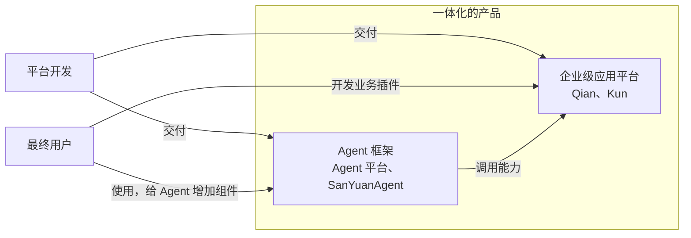
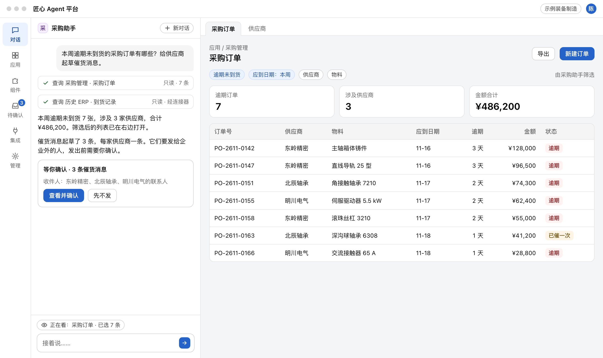
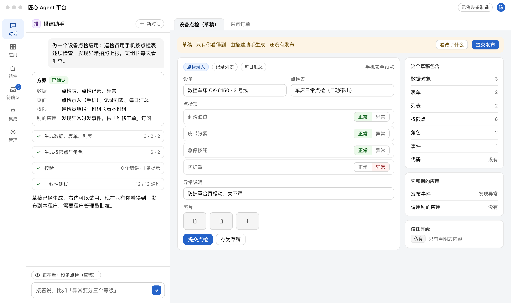
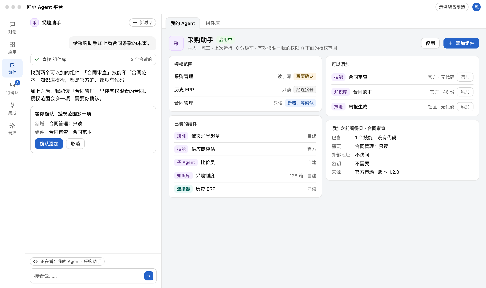
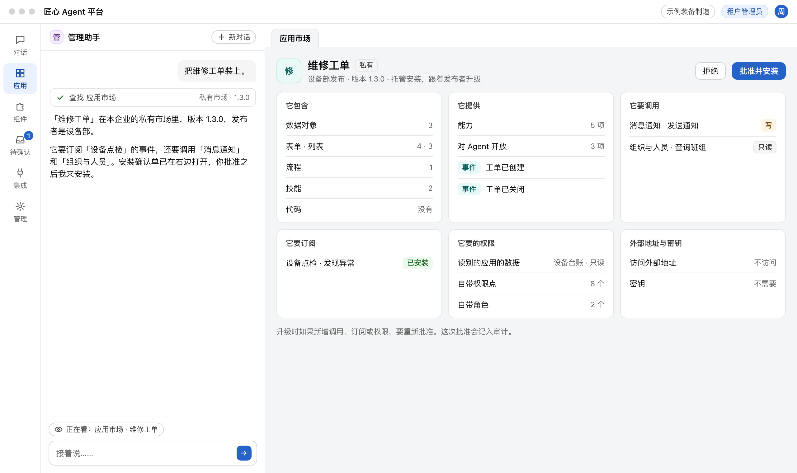
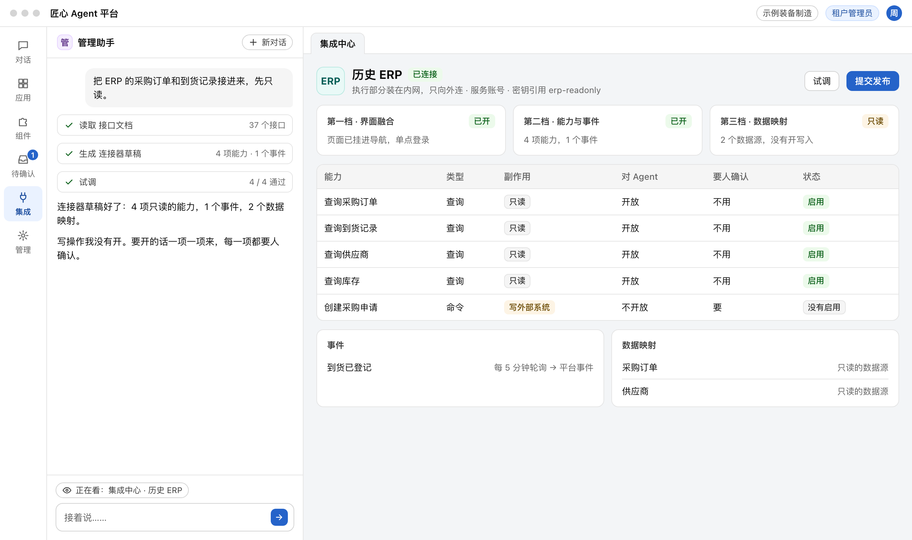
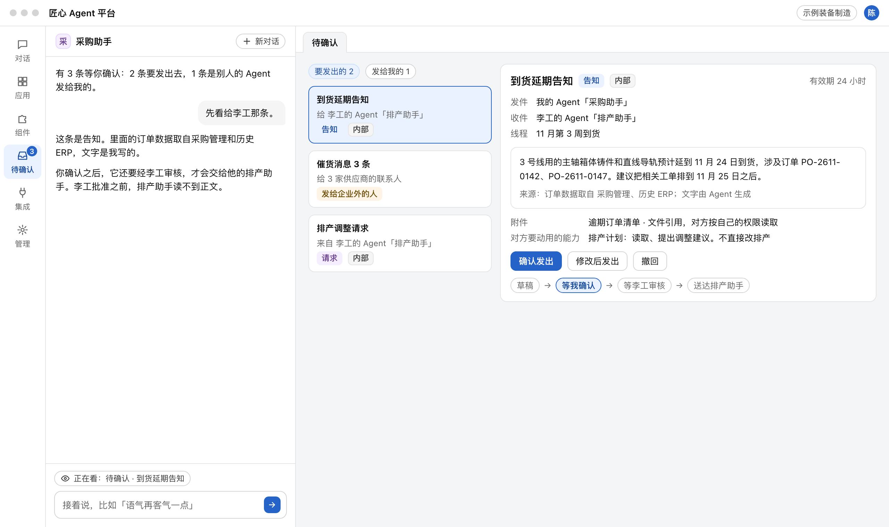

# 角色与产品形态

> 状态：规划稿（2026-11-19）。已定的是第 1 节列的几条，出自 [2026-11-19 平台级裁定](decisions/2026-11-19-platform.md) P22 至 P25、P33；其余是提议，待产品负责人确认。本文说的界面都还没有实现。「已有」指在来源仓库里已经实现。
>
> 2026-11-20 补：匠心工业智能体平台的 Agent 运行时用 DSH，界面外壳用 DSH 自己的客户端；客户可能用到 Web 端和客户端（桌面）两个端，管理端先不做（已定，[2026-11-20 产品裁定](decisions/2026-11-20-product.md) P37 至 P39）。本文写于这之前，第 3 节里「界面用 Qian 搭」的提议和第 4.3 节引用的 P13 已按这几条标注；三栏工作台、三种端、两样交付物各由什么组成，还是原来的写法，怎么改待定。

## 1 已定

1. 平台上分两种角色：平台开发，普通开发或最终用户。Agent 框架与企业级核心的开发不由后者负责，他们只使用工具。（P22）
2. 平台开发交付两样东西：一个 Agent 框架，一个企业级应用平台。两者互补，最终是一体化的产品；`jiangxin` 仓库就是组合体。（P23）
3. 最终用户的使用界面是 Agent 平台。它的客户端基于企业级框架。企业级应用平台不另做一套入口：Agent 平台收起对话区，就是它。（P24；2026-11-20 被 P38 部分取代：界面外壳改用 DSH 的客户端）
4. 最终用户有两种扩展：基于企业级应用平台开发插件；给 Agent 增加组件。平台提供基础组件，并内置智能体、知识库模板等内容。（P25）
5. 交付给客户的，可以是多租户的版本，也可以是单租户的版本。（P33）

## 2 两种角色

分界线是谁能改框架与核心。

| | 平台开发 | 最终用户 |
|---|---|---|
| 是谁 | 写三个框架的人 | 企业里的业务人员和普通开发 |
| 交付或产出 | Agent 框架、企业级应用平台，以及系统级与官方的组件 | 业务插件、Agent 组件、连接器配置 |
| 用什么工具 | 通用的编码智能体，加各仓库写给智能体的协作约定 | Agent 平台本身。会写的人另有组件命令行 |
| 能碰什么 | 框架与核心代码。产出可以进平台的共享进程 | 声明式内容、沙箱里的函数。不进共享进程 |
| 信任等级 | 系统级、官方 | 租户内自建的是私有；上架市场之后的等级按来源与审核另定 |

这条边界有一半已经写进现行的规格：智能体生成的组件固定为私有等级，不得带进平台共享进程的代码，需要代码时只能是沙箱里的函数；社区来源的组件现阶段只接受无代码的形态。函数沙箱的运行时还没有做。见[一切皆插件](03-plugin-model.md)第 6、7 节。

### 2.1 最终用户的三顶帽子

提议。最终用户是一种角色，租户里的权限把它分成三顶帽子，同一个人可以兼有。

| 帽子 | 做什么 |
|---|---|
| 使用者 | 用应用，用 Agent 办公 |
| 构建者 | 开发业务插件，给 Agent 增加组件 |
| 租户管理员 | 批准安装与发布，定哪些内容可以免审 |

### 2.2 平台给最终用户准备的东西

| 东西 | 用来做什么 | 现状 |
|---|---|---|
| Agent 平台 | 使用界面，也是开发工具：说清要什么，Agent 生成草稿 | 规划 |
| 基础组件 | 租户、身份、权限、事件、审计、文件、定时作业、消息通知、模型服务。业务插件直接用，不用自己做 | 前七项的核心已有；消息通知、模型服务是规划 |
| 内置内容 | 智能体模板、知识库模板、应用模板、连接器模板。放在官方市场里，装进租户之后可以改 | 规划 |
| 校验器与一致性测试 | 智能体生成的和人写的走同一套，过不了就不能发布 | 校验器已有；一致性测试三套里完成了运行时语义一套，组件一致性那一套与发布前的闸门是规划 |
| 预览 | 草稿先只对自己可见，试用满意再提交 | 规划 |
| 应用市场与组件库 | 找现成的，上架自己的 | 清单格式与校验已有；市场本身是规划 |
| 组件命令行 | 给会写的人：在本地写组件，走同一套校验与发布 | 安装、升级、移除、列出、打印配置树已有；成套的脚手架模板、本机运行、打包、签名、发布是规划 |

## 3 两样交付物与一体化

| 交付物 | 由什么组成 | 管什么 |
|---|---|---|
| Agent 框架 | 智能体引擎 SanYuanAgent；Agent 平台，即最终用户的使用界面 | 理解意图、规划、调用工具、记忆；和人对话，把结果交给人判断 |
| 企业级应用平台 | 后端 Kun；前端 Qian | 租户、身份、权限、数据、事件、审计；应用、应用市场、历史系统的接入 |
| 组合体 | 在 `jiangxin` 仓库 | 把上面两样拼成一个产品 |

Agent 平台的客户端基于企业级框架（已定）。原来的提议是这样落：界面用 Qian 搭；身份、权限、应用与能力来自 Kun；智能来自 SanYuanAgent。2026-11-20 起界面外壳用 DSH 的客户端、Agent 运行时用 DSH（已定，P37、P38），这条提议由此改写；身份、权限这些由哪个后端提供，SanYuanAgent 以后怎么接，待定。组合体里现在有什么，见[仓库与归属](05-repositories.md)第 1.1 节。

## 4 Agent 平台是入口

最终用户打开的是 Agent 平台（已定）。提议它是一个三栏的工作台：左边是导航，中间是和 Agent 的对话，右边是工作区。

企业级应用平台没有另一个要用户去记的入口，它出现在三个地方：

- **工作区里打开的每个页面。** 应用、应用市场、集成中心、系统管理，都是企业级应用平台的页面，由 Agent 平台按需装载。
- **Agent 调用的平台能力。** Agent 查业务数据、办业务上的事，调的是企业级应用平台登记在能力目录里的能力。它的有效权限不超过用户本人的权限与授给它的范围的交集。引擎自带的工具和本机的工具不在此列。
- **业务插件运行的底座。** 最终用户开发的插件装在它上面，装好就是工作区里能打开的应用，也是 Agent 能调用的能力。

对话区和工作区是连着的：

- 工作区当前的页面和选中的记录，是 Agent 的上下文。
- Agent 的结果可以落到工作区：打开页面、定位记录、给出草稿的预览。
- Agent 要改数据或往外发内容时，在对话里出一张确认卡，人点了才执行。

对话区可以收起。收起之后就是企业级应用平台，应用页面照常使用（已定）。

### 4.1 导航里的六个入口

提议。

| 入口 | 里面有什么 |
|---|---|
| 对话 | 和自己的 Agent 说话。一个人有几个 Agent，在这里切换；历史会话也在这里 |
| 应用 | 租户里已经装的应用，和应用市场 |
| 组件 | 我的 Agent，它们各自的组件与授权范围，和组件库 |
| 待确认 | Agent 要发出去的、别人的 Agent 发给我的、等我批准发布的 |
| 集成 | 历史系统的连接器 |
| 管理 | 租户、成员、权限、审计、模型与用量。按权限显示 |

### 4.2 三种用法

| 用法 | 例子 | 靠什么 |
|---|---|---|
| 办公 | 「本周逾期未到货的采购订单有哪些，给供应商起草催货消息」 | 能力目录、权限判定、确认卡 |
| 开发 | 「做一个设备点检应用」「给采购助手加上看合同条款的本事」 | 构建闭环，见[一切皆插件](03-plugin-model.md)第 7 节 |
| 管理 | 「把维修工单装上」「把 ERP 的采购订单接进来」 | [应用互通](10-app-interop.md)、[历史系统接入](11-legacy-systems.md) |

### 4.3 三种端

提议。

| 端 | 形态 | 说明 |
|---|---|---|
| 网页 | 三栏工作台 | 引擎在集群里 |
| 桌面 | 同一套界面，加本机的引擎 | 能读写本机文件、接本机的工具 |
| 移动 | 待确认与通知优先 | 随时批准或驳回 |

引擎是独立运行的 SDK，每个端都要用到它（已定，见 [2026-11-17 平台级裁定](decisions/2026-11-17-platform.md) P13）。2026-11-20 起 Web 端和客户端的 Agent 运行时用 DSH（P37），P13 的这一句对这两个端不再成立，见 [2026-11-20 产品裁定](decisions/2026-11-20-product.md)第 2 节。Agent 平台的客户端基于企业级框架（已定），三种端登录的都是同一个平台。

## 5 界面示意

下面六张图是示意，不是最终设计。图里的企业、人名与数据是虚构的。

**办公：问数据，办事情。** Agent 在用户本人的权限与授给它的范围之内查了两个地方的数据，把结果落到工作区的页面上；要发给企业外的人的消息，停在确认卡上等人点。

**开发业务插件：一句话做应用。** Agent 先给方案，人确认之后才生成。草稿在工作区里可以直接试用，右侧列出它包含什么、和别的应用有什么往来。发布要另外提交。

**给 Agent 增加组件：我的 Agent。** 每个 Agent 有自己的授权范围和一组组件。添加组件之前，先看得见它包含什么、需要什么；授权范围变大要本人确认。

**安装确认：应用互通看得见。** 安装之前，管理员一次看清这个应用和别的应用之间的全部往来。见[应用互通](10-app-interop.md)。

**历史系统：连接器。** 一套历史系统一个连接器。三档接入各自开关；每项能力写明副作用、是否对 Agent 开放、是否要人确认；写操作缺省不开。见[历史系统接入](11-legacy-systems.md)。

**待确认：发出去之前人审。** Agent 要发出去的内容先停在这里。确认的人看得到谁发给谁、正文、数据来源、对方要动用哪些能力。见 [Agent 协同](04-agent-collaboration.md)。

## 6 两种交付版本

交付给客户的，可以是多租户的版本，也可以是单租户的版本（已定）。

提议：两个版本是同一套代码、同一种数据模型的两种装配，不分叉。

| | 多租户的版本 | 单租户的版本 |
|---|---|---|
| 适合 | 一套部署服务多个组织，例如集团、园区、运营方 | 一个组织自己用一套 |
| 租户 | 多个。各自隔离，各自启用与定制 | 只有一个 |
| 装什么 | 全部，含租户开通与租户运营 | 不装租户开通与租户运营；界面上不出现切换租户 |
| 数据 | 每条记录带租户 | 同样带租户，只是只有一个。以后要变成多租户，不用迁移数据 |

## 7 待定

| 事项 | 提议 |
|---|---|
| 三栏的布局、六个入口、三种端 | 见第 4 节 |
| 最终用户的三顶帽子各对应哪些权限 | 沿用租户里现有的角色：使用者、开发者、管理员 |
| 第一批内置内容做哪些 | 没有提议。候选见[一切皆插件](03-plugin-model.md)第 5 节 |
| 单租户的版本怎么装配 | 同一套代码，装配时只留一个租户，见第 6 节。用哪一种部署形态待定 |
| 桌面端的本机引擎怎么接平台 | 照设备接入的思路，见[总体架构](02-architecture.md)第 5 节 |
