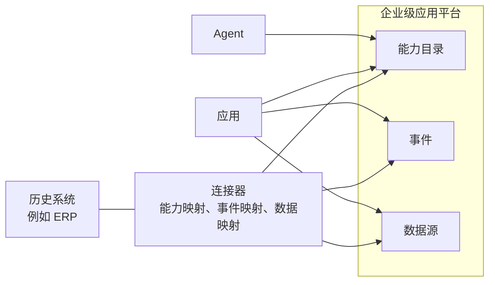
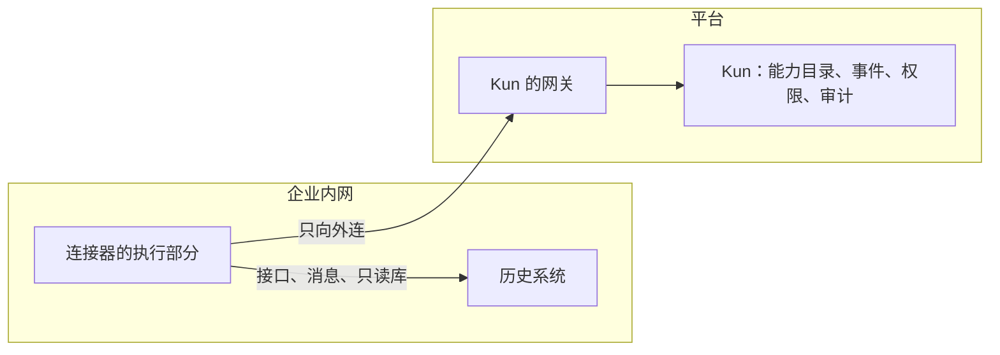
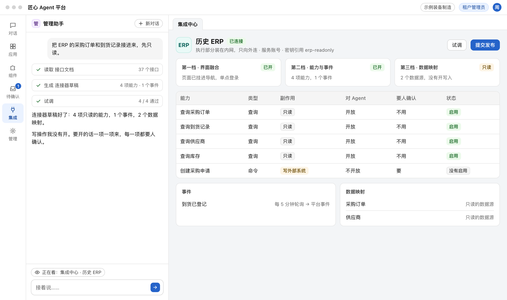

# 历史系统接入

> 状态：规划稿（2026-11-19）。已定的是第 1 节的两条，出自 [2026-11-19 平台级裁定](decisions/2026-11-19-platform.md) P27；其余是提议，待产品负责人确认。本文说的连接器还没有实现。「已有」指在来源仓库里已经实现。

## 1 已定

1. 遗留的历史系统要能集成进企业级框架，并融合进 Agent 框架。
2. 历史系统在企业内网的，连接器的执行部分装在内网，只向外连。

本文回答怎么落：历史系统在平台里以什么形态出现、接到多深、几种接法、账号与数据归谁、怎么进 Agent。

## 2 一套历史系统一个连接器

企业里已有的系统不会消失，例如 ERP。提议把每一套历史系统做成一个连接器组件。连接器把历史系统翻译成平台里的三样标准东西：能力、事件、数据。翻译完，应用和 Agent 用它的方式，和用平台自己的应用一样。

连接器是组件的一种（见[一切皆插件](03-plugin-model.md)）：它装进租户、按租户启用、受同一套信任等级与安装确认约束。在主体模型里，物由连接器代表，连接器以服务主体运行，能访问哪些外部地址要事先声明，见[总体架构](02-architecture.md)第 3 节。

## 3 连接器里有什么

| 内容 | 说明 | 现状 |
|---|---|---|
| 连接配置 | 地址、认证方式。密钥只写引用，不写值 | 密钥引用已有；数据库连接的档案已有，现在只支持 PostgreSQL |
| 出网声明 | 它会访问哪些外部地址。没声明的访问不放行 | 清单字段已有 |
| 能力映射 | 把对方的操作登记成平台的能力，写明副作用等级、是否对 Agent 开放、是否要人确认 | 能力条目的这些字段已有；映射的格式是提议 |
| 事件映射 | 把对方的变更转成平台事件：对方回调、定时轮询、变更捕获 | 提议 |
| 数据映射 | 把对方的数据映射成平台的数据源，表单和列表直接用 | 提议。它与来源仓库规划里的数据接口有重叠，要一起定 |
| 身份映射 | 平台用户对到历史系统里的账号 | 提议 |

## 4 三档接入深度

| 档 | 做什么 | 得到什么 |
|---|---|---|
| 第一档：界面融合 | 历史系统的页面挂进导航，单点登录之后在工作区里打开 | 成本最低。应用和 Agent 还不能调它 |
| 第二档：能力与事件 | 把常用的查询和操作登记成能力，把关键变更转成事件 | 应用可以调用和订阅，Agent 可以把它当工具用 |
| 第三档：数据映射 | 把它的数据映射成数据源 | 平台的表单和列表直接读。写入要单独放开 |

一套系统可以三档并用。建议先做第一档，再做第二档；第三档只给确实要在平台里直接看的数据。

## 5 按历史系统的开放程度选接法

| 历史系统有什么 | 接法 | 注意 |
|---|---|---|
| 有接口 | 连接器直接调接口 | 首选 |
| 有消息队列或企业服务总线 | 订阅它的消息，转成平台事件 | 消息要去重 |
| 只有数据库 | 只读账号，加视图或变更捕获 | 照已有决策，直接写查询语句是高级权限：只读账号、限时、限行数、参数化、留审计，发布要租户管理员批准。这条决策只覆盖平台自己的库；连历史系统的库，属于还没有裁决的「租户自带连接」，要另定，见第 10 节 |
| 只能导入导出文件 | 定时交换文件 | 延迟按批次算 |
| 只有界面 | 在沙箱里做界面自动化 | 最后的手段。脆弱，只做读取或低风险的操作 |

## 6 几条规则

提议。

- **账号。** 两种用法。服务账号：连接器用一个账号访问，谁能用哪项能力由平台的权限管。本人账号：按身份映射用本人在历史系统里的账号，历史系统自己的权限继续生效。
- **数据归属。** 每类数据定一个权威方。缺省单向同步，不双写。
- **写操作。** 往历史系统里写的能力，副作用等级标为「对外」，也就是对平台之外产生作用。这类能力缺省要人确认，带幂等键，失败时给结构化的错误。Agent 经连接器往历史系统里写，算「发出去」，要人确认（已定），见 [Agent 协同](04-agent-collaboration.md)第 4.2 节。
- **进 Agent。** 连接器登记的能力进能力目录，按范围成为 Agent 的工具。标了不对 Agent 开放的不出现。
- **谁来做。** 接口描述规范的，最终用户用 Agent 生成配置型的连接器。协议特殊的，由平台开发或伙伴做带代码的连接器，过审核。

## 7 装在内网的执行部分

历史系统多在企业内网，平台连不进去。已定：历史系统在内网的，连接器的执行部分装在内网，只向外连。

做法是提议：

- **连接器分成两部分。** 声明（映射、权限、出网）在平台；执行部分是一个常驻的小程序，装在连得到历史系统的网络里。
- **只向外连。** 执行部分启动后主动连平台，平台不需要连进内网，内网不用为平台开入站的端口。
- **入网要人批准。** 照设备入网的思路：在本机生成密钥，由租户管理员在平台上批准，之后用密钥换短期令牌。设备入网见[总体架构](02-architecture.md)第 5 节。
- **账号留在内网一侧。** 历史系统的账号与密钥由执行部分在内网里解析，平台只存引用。
- **断连时不丢。** 连不上时，调用返回结构化的错误；历史系统一侧的变更先存本机，连上之后补传。
- **同一个网络里的不用分。** 平台和历史系统在同一个网络里时，执行部分可以和平台装在一起。

## 8 接入一套 ERP 的步骤

1. 盘点。列出要用的数据和操作，每类数据定权威方。
2. 做第一档。把 ERP 的页面挂进导航，接上单点登录。
3. 建连接器。填地址与认证方式，声明出网地址，密钥存成引用；历史系统在内网的，装上执行部分并批准它入网。
4. 登记只读的能力。查询采购订单、到货记录、供应商、库存，试调通过后启用。
5. 接事件。把「到货已登记」转成平台事件。
6. 放开写操作。一项一项来，每项都要人确认。
7. 需要的话做数据映射。把采购订单映射成只读的数据源，给平台里的列表用。

连接器页面的示意（不是最终设计，图里的企业、人名与数据是虚构的）：

## 9 三个框架各做什么

| 框架 | 负责 | 现状 |
|---|---|---|
| Kun | 连接器的格式与校验；把映射登记成能力、事件与数据源；身份映射；执行部分的入网与连接 | 密钥引用、出网声明、能力条目的字段已有；其余是规划 |
| Qian | 集成中心的界面：连接器、三档的开关、能力逐项启用与试调 | 规划 |
| SanYuanAgent | 把连接器登记的能力当工具用；生成配置型连接器的草稿 | 规划 |
| 契约 | 连接器的映射格式；执行部分与平台之间的接口 | 规划 |

## 10 待定

| 事项 | 提议 |
|---|---|
| 连接器的格式：能力、事件、数据三种映射怎么写 | 作为组件里的一类声明式内容；配置型的连接器不带代码 |
| 装在内网的执行部分怎么接入平台 | 照设备入网的思路，见第 7 节 |
| 身份映射怎么做 | 先支持服务账号，本人账号随后 |
| 能不能直接连历史系统的数据库 | 没有提议。现行的决策只让平台自己的库用只读账号；租户自带连接在来源仓库里还没有裁决 |
| 带代码的连接器由谁做、谁审核 | 平台开发或伙伴做，按信任等级过审核 |
| 界面自动化这种接法做不做 | 最后的手段，起步不做 |
| 第一个参考连接器接什么 | 没有提议 |
