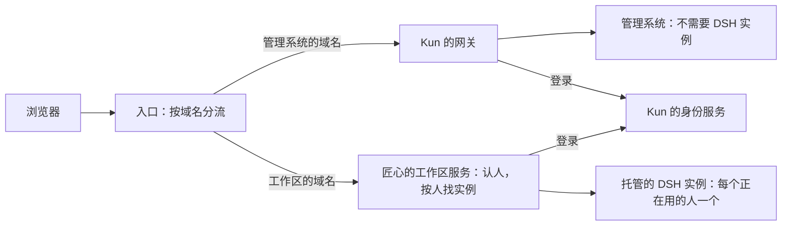

# 2026-11-25 平台级裁定

> 记录产品负责人 2026-11-25 对平台的裁定，编号接着 [2026-11-24 平台级裁定](2026-11-24-platform.md)。引号里是原话，照录不改，有歧义的地方把读法写在括号里。本文第 1 节只记已定的事；没有定的在第 6 节，标「提议」或「待定」。
>
> 本文说到的管理系统、工作区服务、托管的 DSH 实例、单机版的装配、`deploy/` 目录、确认卡、「待确认」的页面、生成应用用的渲染器、平台上等人点头的任务、演示用的替身，都是规划，还没有实现。按 P76 做的基础组件已经有了第一批，见第 3.10 节的现状。

同一天，一份整体蓝图的草稿把要产品负责人点头的事分成两组：与已接受的决策有出入的，编号甲 1 至甲 3；要一个答案才能动手的，编号乙 1 起。原话里的「甲」「乙」指的是这些编号。蓝图草稿本身是提议，没有入库；本文只记其中产品负责人点了头的条目。

同一天还有一份对三个场景的评估，场景见第 3.5 节。P66 至 P74 答的是这份评估里的提议。评估本身也没有入库，本文同样只记点了头的条目。P75 答的是把第一条线拆成任务时提出的一问。

同一天稍晚还有两问。在真的 DSH 实例里把三种做法试过以后，问了基础组件用哪一套，P76 答的是这一问。随后产品负责人要求评估 Qian 还需不需要，评估以后问了它的仓库归不归档，P77 答的是这一问。试验和评估都没有入库，本文同样只记点了头的条目。

## 1 已定

| 编号 | 裁定 | 原话 |
|---|---|---|
| P57 | 运维侧各个控制台的登录也接 Kun 的身份服务，交付给客户的产品里不带 Authentik。各控制台保留一个本地的应急管理员 | 「都按提议定」（答的是「与旧决策有出入的甲 1 至甲 3，都按提议定吗？」；这是甲 1） |
| P58 | 单机版默认不装 Apollo，读配置文件；要在运行期改配置的客户可以加装。企业版照旧装 | 同上（甲 2） |
| P59 | 单机版里身份服务与平台服务同一个进程，网关仍独立成进程。企业版仍是三个进程分开 | 同上（甲 3） |
| P60 | Kun 是通用的组件：提供登录这类组件，不负责任何业务。匠心首先是一套企业级的管理系统加 Agent。最终的界面放在匠心，也可以放到另一个仓库 | 「我想 Kun 是一个通用的组件，Jiangxin 首先是一套企业级的管理系统+Agent」「例如，Kun 提供一些登录等组件，但是不负责任何业务，最终的界面肯定是要放到Jiangxin 也可以放到另外一个库。」 |
| P61 | 产品的部署清单放 `jiangxin` 的 `deploy/`，跟着产品版本打标签；各环境的差异留在部署仓库。放哪个仓库，产品负责人交给蓝图的整理者定；这一条是受托定下的 | 「乙 1 清单放哪个仓库，你来定。」 |
| P62 | 每人一个 DSH 实例。客户端（桌面）每人一个，跑在各人自己的电脑上。Web 端怎么做当时没有想好，要设计，结果见 P63 | 「乙 2 没人一个 DSH，客户端每个人一个 DSH，但是 web 端 我没有想好如何设计。 这个地方需要进行设计。」（「没人」按上下文读作「每人」） |
| P63 | Web 端按「管理系统加按需托管的工作区」的形状走。Web 端分成两块，放在两个域名上：管理系统是多用户的网页应用，不需要 DSH 实例；Agent 工作区用 DSH 自己的客户端，后面是托管在服务器上的 DSH 实例。托管实例每个正在用 Agent 的人一个，按需启动、空闲回收、有上限。把登录的人送进他自己的实例，由匠心的工作区服务做。单机版以桌面为主 | 「按这个设计走」（答的是「Web 端按「管理系统加按需托管的工作区」这个设计往下走吗？」） |
| P64 | 工作区的域名由匠心的工作区服务直接接，不经过 Kun 的网关。工作区服务用 Kun 发布的登录组件认人，登录仍然到 Kun 的身份服务，Kun 不用改。管理系统的域名照旧过 Kun 的网关。另一条路是先补 Kun 的网关、再让工作区走它，没有选 | 「工作区服务直接接」（答的是「工作区这个域名的入口，由谁来接？」） |
| P65 | 管理端也要支持 Cordis；管理端的内容要能显示在 DSH 右侧的页签里。此前的建议是管理系统用 Qian 搭、工作区里用 DSH 的组件、两套不放进同一个页面，没有采纳 | 「主要我想让管理端也能支持 Cordis，还有，我管理端最终其实也想在 DSH 的右侧展示一些内容，可以通过 table 页签这种形式。举个例子，我想生成一个什么什么系统，然后在右侧可以生成界面并进行发布。」（「table 页签」读作「tab 页签」；答的是「前端按管理系统用 Qian、工作区里用 DSH 的组件这样分吗」） |
| P66 | 管理端只要浏览器一侧：管理端的界面是浏览器里的 Cordis 应用，页面是只有浏览器一半的 Cordis 插件；管理端不设多人共用的 Node 运行环境；带后端一半（Node）的插件只在各人的 DSH 实例里跑。另一个选项是插件的后端一半也要能在管理端跑，没有选 | 「这样定」（答的是「管理端只要浏览器一侧，这样定吗？」） |
| P67 | Agent 生成的应用，界面只能是数据描述，由平台的渲染器画出来；生成的代码不当页面插件装 | 「其余的也按提议定」（答的是整理者的一句话：「评估里其余的做法我没有当成已定，仍是『先按着走，不反对就这样』：生成的应用界面只能是数据描述、等人点头的事记在平台、审批时模型默认不参与、『日报』先按填报的来排。」这是其中第一项） |
| P68 | 等人点头的事记在平台，包括平台来的审批任务与 Agent 要办的、要人确认的事。确认卡的点击由浏览器带着本人的登录直接交给平台；DSH 自带的问人接口只用于实例里面的动作 | 同上（第二项） |
| P69 | 审批时模型默认不参与，人点了才让它看 | 同上（第三项） |
| P70 | 「日报」先按填报的日报来排，排在生成应用的最小一圈里；汇总的日报等报表和应用互通。这是排期上的约定 | 同上（第四项） |
| P71 | 「待确认」做成页面插件，DSH 的右侧和管理端装同一份；在管理端里它就是待办页 | 「待确认和三条线的先后也按提议定」（整理者随后列出上一句话没有算进去的几项，他点了其中两项；这是第一项） |
| P72 | 三条线的先后：先做确认卡的最小一圈（对应里程碑 M2），再做生成应用的最小一圈（对应 M3）；流程、报表、市场、函数的沙箱、通知往后（对应 M5、M7）。确认卡那一圈不依赖生成应用那一圈；业务审批在对话里弹出来要等流程 | 同上（第二项） |
| P73 | 标了要人确认的能力，调用方不是人本人时，平台自己不执行，先生成一条等人输入的任务，等人点；人点了，平台才执行。「不是人本人」指调用方是 Agent，或者带着委托链。人自己在界面上直接调同一个能力，不拦 | 「都按提议定」（答的是「与 Kun 现行写法对不上的两处，都按提议定吗？」。给他列的表里，这一行是「Agent 调要人确认的能力时，平台自己停下来等人点」，提议是「照这样定，并回写 Kun」） |
| P74 | 等人点头的任务上的动作，缺省只能人做。Agent 代办不是缺省，以后要用再单独放开；怎么放开没有定 | 同上（表里这一行是「等人点头的动作，缺省只能人做」，提议是「照这样定；Agent 代办以后要用再单独放开」） |
| P75 | 确认卡的最小一圈（第一条线，对应里程碑 M2）不等 M1 的智能体主体与 MCP 路由，先用替身演示，和 M1 并行；M1 做好以后替身撤掉 | 「先用替身」（答的是「确认卡这一圈先用替身演示、不等 M1，这样定吗？」，两个选项是「先用替身」「等 M1」） |
| P76 | 匠心的基础组件用 shadcn 这一套（底下是 Base UI），样式用 Tailwind。另一个选项是 Ant Design，没有选 | 「shadcn 加 Tailwind」（答的是「基础组件定哪一套？」，两个选项是「shadcn 加 Tailwind」「Ant Design」） |
| P77 | 前端框架 Qian 的仓库归档，只读；已发布的包留着，继续可以安装。Qian 不再发新版，要发先取消归档 | 「归档，包留着」（答的是「Qian 的仓库现在归档吗？」，两个选项是「归档，包留着」「先不归档」。起因是他先说的一句：「评估Qian 是否需要，如果不需要可以归档。」） |

## 2 用到的前提与说法

产品负责人 2026-11-24 交代蓝图时说过下面四句话。第 3 节拿它们当理由引用。它们本身没有编号；要不要记成平台级裁定，待产品负责人定，见第 6 节。

| 说了什么 | 原话 |
|---|---|
| 多租户、登录、网关鉴权由 C# 写的 PaaS 服务提供 | 「C# 提供 PaaS服务（多租户、登录、网关鉴权）」 |
| 匠心是最终的展示系统，有 Web、客户端、管理端 | 「Jiangxin 是最终的展示系统（Web、客户端、管理端）」 |
| 还要适配小企业：单机上能跑，大模型通过 API 调用 | 「有些企业可能比较小，能不能同时适配一个小型的企业在单机上可以跑的，大模型通过 API 进行调用。」 |
| 所有涉及权限的，以后都接到 PaaS 服务上，统一用 C# 提供 | 「所有涉及到权限的这些，后面我都会接入到 PaaS 服务上。统一使用 C# 进行提供。」 |

本文的几个说法：

- **单机版、企业版。** 单机版指上表第三句说的那种部署：给小企业，一台服务器上能跑，模型经 API 调用。企业版指跑在集群上的全套部署。两个版本各装什么，除 P58、P59 两条以外都是提议。它们和 P33 的多租户的版本、单租户的版本不是一回事：前者说部署的规模，后者说租户的数量。这是整理时的读法。
- **管理系统、管理端。** 指同一样东西：Web 端里不需要 DSH 实例的那一块，代码的位置是 `apps/console/`。产品负责人两个词都用过。
- **工作区服务。** 匠心自己的一个服务：接工作区的域名，把登录的人送进他自己的 DSH 实例（P63、P64）。
- **托管实例。** 跑在服务器上、给 Web 端用的 DSH 实例。桌面客户端里的 DSH 跑在各人自己的电脑上，不算托管实例。

## 3 理由与范围

### 3.1 P57 至 P59：与 Kun 已接受的决策有出入的三条

**P57 运维侧的登录。**

- 理由：第 2 节第四句。交付给客户的东西里少一个组件，单机版尤其需要。不这样做，客户现场要维护两套身份系统，权限有一半不在 C# 里。
- 应急管理员：Kun 的身份服务自己要靠数据库和缓存才能运行。它不可用的时候，要能登进控制台去修，所以每个控制台留一个本地的应急管理员，平时不用。
- 范围：交付给客户的产品。已有环境的运维侧什么时候换，不在这一条里。

**P58 单机版默认不装 Apollo。**

- 理由：单机版少装一套组件，少备份一个库；Kun 的宿主不接 Apollo 也能启动，这时读的是宿主自己的配置。
- 代价：单机版没有运行期的配置推送、配置灰度和配置发布的审计。改配置靠改文件，一般要重启服务。
- 更正：裁定时给的理由里还有省内存一条，估的是约 3 GB。这个数是按内存的请求量估的，偏高；裁定之后核对，省下的内存比当时说的少。上面两条理由不变。

**P59 单机版里身份与平台同进程。**

- 理由：这个形状验收过，Kun 的联调环境与集成测试用的就是它（Kun 的 ADR-017 第 10 节）。一台机器上，分进程换来的隔离有限。
- 代价：身份服务与平台服务的故障、漏洞连在一起。单机版升到企业版时要拆开；数据不用迁，换装配。
- 范围：只是单机版的一处写明的例外。企业版不采用这个形状。

### 3.2 P60：Kun 与匠心各管什么

- 这两句话接着产品负责人自己的一个疑问说的：「我现在有一个疑问，C# 这个平台要不要从jiangxin 里面拿出来。管理端」。
- 此前的建议是管理端的主体放在 Kun，接着用那里的外壳和界面包，匠心只留自己的几个管理页面。没有采纳。
- 由此：管理端和最终的界面归匠心，或者另一个仓库；Kun 只出通用的组件，不带业务。它与 P23（`jiangxin` 是组合体）、第 2 节第二句是一个方向，说得更细。
- 它不改 Kun 现在负责的东西。租户、身份、权限、数据、事件、审计这些是通用的平台能力，不带哪一家的业务。这是整理时的读法，没有问过。
- 没有定的：放 `jiangxin` 还是另开一个仓库；Kun 里现有的应用外壳与界面包以后怎么用。见第 6 节。

### 3.3 P61：部署清单放哪

- 定成什么：产品的清单（base，加各版本的装配）放 `jiangxin` 的 `deploy/`，跟着产品版本打标签。各环境的差异（域名、镜像仓库的地址、密钥的引用、节点与资源）留在部署仓库，按产品的版本号引用这里。第三方组件在本仓库只放钉住的版本、取值和渲染的脚本；渲染出来的结果进发布包与部署仓库，不进本仓库。
- 理由：匠心就是产品（P60），各版本装什么是产品定义的一部分，应该和产品用同一个版本号发布。再开一个仓库，就多一处要对齐的版本。
- 守住的规矩：本仓库是公开的。清单里不出现内部地址、镜像仓库的真实地址、密钥；镜像地址用占位，由各环境的 overlay 替换。另加一条 CI 检查拦内网地址，这一条是规划。
- 与 Kun 的 ADR-017：D17.1 的约定（三层、Kustomize、Argo CD）与 D17.6（每个客户一套 overlay）照旧，变的只是 base 放在哪。
- 现状：只是定了地方，目录还没有建。

### 3.4 P62 至 P64：每人一个实例，Web 端的形状

图里除入口、Kun 的网关与身份服务以外，都是规划。桌面客户端不在图里：它的 DSH 跑在各人自己的电脑上。

- **为什么每人一个。** DSH 的一个实例只有一种调用方身份，就是实例的主人；会话里没有用户和租户，设置、插件、凭据整个实例共用。这是 [2026-11-20 产品裁定](2026-11-20-product.md)第 3 节那条提议的理由，这次定下来。
- **为什么分成两块、两个域名。** 管理页面给很多人用，不该每人为它占一个实例。工作区里要渲染模型生成的内容，还要跑插件；万一被注入了脚本，不能让它带着登录态去调管理接口。
- **为什么按需。** 一个实例空闲时常驻约 320 到 400 MB 内存，冷启动 2 到 3 秒（2026-11-25 在本机与本地容器里实测）。所以不给每个注册用户常驻一个，只给正在用的人，不用就回收。
- **为什么工作区的域名不经过 Kun 的网关。** 2026-11-25 对着 Kun 的主干实测并读了代码：Kun 现有的网关宿主只按路径分流，一个宿主只有一个登录回调地址，接不了第二个域名；它要求会改状态的请求带防伪令牌的请求头，DSH 的客户端不带这个头，请求会被拒。另外，Kun 是通用的组件（P60），「把人送到他的 Agent 实例」这段逻辑不该写进 Kun 的网关。
- **P64 的代价。** 工作区服务成了直接面向浏览器的入口，可信代理、限流、会话存储要自己装配，可以用 Kun 的包。这条流量不经过 Kun 网关的限流与审计。
- **P64 是一处有意的偏离。** Kun 的 ADR-010 定的是业务接口的边界在 Kun 的网关，见第 5 节。Kun 以后补了按主机名路由这类能力，要不要把工作区并回去，可以再议。
- **已定的只是形状。** 实例怎么隔离、凭据怎么保管、什么算空闲、上限是多少、登录以后先到哪一页，都是提议，见第 6 节。

### 3.5 P65、P66：管理端的前端

- **P65 的范围。** 它是 P38 的延伸。P38 定的是 Web 端与桌面的界面外壳用 DSH 自己的客户端，DSH 的客户端本身是浏览器里的一个 Cordis 应用。这次把管理端也定到同一条路上，而且管理端的内容要能出现在 DSH 的右侧。它不改 P38，也不解冻 Qian。
- **P66 的理由。** 产品负责人同一天说了三个要实现的场景：管理端有应用市场，用户用自然语言生成应用并上架；在 Agent 平台上开发企业级应用，发布到企业级平台；对话里弹出确认框，直接审批。评估下来，这些场景里应用的后端都落在企业级平台上，没有一处需要在管理端里跑 Node。管理端是多人共用的，第三方的和生成出来的代码不该进共享的进程。带后端一半的插件仍然有地方跑，就是各人的 DSH 实例。
- **试过的。** 2026-11-25 在本机做了两个实验，用的都是假的平台接口。一个不起 DSH 进程，只用静态文件搭一个不带对话的 Cordis 应用，把仓库里现有的插件样板和品牌包原样装进去，能用。另一个在 DSH 的右侧登记自己的页签，显示对话里生成的界面，能用。
- **没有定的。** 怎么做到同一份页面两边都能装、取数走哪条路、管理端的外壳怎么搭、Qian 的组件怎么迁，都是提议，见第 6 节。其中「待确认」这一页已定两边装同一份，见 P71。

### 3.6 P67：生成的应用，界面是什么

- **定成什么。** Agent 生成的应用是一个用数据描述的包：数据模型、表单、列表、流程、菜单、角色这些声明式的内容。界面由平台自己的渲染器用平台的组件画出来。生成出来的代码不当页面插件装进外壳。
- **理由。** 页面插件装进外壳以后，和外壳在同一个页面里，外壳能做的它都能做。按 Kun 现行的[组件模型规格](https://github.com/CavaiLAB/kun/blob/main/docs/prd/specs/component-model.md)第 11.1 节，租户自己写的和 Agent 生成的组件是 `private` 等级，界面代码只能隔离着跑；隔离运行的办法在规格里排在后面的阶段，是规划。所以生成的界面只走数据描述这一条路。
- **与此前的写法。** [一切皆插件](../03-plugin-model.md)第 7 节已经写了现行规格里的规则：智能体生成的组件固定为 `private` 等级，不带进平台共享进程的代码，需要代码时只能是沙箱里的函数。P67 与它同向，补上界面这一半。P65 的例子「在右侧可以生成界面并进行发布」照这一条落：右侧显示的是渲染器按草稿画出来的界面。
- **范围。** 只说 Agent 生成的应用。官方与伙伴写的页面插件按信任等级另算，不在这一条里。
- **现状。** 列表与详情的渲染器、按元数据读写业务记录都是规划，排在里程碑 M3。

### 3.7 P68、P69、P73、P74：对话里的确认与审批

起因是第 3.5 节说的第三个场景：审批任务来了，在对话里弹出来，直接批。

**P68 等人点头的事记在平台。**

- 等人点头的事有两种来路，都记在平台。一种是平台来的审批任务，比如流程走到某个人这一步。另一种是 Agent 要办的、要人确认的事，比如它起草的单据要落库、要往外发一条消息。「平台」指企业级应用平台，即 C# 的平台服务。
- 确认卡的点击由浏览器带着这个人自己的登录直接交给平台，不经过模型，也不经过 DSH 实例。
- DSH 自带的问人接口留给它本来的用途：实例里面的动作，比如命令要写工作区以外的文件。

评估里这一条的做法：

- 每件等人点头的事是平台上的一条任务，状态是等人输入，带着允许的动作，并标明只能人做。
- Agent 调一个要人确认的写操作时，平台不执行，先生成一条任务；人点了，平台才执行，结果再回给 Agent。
- 卡片的内容按任务去平台取，不用模型写的文字。

前两条里各有一处与 Kun 现行的写法对不上：Agent 要办的事由平台自己停下来等人点；等人点头的动作只能人做。产品负责人同一天另外答了一句，都按提议定，记为 P73、P74，见本节后半。

理由：

- 实例里跑着模型和插件。答案如果先回到实例、再由实例告诉平台「人批了」，平台就得相信实例的话。平台的事要平台自己从人那里拿到答案。
- 记录只有一份。DSH、管理端、以后的移动端看的是同一条，一处办了，别处一起消失。
- 模型自己调不了平台的批准接口：平台只认这个人自己的登录，这个登录不交给实例。
- 页面里的代码不被模型改动，是另一项前提。托管的实例要为此加固，做法随设计细化，是规划。

这条记录的模型就是 Kun 的 [PRD 第 8.12 节](https://github.com/CavaiLAB/kun/blob/main/docs/prd/08-s2-lowcode.md)写的那一种：流程的待办与 Agent 的中断是同一个模型，标了只能人做的动作 Agent 用不了。那一节还没有实现。

**P69 审批时模型默认不参与。** 任务来了默认只出卡片，不自动让模型读它，也不自动发起一轮对话。人在卡片上点了，Agent 才去读这条任务、查相关的数据、给建议，范围不超过这个人的权限与授给 Agent 的范围。批不批仍然只能由人在卡片上点。

理由：

- 已定的规则是发给每个 Agent 的内容要由人审核，见 [Agent 协同](../04-agent-collaboration.md)第 1 节。申请人写的事由是别人写的内容，自动交给 Agent 就绕过了它；人点一下，正好是这次审核。
- 别人写的内容里可能带着指挥模型的话。
- 自动发起一轮会打断正开着的对话，每来一个任务也多花一轮模型的用量。

**P73 标了要人确认的能力，平台自己停下来等人点。**

- 定成什么：能力条目上标了要人确认的能力，调用方不是人本人时，平台自己不执行，先生成一条等人输入的任务，等人点；人点了，平台才执行。「标了要人确认」指 Kun 的[能力条目契约](https://github.com/CavaiLAB/kun/blob/main/contracts/v0/README.md)里 `agent.requiresConfirmation` 为真。「不是人本人」指调用方是 Agent，或者带着委托链。
- 人自己在界面上直接调同一个能力，不拦。
- 理由见 P68 的第一条：平台的事要平台自己从人那里拿到答案。
- 范围：这一条只定了这一件，标了要人确认的能力由平台自己停。它没有把 Agent 运行时一侧的工具策略与风险门禁整个搬到平台；Kun 的 ADR-016 D16.3 与 PRD 第 10.3 节在别的事情上照旧，调用方自己的策略可以更严。这是整理时的读法。

**P74 等人点头的任务上的动作，缺省只能人做。**

- 定成什么：等人点头的任务上的动作，比如同意、拒绝，缺省只能人做。Agent 以委托人的名义代办不是缺省，以后要用再单独放开。
- 怎么放开没有定。
- 范围：说的是任务上的动作这一层，即 Kun 的 PRD 第 8.8、8.12 节那一层。能力那一层另有一个「只能人做」，在 Kun 冻结的契约里是 `agent.expose` 为假，不是这一条说的。这是整理时的读法。
- 与 P69 的关系：P69 那一段末尾写「批不批仍然只能由人在卡片上点」。照这一条，它是缺省；Agent 代办单独放开以前，这句话不变。这是整理时的读法。

P73、P74 与 Kun 现行写法的出入见第 5 节。两条在 Kun 里都还没有实现：能力条目上的那个标记现在只是登记，平台还不按它拦。

范围：P68、P69、P73、P74 定下的是上面这些。接口的形状没有定。第一条线怎么起步，先用替身已定（P75，见第 3.9 节），其余几项没有定。卡片长什么样、出现在界面的哪几处、平台收到点击时查哪几样，随设计细化。见第 6 节。

### 3.8 P70 至 P72：先做什么

**P70 「日报」先按填报的来排。** 「日报」是第一个场景里的例子，有两种读法：

| | 填报的日报 | 汇总的日报 |
|---|---|---|
| 是什么 | 每人每天填一张单子，主管能看、能汇总 | 按天把已有的数据汇总成一张表，定时发给人 |
| 用到什么 | 数据模型、表单、列表、权限 | 报表、对别的应用数据的查询、定时、消息 |
| 排在哪 | 生成应用的最小一圈，里程碑 M3 | 等报表和应用互通，应用互通在 M5 |

定的是先按前一种来排。

**P71 「待确认」做成页面插件。** 它是只有浏览器一半的页面插件（P66），DSH 的右侧和管理端装同一份；在管理端里它就是待办页。理由：等人点头的事在平台上只有一份记录（P68），两边看的是同一份；这也是 P65 的方向。对话里的卡片要 DSH 开着才有，所以管理端的待办页和平台的通知是兜底；平台的通知是规划。

**P72 三条线的先后。**

| 先后 | 做什么 | 做完能演示什么 | 对应的里程碑 |
|---|---|---|---|
| 第一条线 | 确认卡的最小一圈：平台上等人输入的任务与推送，对话里的确认卡与「待确认」的页面，加一个要人确认的写能力 | Agent 起草一张单据，对话里出确认卡，人点了才落库；审计里看得到是谁点的 | M2 |
| 第二条线 | 生成应用的最小一圈：按数据描述读写业务记录的后端，数据描述的登记与版本；表单、列表的渲染器，组件库带上给 Agent 看的组件目录；管理端的外壳接上登录和真的接口；给 Agent 用的生成工具，即查控件、查数据、校验、预览、试发布；运行时安装数据描述的包，发布的审批和记录 | 说一句话，右侧生成一个填报的日报，有表单、列表、权限；预览，发布到本租户，管理端的菜单里出现 | M3 |
| 第三条线 | 往后：流程（审批）、报表、市场（上架、授权、开通）、函数的沙箱、通知 | 业务审批在对话里弹出来；汇总的日报；市场；带自己逻辑的应用 | M5、M7 |

- 第一条线比第二条线小得多，也不依赖它。
- 业务审批在对话里弹出来要等流程。在那之前，确认卡先用在 Agent 自己要办的事上。
- 与路线的关系：里程碑的顺序是 [P31](2026-11-19-platform.md) 定的，这次没有改。三条线只排了三个场景要用到的东西，不改 M0、M1 在前的顺序；这一句是整理时的读法。
- 当天晚些时候又定了 P75：第一条线不等 M1，先用替身演示，和 M1 并行。上一条的读法照此读：里程碑的顺序、M1 自己的内容与完成标志都不变，变的是第一条线不再等 M1 才开工。见第 3.9 节。
- 各项由哪个仓库承担、什么时候拆成任务，没有定，见第 6 节。

### 3.9 P75：确认卡那一圈先用替身演示

**定成什么。** 确认卡的最小一圈，即 P72 的第一条线，不等 M1 的智能体主体与 MCP 路由，先用替身演示，和 M1 并行。M1 做好以后，替身撤掉。

这一件此前给产品负责人列过，写法是「智能体主体还没有，先用替身演示还是等 M1」，提议是先用替身。

**替身是什么。** M1 做好以前，Agent 没有自己的主体，也没有经 MCP 路由调平台的那条路。替身是这段时间里代它向平台提出请求的一方。下面是做法，接口的形状是提议：

- 实例里的工具不直接调平台，调的是匠心的工作区服务上一个给实例用的入口。
- 工作区服务认出是哪个实例、主人是谁，用自己的服务身份调平台，并写明这次是代谁提出、处理人是谁。
- 平台照样不执行，先建一条等人输入的任务，等人点（P73）。确认卡的点击照 P68，没有变。
- 平台一侧要多一种调法：有专门权限的服务主体声明这次是代某人提出。P73 里「不是人本人」写的是 Agent 或带着委托链；替身期间平台怎么认出要拦，是提议，随契约定稿。

**演示得了的与演示不了的。**

| 用替身 | 具体是什么 |
|---|---|
| 演示得了 | 人点了才落库；审计里看得到是谁点的；实例一侧替人提交决定，平台会拒绝 |
| 演示不了 | 「Agent 以谁的名义」；权限取本人的权限与授给 Agent 的范围的交集。审计里「提出」那一条的主体是工作区服务，不是这个人的 Agent |

**理由。**

- 先用替身，这一圈可以和 M1 并行。等 M1，这一圈就排在它后面。
- 代价：多做一点只为替身用的东西，M1 做好以后要撤；演示时「Agent 以谁的名义」是假的。
- 用替身的做法在试验里走通过，平台与模型用的是替代品。

**与此前写法的关系。**

- 里程碑的顺序是 P31 定的，没有改。M1 自己的内容与完成标志不变。
- 照已有决策，Agent 调平台的能力一律经 MCP 路由，见[总体架构](../02-architecture.md)第 4.1 节。替身期间这一圈的请求不走那条路，是 M1 之前的过渡，有意的偏离；M1 做好以后撤掉，那条决策本身不改。Kun 一侧的出入见第 5 节。

**范围。** 只定了「先用替身、不等 M1」这一件；这是整理时的读法。演示用的那条能力放在哪、谁做、什么时候做、任务进不进看板、替身的接口形状、平台一侧那种调法以后留不留，都没有定。用替身演示出来的算不算里程碑 M2 的完成标志，没有问。见第 6 节。

**现状。** 都还没有实现。

### 3.10 P76：基础组件用哪一套

**定成什么。** 匠心的基础组件用 shadcn 这一套：组件的代码由它的命令行生成、放进自己的仓库，底下的无样式组件是 Base UI，样式用 Tailwind。另一个选项是 Ant Design，没有选。

**起因。** 产品负责人要从两套里选一套作基础组件，原话是「我会从这里选一套，让它作为基础组件，我就不用再自己封装一些基础组件了，有一些不满足的我来自行封装。」随后他补了一句：「或者也考虑使用 DSH 原生，所以前端框架可以不要也可以的，放入 jiangxin 中。」

**选之前试了什么。** 三种做法都放进真的 DSH 实例里试过：shadcn 生成的组件加 Tailwind；直接用 Base UI、样式照 DSH 手写；Ant Design。看到的是：

- 三种做法都装得进 DSH 的右侧页签，都不改变 DSH 自己界面的显示。
- shadcn 生成的组件不能原样用，要按 DSH 的规矩适配一次：不引 Tailwind 的全局重置，类名带前缀；DSH 给所有元素设了圆角的形状，正圆要写回去；生成的代码按 React 19 写，DSH 给插件共享的是 React 18，要改成能转发 ref 的写法，这一条类型检查查不出来，要另设检查；弹层的层级要高过 DSH 的弹窗。
- 弹层放进 DSH 的弹窗，要挂在弹窗里面，不然 DSH 会在按 Tab 时把焦点拉走。
- 弹窗和抽屉的壳用别家的，里面再放 DSH 的菜单，按 Esc 会两层一起关。用 DSH 自己的弹窗改成抽屉是可行的。
- Ant Design 不用改源码就能用，但主题要靠脚本同步，颜色和 DSH 对不准；它的日期选择器放进 DSH 的弹窗，按一次 Esc 会把弹窗一起关掉。
- 同一组控件，两套的体积差两到三成，都只有 DSH 自己的一成上下。

试验用的是本机的假模型，只试了网页形态。桌面形态、管理端的外壳、中文输入法的组字过程没有试。

**理由。**

- 页面是装在 DSH 里、挨着 DSH 自己的控件的。颜色、深浅色、品牌色要跟得上 DSH，按键要守 DSH 的规矩。组件的代码在自己手里，这些改一次就全体生效。
- 这一套的短处是控件不如 Ant Design 齐：日期范围、级联、树、上传要自己拼。
- 它和 Kun 的前端框架选的是同一套，见第 5 节。

**范围。** 只定了用哪一套；这是整理时的读法。下面几条是照试验结果写的做法，产品负责人没有逐条点头，见第 6 节：组件放 `@jx/ui-kit`；DSH 自带的控件直接用 DSH 的，只补它没有的；弹窗和抽屉的壳用 DSH 的；Tailwind 只在界面包这一层用，类名带前缀；界面包以后做成一个插件，各插件共用一份。

**与此前写法的关系。**

- [P38](2026-11-20-product.md#1-已定) 说组件「按 DSH 的写法迁进我们自己的界面包」。外壳用 DSH、组件进自己的界面包，没有变；改的是写法：基础组件不再照 DSH 的样式手写，由 shadcn 生成、样式用 Tailwind，再按 DSH 的规矩适配。手写的组件照旧可以用 DSH 的写法。
- 界面包的[说明](https://github.com/CavaiLAB/jiangxin/blob/main/packages/ui-kit/README.md)原来写着不用 Tailwind、不引第三方组件库，落地时已经改写。

**现状。** 已有：第一批基础组件在界面包里，有带搜索的选择器、下拉选择、日期选择、单选组、多行输入，抽屉用 DSH 的弹窗改成；企业插件样板的台账页用上了它们。怎么加组件、放进 DSH 弹窗要守哪两条，写在界面包的说明里。规划：界面包做成一个插件、各插件共用一份，还没有做，现在是每个用组件的插件各打一份。桌面形态、中文输入法的组字过程仍没有试。

### 3.11 P77：Qian 的仓库归档

**定成什么。** 前端框架 Qian 的仓库归档，变成只读。已发布的包留着，继续可以安装。Qian 不再发新版；要再发，先取消归档。

**起因。** P76 定了以后，产品负责人说：「评估Qian 是否需要，如果不需要可以归档。」这里的「归档」读作把 GitHub 上的仓库设为归档。

**评估看到的。**

- 以后做界面不靠 Qian：外壳用 DSH 的客户端（[P38](2026-11-20-product.md#1-已定)），管理端也走这条路（P65、P66），基础组件用 P76 定的那一套。
- Qian 已发布的包还在用：Kun 仓库里的应用外壳、身份与租户页面等界面，钉在 Qian 的 `0.2.1` 上构建。[P44](2026-11-23-legacy-npm.md) 指定的替代版本也是 `0.2.1`。
- 所以「不需要」只成立一半：仓库不需要再开发，包还不能没有。归档的是仓库，包不动。
- Qian 各个包的源码自 2026-11-17 以后没有改过，仓库里没有没合并的改动。

**归档带来的。**

- 仓库只读：不能再提交，不能再提议题和合并请求。归档可以取消。
- 不再发新版。要改 Qian 的库，得先取消归档。
- Qian 自己的检查不再跑。
- Qian 的 README 和文档以后改不了。平台的名称、分工再有变动，以本仓库的说法为准。
- 归档前，Qian 的 README 写明了仓库归档、包继续可装、以后的界面组件在哪。

**核对过的一件（归档以后补记）。** GitHub 的文档没有写明：仓库归档以后，关联在它名下的包还能不能照常安装。归档当天核对了，照常能装，没有取消归档。核对的是三处，都通过：

- Kun 里一个要装这些包的工作流，归档前后各跑了一次，都不用缓存、把依赖全部重新下载，两次都成功。
- Kun 的文档站按标签检出 Qian 再构建，成功。
- 本仓库的文档站取 Qian 的最新提交再构建，成功。

另外直接读过包源上的版本清单，`0.2.0`、`0.2.1` 都在。核对到的是这一种情形：包是公开的，装包的是别的仓库的工作流。

**范围。** 只定了仓库归档、包留着、不再发新版；这是整理时的读法。没有定的见第 6 节：Kun 里现有的应用外壳与界面包以后怎么用；Kun 的租户与成员管理页面在匠心重做，还是由 Kun 放开嵌入；平台「三个框架」的说法要不要改。

**与此前写法的关系。**

- 「Qian 冻结以后还发不发新版本」是 [2026-11-20 产品裁定](2026-11-20-product.md)第 3 节登记的待定项，[P42](2026-11-21-shell-migration.md) 里又写了一次。现在定了：不发。
- [P34、P35](2026-11-20-release.md) 讲 Qian 后续版本怎么定版本号、组件文档怎么生成。这两条不改；Qian 不再有后续版本，取消归档以后再发版时照这两条办。
- [P44](2026-11-23-legacy-npm.md) 不变：三个旧版本的替代版本仍是 `@cavailab/qian-*@0.2.1`，包留着。
- [P2](2026-11-17-platform.md) 把 Qian 列为三个框架之一。这一条没有改；要不要改，没有问。（11 月 26 日补：已定，「三个框架」的说法移除，见 [P81](2026-11-26-platform.md)）

**现状。** 已有：仓库已于 2026-11-25 归档，只读；已发布的包照常能装，见上面「核对过的一件」。

## 4 修订或取代了此前的哪几条

| 此前的写法 | 出处 | 被哪条修订或取代 | 程度 |
|---|---|---|---|
| 一个用户一个 DSH 实例（提议，没有确认） | [2026-11-20 产品裁定](2026-11-20-product.md)第 3 节；[术语表](../glossary.md)第 5 节；[仓库与归属](../05-repositories.md)第 1.1 节 | P62、P63 | 由提议改为已定。桌面端每人一个；Web 端每个正在用的人一个托管实例 |
| 登录、租户、授权放在实例外面的门户里；门户的认证网关把登录过的用户送进他自己的实例（提议） | 同上；[apps/web 的说明](https://github.com/CavaiLAB/jiangxin/blob/main/apps/web/README.md)第 4 节 | P63、P64 | 部分定下。把人送进实例的那一段就是工作区服务，它直接接工作区的域名，用 Kun 的登录组件认人。令牌怎么换成会话、存在哪，仍是提议 |
| 管理端先不做，目录先建好 | [2026-11-20 产品裁定](2026-11-20-product.md) P39 | P60、P63、P65、P66、P72 | 不取代。「先不做」没有变，什么时候开始做没有单独说。这次定的是它以后是什么：Web 端的两块之一，界面是浏览器里的 Cordis 应用。P72 的第二条线要用到它的外壳，按这个先后它最晚随那一圈开始做；这是推论，见第 6 节 |
| 管理端不是 DSH 的插件，是单独的一个应用；用什么做、接哪个后端，到做的时候再定（提议） | [apps/console 的说明](https://github.com/CavaiLAB/jiangxin/blob/main/apps/console/README.md) | P64 至 P66 | 改写。它仍是单独的一个应用；界面定为浏览器里的 Cordis 应用，页面是只有浏览器一半的 Cordis 插件，同样的内容要能显示在 DSH 右侧的页签里；它的域名过 Kun 的网关 |
| 界面外壳用 DSH 自己的客户端，网页与桌面都是；Qian 冻结在 0.2.1 | [2026-11-20 产品裁定](2026-11-20-product.md) P38 | P65、P66 | 延伸，不取代。管理端也走这条路，范围只到浏览器一侧 |
| 应用、应用市场、系统管理都是三栏工作台里右边的工作区打开的页面（提议） | [角色与产品形态](../09-roles-and-product.md)第 4 节 | P63、P65 | 仍是提议。P65 与它同向。另有一块不需要 DSH 实例的管理系统（P63），是那一节没有写到的 |
| 人到 Agent 的请求经 Kun 的网关转给引擎（规划） | [总体架构](../02-architecture.md)第 1、4、4.1 节 | P63、P64 | 改写。Web 端里这条流量由工作区服务直接接，转给本人的托管实例，不经过 Kun 的网关；经 Kun 的网关的是管理系统 |
| 部署清单放在哪：没有提议 | [仓库与归属](../05-repositories.md)第 1.1、2.5 节 | P61 | 由待定改为已定，是受托定下的。是否另建部署仓库仍待定 |
| 登录、租户、策略、审计由哪个后端提供（待定） | [2026-11-20 产品裁定](2026-11-20-product.md)第 3 节；[2026-11-21 旧应用外壳迁移裁定](2026-11-21-shell-migration.md) P42 | P57、P64 | 登录的部分定了：用 Kun 的身份服务。其余见第 6 节 |
| 依赖的基础设施里有配置中心，选型是 Apollo | [总体架构](../02-architecture.md)第 5、8 节 | P58 | 企业版不变；单机版默认不装 |
| 网关、身份服务、平台服务是三个工作负载 | [总体架构](../02-architecture.md)第 5 节 | P59 | 企业版不变；单机版里身份与平台同进程，是写明的例外 |
| 交付给客户的可以是多租户的版本，也可以是单租户的版本 | [2026-11-19 平台级裁定](2026-11-19-platform.md) P33 | P58、P59 | 不取代。单机版与企业版是另一个维度，见第 2 节 |
| 智能体生成的组件固定为 `private` 等级，需要代码时只能是沙箱里的函数（现行规格里的规则） | [一切皆插件](../03-plugin-model.md)第 7 节 | P67 | 不取代。补上界面这一半：生成的应用界面只能是数据描述，生成的代码不当页面插件装 |
| Agent 要改数据或往外发内容时，在对话里出一张确认卡，人点了才执行（提议） | [角色与产品形态](../09-roles-and-product.md)第 4 节；[Agent 协同](../04-agent-collaboration.md)第 4.2 节；[术语表](../glossary.md)第 4 节 | P68、P69、P73、P74 | 部分定下：等人点头的事记在平台，点击由浏览器直接交给平台，模型默认不参与；标了要人确认的能力由平台自己停下来等人点，任务上的动作缺省只能人做。卡片的样子与位置仍是提议 |
| 「待确认」是 Agent 平台界面的一部分，归在 Qian 名下（提议） | [Agent 协同](../04-agent-collaboration.md)第 6 节；[角色与产品形态](../09-roles-and-product.md)第 4.1 节 | P71 | 改写。「待确认」做成页面插件，DSH 的右侧和管理端装同一份。里面列什么仍是提议 |
| 里程碑 M2、M3、M5、M7 做什么、完成标志是什么 | [路线与迁移](../06-roadmap.md)第 2.1 节；[2026-11-19 平台级裁定](2026-11-19-platform.md) P31 | P70、P72 | 不改顺序。定了三个场景各落在哪个里程碑、前两条线各自做到什么算完；「日报」先按填报的来排 |
| 三条线只排了三个场景要用到的东西，不改 M0、M1 在前的顺序（整理时的读法） | 本文第 3.8 节；[路线与迁移](../06-roadmap.md)第 2.1 节 | P75 | 加注，不取代。里程碑的顺序、M1 自己的内容与完成标志不变；第一条线不等 M1，先用替身演示，和 M1 并行 |
| Agent 不直接连平台服务的地址，一律经 MCP 路由（照已有决策） | [总体架构](../02-architecture.md)第 4.1 节 | P75 | 不取代。M1 之前确认卡那一圈用替身，不走 MCP 路由，是过渡；M1 做好以后撤掉 |
| 组件以后缺哪个，按 DSH 的写法迁进我们自己的界面包 | [2026-11-20 产品裁定](2026-11-20-product.md) P38；[界面包的说明](https://github.com/CavaiLAB/jiangxin/blob/main/packages/ui-kit/README.md) | P76 | 部分改写。外壳用 DSH、组件进自己的界面包，没有变。基础组件改为由 shadcn 生成、样式用 Tailwind，按 DSH 的规矩适配；界面包的说明落地时已经改写 |
| Qian 冻结以后还发不发新版本（待定） | [2026-11-20 产品裁定](2026-11-20-product.md)第 3 节；[P42](2026-11-21-shell-migration.md)；[协作约定](../07-governance.md)的版本表 | P77 | 由待定改为已定：不发。仓库归档，包留着；要发先取消归档 |
| Qian 的组件怎么办（提议：照旧冻结，按需迁进 `@jx/ui-kit`） | 本文第 6 节 | P76、P77 | 部分定下。基础组件用哪一套、Qian 的仓库归档已定；Kun 的租户与成员管理页面怎么办，仍没有定 |

## 5 与 Kun 现行决策的出入

这几条与 Kun 里已接受的决策记录有出入，或者要在那边记一笔。P57 至 P74 里的几条登记成了 Kun 的[决策任务 S1-DEC-041](https://github.com/CavaiLAB/kun/blob/main/pm/tasks/S1-DEC-041.md) 的条目，其余的那边只记了一段说明，见本节后面。P75 登记在[决策任务 S1-DEC-042](https://github.com/CavaiLAB/kun/blob/main/pm/tasks/S1-DEC-042.md)。对应的决策记录末尾各追加了带日期的小节，原文不改。

| Kun 的现行决策 | 现行的写法 | 出入 |
|---|---|---|
| 部署（ADR-017 D17.11，另见 D17.3）；身份（ADR-005 D5.7）；配置中心（ADR-007 D7.1） | 客户的身份用平台自己的身份服务，运维侧用 Authentik | P57：交付给客户的产品里，运维侧的登录也接 Kun 的身份服务，不带 Authentik |
| 配置中心（ADR-007 第 1 节、D7.1） | Apollo 是硬性要求，作为共享的平台组件部署 | P58：单机版默认不装 Apollo。企业版不变 |
| 部署（ADR-017 第 10 节） | 身份与平台同进程只是预发环境的过渡形状，生产不采用 | P59：单机版作为写明的例外采用它，网关仍独立 |
| 网关分层（ADR-010 D10.1） | 三层网关，业务接口的边界在 Kun 的网关 | P64：工作区的域名不经过 Kun 的网关。这是有意的偏离；管理系统的域名与三层的分工不变 |
| 组件模型（ADR-020 第 4 节） | 放弃「直接用 Cordis 作 .NET 一侧的运行时」 | 没有出入。P65、P66 用的是浏览器一侧的 Cordis 插件，管理端里不跑服务端的 JS 运行时 |
| 部署（ADR-017 D17.1、D17.6） | 沿用部署仓库的约定；每个客户一套 overlay | 没有出入。P61 只定了产品的 base 放在哪 |
| Kun 的定位（合并蓝图 ADR-023） | Kun 是多租户平台框架，分内核档与平台档 | 没有出入。P60 另加一句：Kun 不负责任何业务，最终的界面在匠心 |
| 与 Agent 运行时的边界（ADR-016 D16.3；PRD 第 10.3 节，另见第 10.1.2 节） | 平台给出工具的元数据。要不要人确认，运行时的决定权在 Agent 运行时一侧，平台只给默认值 | P73：标了要人确认的能力，调用方不是人本人时，平台自己不执行，等人点。只改这一件，其余照旧，见第 3.7 节的范围 |
| 流程里 Agent 代办的身份（ADR-012 D12.7；PRD 第 8.8 节，另见第 13.5 节） | Agent 可以以委托人的名义做「同意」这类动作，只有签名类动作只能人做 | P74：等人点头的任务上的动作缺省只能人做；Agent 代办不是缺省，以后要用再单独放开 |
| Agent 的调用路径（ADR-016 D16.9；另见 ADR-010 第 6 节，PRD 第 7.9、10.2 节） | Agent 不直连平台服务的地址，一律经 MCP 路由；启用的时点在 M1 | P75：M1 之前，确认卡那一圈用替身演示，请求经匠心的工作区服务、由它用服务身份调平台，不经 MCP 路由。这是过渡，有意的偏离；M1 做好以后撤掉，D16.9 本身不改 |

P73、P74 两行与 Kun 已接受的写法有出入，这一点在给产品负责人列的表下面写明了。回写在 Kun 的 ADR-016 第 9 节、ADR-012 第 9 节，以及 PRD 第 8.8、8.12、10.3、13.5 节的修订注。P75 一行回写在 ADR-016 第 10 节，以及 ADR-010 第 6 节、PRD 第 7.9、10.2 节的标注。

Kun 的 PRD 里另有三句与 P73 同向的话，都没有展开成契约：第 10.3 节说危险操作 Agent 只能发起申请；第 13.5 节把「要确认」解释为 Agent 发起时平台回等人输入，由人确认后继续；第 3.10 节的例子说 Agent 调一个要人确认的工具，收到的也是等人输入。

P67 至 P72 没有登记成那份决策任务里的条目，那边只记了一段说明。

- P67 与 Kun 的现行规格没有出入：照的是 Kun 的 [PRD 第 10.4 节](https://github.com/CavaiLAB/kun/blob/main/docs/prd/10-s4-agent.md)与组件模型规格第 11.1、11.2 节。
- P68、P69 用的任务模型是 Kun 的 PRD 第 8.12 节的那一种。评估里的做法原有两处与 Kun 现行的写法对不上，现在已定，就是上表的 P73、P74。

这几节在 Kun 里都还没有实现，替身要用的那种调法也没有。

P76、P77 没有登记成 Kun 的决策任务，那边也没有回写。P76 与 Kun 的 ADR-013（前端框架）选的是同一套：Base UI 加 shadcn，代码放进自己的仓库，没有出入。ADR-013 把 Qian 定为前端框架，文中没有冻结或归档的标注。P77 不动 Kun 仓库里钉在 Qian `0.2.1` 上的界面。（11 月 26 日补：P77 已登记进 Kun 的决策任务 S1-DEC-043，ADR-013 加了归档的标注，见 [2026-11-26 平台级裁定](2026-11-26-platform.md)第 5 节。P76 没有出入，没有登记）

## 6 提议与待定

下面这些产品负责人没有定。个别行里已定的部分，在行里写明。

| 事项 | 现在的情况 | 状态 |
|---|---|---|
| 第 2 节的四句前提要不要记成平台级裁定 | 它们是产品负责人交代蓝图时说的，本文只当理由引用 | 待定 |
| 登录、租户、策略、审计由哪个后端提供 | 登录已随 P57、P64 落在 Kun 的身份服务。租户、策略、审计，第 2 节第一、四句等于答了，是 C# 的 PaaS 服务，即 Kun；没有记成裁定 | 登录已定；其余待确认 |
| 企业版与单机版各装什么 | 蓝图草稿的提议：两个版本用同一套清单、两份装配，单机版用单节点的 K3s，少装一批组件。除 P58、P59 以外都没有定 | 提议 |
| 配置中心用 Apollo 还是 Nacos | 产品负责人 2026-11-25 要求评估。评估的建议是维持现行决策，配置中心用 Apollo；他没有表态。P58 说的 Apollo 照现行决策写 | 提议，没有被反对 |
| Web 端的细则 | 实例怎么隔离，凭据怎么保管，什么算空闲、上限是多少，所有人的工作区是不是同一个域名，登录以后先到哪一页，网页与桌面的会话通不通，分几步做 | 提议 |
| 管理端什么时候开始做 | P72 的第二条线要用到管理端的外壳，按这个先后它最晚随那一圈开始做。P39 的「先不做」到什么时候为止，没有单独问过 | 推论，待确认 |
| 管理端与最终的界面放 `jiangxin` 还是另一个仓库 | P60 说两处都可以。没有新的话之前放 `jiangxin` | 待定 |
| Kun 里现有的应用外壳与界面包以后怎么用 | [P42](2026-11-21-shell-migration.md) 留下的待定项。按 P60 的推论是界面包留在 Kun 当组件，组装成最终界面的应用放匠心；没有问过 | 待定 |
| 怎么做到同一份页面两边都能装 | 提议：页面做成只有浏览器一半的页面插件，DSH 的右侧和管理端各有一个很小的适配把它挂进去；页面的数据走平台的接口，不经过 DSH 实例。「待确认」这一页已定两边装同一份（P71）；其余页面与适配的写法仍是提议 | 提议 |
| Qian 的组件怎么办 | 基础组件用哪一套已定（P76），Qian 的仓库归档、不再发新版已定（P77）。Kun 的租户与成员管理页面是在匠心重做，还是由 Kun 放开嵌入，没有定 | 部分已定；其余没有定 |
| P76 的做法 | 照试验结果写的：组件放 `@jx/ui-kit`；DSH 自带的控件直接用 DSH 的，只补它没有的；弹窗和抽屉的壳用 DSH 的；Tailwind 只在界面包这一层用，类名带前缀；界面包以后做成一个插件，各插件共用一份。产品负责人没有逐条点头 | 做法，没有逐项定 |
| 平台「三个框架」的说法 | [P2](2026-11-17-platform.md) 把 Qian 列为三个框架之一。Qian 的仓库归档以后这句话要不要改，没有问 | 没有问（11 月 26 日补：已定，这个说法移除，见 [P81](2026-11-26-platform.md)） |
| 其余文档里关于 Qian 的旧说法 | 本仓库和 Kun 的文档里还有多处把 Qian 写成在用的前端框架，或者把以后的界面分给它。这次没有改；有出入时以 P38、P65、P66、P76、P77 为准 | 没有改 |
| P76、P77 在 Kun 一侧的回写 | 没有做，见第 5 节末尾 | 没有做（11 月 26 日补：P77 已回写，见第 5 节末尾的补注） |
| 三个场景里平台的定位 | 产品负责人说三个场景时的原话：「这个平台的定位不仅仅是一个企业级平台，也不单单是个 Agent 平台。它是基于 Agent 平台，去开发企业级应用，并发布到企业级平台上，而这些应用都是基于企业级平台的组件来实现的。」它与 P22、P23、P25 同向。要不要另记成一条裁定，没有问 | 没有编号 |
| P68、P69 的做法与 Kun 现行写法对不上的两处 | 2026-11-25 已定，都按提议定，见 P73、P74 与第 5 节。那句话没有覆盖的在下面三行 | 已定 |
| P73、P74 的接口形状 | 路径、字段、回什么状态、错误码怎么登记，都是提议，随契约定稿 | 提议 |
| Agent 代办怎么放开 | P74 只说以后要用再单独放开 | 没有定 |
| 确认卡那一圈怎么起步 | 先用替身演示、不等 M1，已定（P75）。没有定的：演示用的那条要人确认的能力放在哪；谁做、什么时候做；拆出来的任务进不进看板。没有问的：用替身演示出来的算不算里程碑 M2 的完成标志 | 先用替身已定；其余没有定或没有问 |
| 替身的接口形状与以后的去向 | 实例调工作区服务的入口、工作区服务代人提出的那种调法，形状都是提议，随契约定稿。M1 做好以后替身撤掉（P75）；平台一侧那种调法是留给「服务要人点头」的场景，还是一起撤掉，没有定 | 提议；去向没有定 |
| 确认卡的样子与位置 | 评估里写了做法：输入框上方显示最新的一条，右侧的「待确认」页签列出全部，对话里提到某条任务时带出同一张卡；平台收到点击时核对处理人、动作、来源与是否已经办过。P68、P69 定的是第 3.7 节那几句，这些随设计细化 | 做法，没有逐项定 |
| 三个场景里没有问的 | 各项由哪个仓库承担，Kun 一侧的几项什么时候拆成任务；金额大或风险高的审批，要不要在平台自己的页面上再确认一次；桌面怎么连平台 | 没有问 |

## 7 在哪里

| 主题 | 在哪里 |
|---|---|
| Web 端、管理端在组合体里的位置 | [仓库与归属](../05-repositories.md)第 1.1 节；[apps/console 的说明](https://github.com/CavaiLAB/jiangxin/blob/main/apps/console/README.md)；[apps/web 的说明](https://github.com/CavaiLAB/jiangxin/blob/main/apps/web/README.md)第 4 节 |
| 请求怎么走、怎么部署 | [总体架构](../02-architecture.md)第 4.1、5 节 |
| 管理端的界面与 DSH 右侧的关系 | [角色与产品形态](../09-roles-and-product.md)第 4 节 |
| 生成的应用 | [一切皆插件](../03-plugin-model.md)第 7 节 |
| 确认卡与「待确认」 | [Agent 协同](../04-agent-collaboration.md)第 4.2、6 节；[角色与产品形态](../09-roles-and-product.md)第 4 节 |
| 三条线与里程碑、替身 | [路线与迁移](../06-roadmap.md)第 2.1 节；[总体架构](../02-architecture.md)第 4.1 节 |
| Kun 一侧的回写 | Kun 的 ADR-017 第 12、13 节，ADR-007 第 9 节，ADR-010 第 9 节，ADR-020 第 9 节；P73、P74 在 ADR-016 第 9 节、ADR-012 第 9 节，以及 PRD 第 8.8、8.12、10.3、13.5 节的修订注；P75 在 ADR-016 第 10 节，以及 ADR-010 第 6 节、PRD 第 7.9、10.2 节的标注 |
| 名字与术语 | [术语表](../glossary.md)第 4、5 节 |
| 基础组件与界面包 | [界面包的说明](https://github.com/CavaiLAB/jiangxin/blob/main/packages/ui-kit/README.md)。落地时已经按 P76 改写 |
| Qian 的归档与包的处置 | Qian 仓库的 [README](https://github.com/CavaiLAB/qian/blob/main/README.md) 与[迁移文档](https://github.com/CavaiLAB/qian/blob/main/docs/migration.md) |
